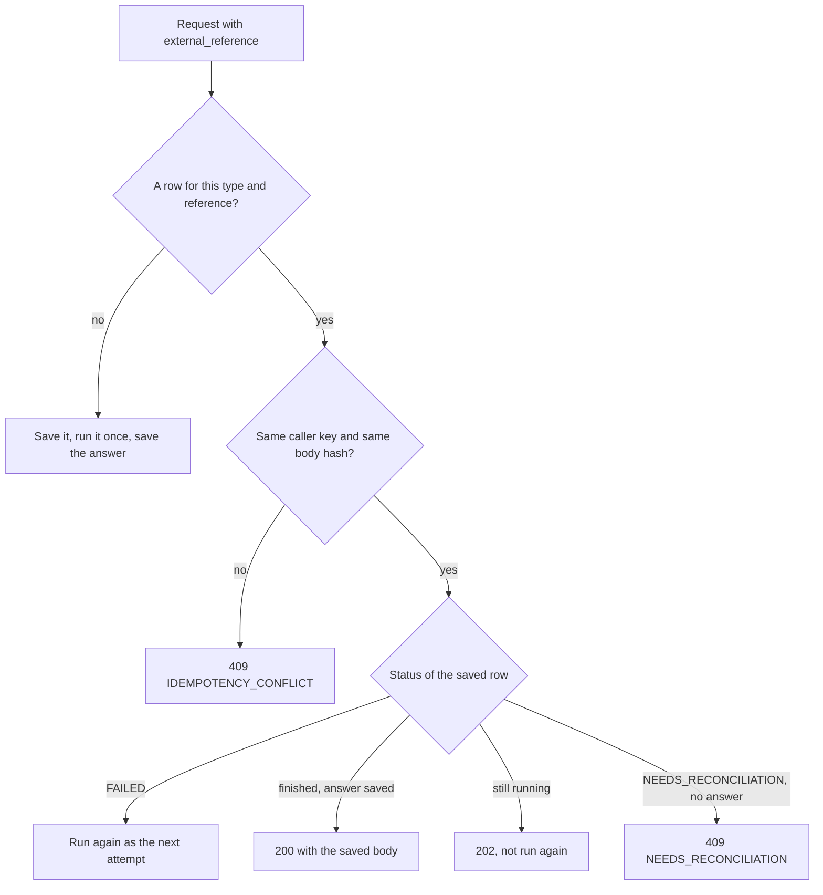

# API

Three APIs: a small Fineract plugin, the Integration Service that client systems call, and a Mock ERP behind it. The quickest way to try them is the Postman collection in [postman/](postman/), which walks every endpoint in order with a test on each answer. The specs are generated from the code and import into Postman too.

| API | Local address | Spec |
|---|---|---|
| Fineract plugin | http://localhost:8080 | `/fineract-provider/glsync.json`, copy in `docs/openapi/fineract-erp-integration.yaml` |
| Integration Service | http://localhost:8091 | `/openapi/openapi.json`, Swagger at `/openapi/swagger`, copy in `docs/openapi/integration-service.yaml` |
| Mock ERP | http://localhost:8090 | same two paths, copy in `docs/openapi/mock-erp.yaml` |

## Rules that apply everywhere

- **Auth.** `X-API-Key` on every `/api` and `/admin` call, or `401`. The Integration Service key is the part after the colon in `PARTNER_API_KEYS` (`demo-partner:change-me-partner-key`); the ERP key is `ERP_API_KEY`. The plugin uses Fineract's Basic auth and `Fineract-Platform-TenantId: default`.
- **Tracing.** Send `X-Correlation-ID` or I make one. It comes back on every response and tags every log line.
- **Dates and money.** `YYYY-MM-DD`, Kigali time. Whole Rwandan francs as integers; `1000.5` gets `422`.
- **Your ids, not Fineract's.** `client_uid` (`SME-000001`), `loan_reference` (`LN-2026-000001`, which I issue) and your own `external_reference`. Fineract's numbers never appear.

## Errors

One shape for every failure, in both Python services:

```json
{ "error": { "code": "IDEMPOTENCY_CONFLICT", "message": "external_reference DEMO-CLI-0001 was already used with different data.",
             "correlation_id": "c-3f9a...", "details": {} } }
```

| HTTP | Code | When |
|---|---|---|
| 401 | `UNAUTHENTICATED` | Missing or wrong key |
| 404 | `NOT_FOUND`, `CLIENT_NOT_FOUND`, `LOAN_NOT_FOUND` | Unknown path, reference, client or loan |
| 422 | `VALIDATION_ERROR` | Bad input, a rule from a Fineract template, or a Fineract refusal; every problem listed in `details.problems` |
| 409 | `IDEMPOTENCY_CONFLICT` | Same reference with different data, or under another caller's key |
| 409 | `CLIENT_UID_TAKEN`, `LOAN_ALREADY_APPROVED`, `LOAN_ALREADY_DISBURSED` | Another reference already holds this client, approval or payout |
| 409 | `NEEDS_RECONCILIATION` | The request waits for a person |
| 502, 503 | `FINERACT_UNAVAILABLE` | Fineract could not be reached or refused my login; nothing was sent |
| 504 | `FINERACT_TIMEOUT` | I do not know yet what Fineract did |
| 502–504 | `ERP_UNAVAILABLE`, `ERP_TIMEOUT` | GL sync or reconciliation could not read the ERP |

## Idempotency contract

Every write carries an `external_reference` (1 to 40 of `A-Z a-z 0-9 . _ : -`). Make one per business action and resend it on every retry. I keep each request in Postgres under its type and reference with a hash of the body and your key.

| You send | You get |
|---|---|
| A new reference | Runs once: `201` for a new client or loan, `200` for approve, pay out and repay |
| Same reference, same body, still running | `202`, never run twice |
| Same reference, same body, finished | `200` with the body saved the first time |
| Same reference, different body, or another caller's key | `409 IDEMPOTENCY_CONFLICT`, nothing sent |
| Same reference after it ended `FAILED` | Runs again as the next attempt, after a lookup in Fineract |
| A new reference for a client, approval or payout another reference holds | `409 CLIENT_UID_TAKEN` / `LOAN_ALREADY_APPROVED` / `LOAN_ALREADY_DISBURSED`, nothing saved |



A payout or repayment answers `200` once Fineract is done, before its journal entry reaches the ERP. `erp_status` tracks that: `PENDING`, `SENT` or `NEEDS_RECONCILIATION`.

## When Fineract fails or gives no clear answer

Before resending any write, I look it up in Fineract by its `externalId`.

| What happened | Status | Answer | You |
|---|---|---|---|
| Not reachable, or nothing was sent | `FAILED` | `503 FINERACT_UNAVAILABLE` | Send the same request again |
| Timeout or `5xx`, and the lookup finds the transaction | done | `200` | Nothing |
| Timeout or `5xx`, and the lookup finds nothing yet | `FINERACT_PENDING` | `504 FINERACT_TIMEOUT`, then `202` on repeats | Wait; recovery settles it after about 3 minutes |
| Fineract clearly refused | `FAILED` | `409` or `422` | Fix the request |

## Fineract plugin

Only the Integration Service calls these, and they are the only way to create a GL account here. Needs the `SYNC_GLACCOUNT` permission.

| Method and path | What it does |
|---|---|
| `PUT /fineract-provider/api/v1/erp-integration/accounts/{erpReference}` | Creates the GL account for one ERP account or returns the existing one: `200 CREATED`, `200 UNCHANGED` for the same data again, `409` when the reference holds other data, the GL code is taken or the parent is missing |
| `GET …/erp-integration/accounts/{erpReference}` | Which GL account an ERP account became; `404` if not synced yet |

```json
PUT /fineract-provider/api/v1/erp-integration/accounts/GL-1200
{ "name": "Loan Receivable", "glCode": "1200", "type": 1, "usage": 1, "manualEntriesAllowed": false, "parentAccount": "GL-1000" }

200 { "erpReference": "GL-1200", "glCode": "1200", "outcome": "CREATED", "parentAccount": "GL-1000", ... }
```

## Integration Service

| Method and path | What it does |
|---|---|
| `POST /api/accounts/sync` | Copies the ERP chart into Fineract, parents first; a repeat resends only pending or failed accounts. `202` while another sync runs |
| `GET /api/accounts/sync` | The same report from my database |
| `POST /api/accounts/{erp_reference}/sync` | One account |
| `GET /api/clients/template` | The client form: fields, limits, the office a new client gets |
| `POST /api/clients` | Creates an active client with your `client_uid` as Fineract's `externalId` |
| `GET /api/clients/{client_uid}?name=` | Reads the client live from Fineract; `name_matches` checks the name you expect |
| `GET /api/loans/template?client_uid=` | The application form, with the product's range and terms from Fineract |
| `POST /api/loans` | Applies for a loan; you send only the principal, I issue the `loan_reference` |
| `GET /api/loans/{loan_reference}/template?step=` | The form for `approval`, `disbursement`, `repayment` or `payoff`, with `available` and Fineract's figures |
| `POST /api/loans/{loan_reference}/approve` | Approves the full principal from Fineract's template |
| `GET /api/loans/{loan_reference}` | Status, balances and `payoff_amount` as Fineract shows them now |
| `POST /api/loans/{loan_reference}/disburse` | Pays out the approved amount once |
| `POST /api/loans/{loan_reference}/repayments` | Records one repayment and returns Fineract's split |
| `GET /api/transactions/{external_reference}` | What happened to a reference: status, `erp_status` and the full history |
| `POST /api/reconciliation` | Compares Fineract with the ERP for a date range (up to 31 days) or up to 100 references; read-only |
| `POST /admin/recover` | Runs one recovery pass now; it also runs every 5 seconds |

Every write takes `external_reference`. Create and apply take the fields below; approve, pay out and repay take an optional date, and repay takes `amount` and an optional `payment_type` by name.

```json
POST /api/clients
{ "external_reference": "DEMO-CLI-0001", "client_uid": "SME-000001", "first_name": "Jane", "last_name": "Example" }
201 { "client_uid": "SME-000001", "name": "Jane Example", "status": "ACTIVE", "external_reference": "DEMO-CLI-0001" }

POST /api/loans
{ "external_reference": "DEMO-APP-0001", "client_uid": "SME-000001", "principal": 5000000 }
201 { "loan_reference": "LN-2026-000001", "status": "SUBMITTED_AND_PENDING_APPROVAL", "principal": 5000000, ... }

POST /api/loans/LN-2026-000001/repayments
{ "external_reference": "DEMO-RPY-0001", "amount": 500000 }
200 { "status": "ERP_PENDING", "erp_status": "PENDING", "amount": 500000, "principal_portion": 383400,
      "interest_portion": 116600, "outstanding_after": 4616600, "loan_status": "ACTIVE", ... }
```

Reconciliation gives each item one outcome: `MATCHED`, `MISSING_IN_ERP`, `MISSING_IN_FINERACT`, `AMOUNT_MISMATCH` (any difference in lines, source or date, with one reason per difference) or `IN_FLIGHT` (still in my outbox, not counted as missing). Items carry only your references and whole francs.

```json
POST /api/reconciliation
{ "references": ["DEMO-DSB-0001", "DEMO-RPY-0002"] }
200 { "summary": { "MATCHED": 1, "AMOUNT_MISMATCH": 1, "MISSING_IN_ERP": 0, "MISSING_IN_FINERACT": 0, "IN_FLIGHT": 0, "total": 2 },
      "items": [ { "key": "RPY:DEMO-RPY-0002", "outcome": "AMOUNT_MISMATCH",
                   "reasons": [ "account 1200 credit: ERP 50000, from Fineract 44470", "account 4100 credit: ERP 0, from Fineract 5530" ], ... },
                 { "key": "DSB:DEMO-DSB-0001", "outcome": "MATCHED", ... } ], ... }
```

## Mock ERP

The ERP owns the chart of accounts and the journal. Same auth and error shape, lower-case codes (`unauthorized`, `not_found`, `reference_conflict`, `invalid_request`, `entry_not_balanced`, `unknown_account`, `header_account`).

| Method and path | What it does |
|---|---|
| `POST /api/accounts`, `GET /api/accounts` | Adds an account (`code`, `external_reference`, `name`, `type`, `usage`, `parent_code`), lists the chart |
| `GET /api/accounts/{code}/balance` | Debit and credit totals and the balance on the account's normal side |
| `POST /api/journal-entries` | Saves a balanced entry: `external_reference`, `entry_date`, `source`, 2 to 50 `lines` on DETAIL accounts |
| `GET /api/journal-entries/{external_reference}`, `GET /api/journal-entries?from&to&reference&source&q` | One entry, or a search |
| `GET` / `PUT` / `DELETE /admin/faults` | The fault switch: `mode` is `down`, `timeout`, `timeout_after_write` or `rate_limited`, with `delay_seconds` and `remaining` |

Repeats are idempotent by `external_reference`: a new one gets `201 CREATED`, the same data again `200 ALREADY_EXISTS`, different data `409 reference_conflict`, and an entry that does not balance `422` even if the reference is known.

```json
POST /api/journal-entries
{ "external_reference": "RPY:DEMO-RPY-0001", "entry_date": "2026-10-13", "source": "REPAYMENT",
  "lines": [ { "account_code": "1100", "debit": 500000 }, { "account_code": "1200", "credit": 383400 }, { "account_code": "4100", "credit": 116600 } ] }
201 { "erp_transaction_id": "3476f214-...", "total": 500000, "status": "CREATED", ... }
```
