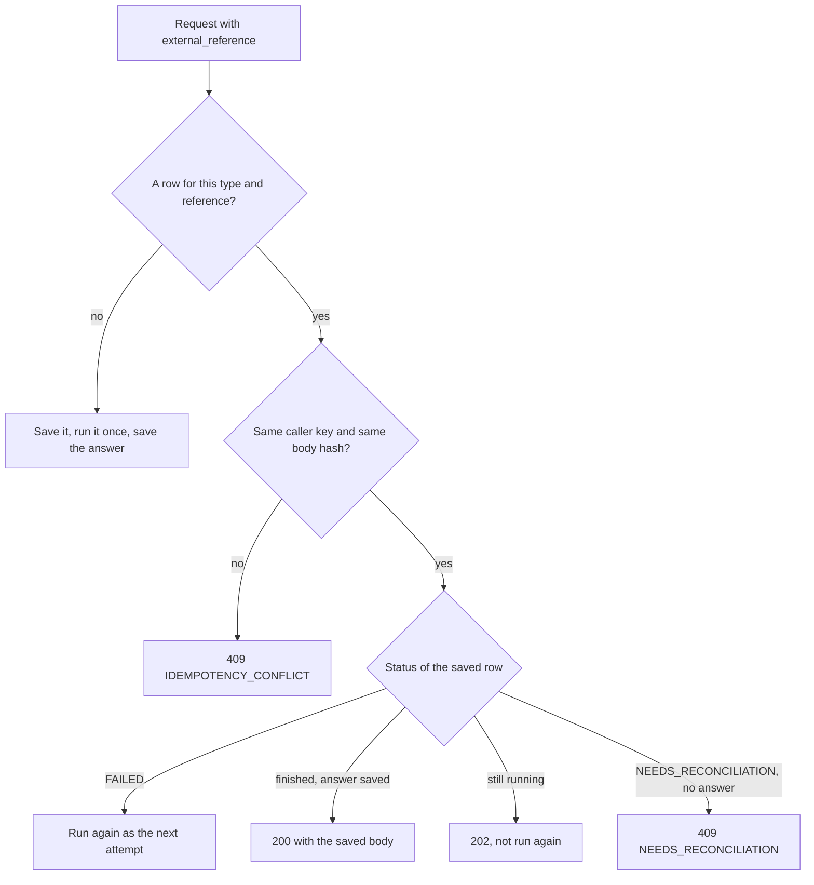

# API

I built three APIs: a small Fineract plugin, the Integration Service the client system calls, and a Mock ERP behind it. Shared rules come first, then every endpoint with its smallest request and answer. In the examples `...` marks fields I cut, and all data is made up.

| API | On the local stack | Spec served at | Copy in the repo |
|---|---|---|---|
| Fineract plugin (ERP integration) | http://localhost:8080 | `/fineract-provider/glsync.json` | `docs/openapi/fineract-erp-integration.yaml` |
| Integration Service | http://localhost:8091 | `/openapi/openapi.json`, Swagger UI at `/openapi/swagger` | `docs/openapi/integration-service.yaml` |
| Mock ERP | http://localhost:8090 | the same two paths | `docs/openapi/mock-erp.yaml` |

The specs are generated from the code, and all three import straight into Postman. To make the calls rather than read them, import [postman/collection.json](postman/collection.json) with its environment file: it walks through every endpoint below in order, with a test on each answer. ARCHITECTURE.md, DECISIONS.md and SIMULATIONS.md cover the design, the reasons and the scenarios.

## General rules

- **Auth.** The Integration Service and the Mock ERP need `X-API-Key` on every `/api` and `/admin` call, or answer `401`; `/health` and `/openapi` are open. Integration Service keys live in `PARTNER_API_KEYS` as `name:key`; locally that is `demo-partner:change-me-partner-key`, so you send `change-me-partner-key`. The plugin takes Fineract's Basic auth and `Fineract-Platform-TenantId: default`.
- **Tracing.** Send `X-Correlation-ID`, or I make one (`c-` plus hex). It comes back on every response and tags every log line; idempotency ignores it.
- **Dates and money.** Dates are `YYYY-MM-DD`, and "today" is Kigali time. Money is whole Rwandan francs as JSON integers, so `1000.5` or `"1000"` gets `422`.
- **Your ids, not Fineract's.** You use `client_uid` (`SME-000001`), `loan_reference` (`LN-2026-000001`, which I issue) and your own `external_reference`. Fineract's numeric ids never show up.

## Errors

Both Python services answer every failure in one shape:

```json
{ "error": { "code": "IDEMPOTENCY_CONFLICT",
             "message": "external_reference DEMO-CLI-0001 was already used with different data.",
             "correlation_id": "c-3f9a...", "details": {} } }
```

Branch on `code`; `message` is for people. A `422 VALIDATION_ERROR` lists every problem in `details.problems` as `{"field", "problem"}`. The plugin keeps Fineract's error shape, with the code in `userMessageGlobalisationCode`.

| HTTP | Code | When |
|---|---|---|
| 401 | `UNAUTHENTICATED` | Missing or wrong `X-API-Key` |
| 404 | `NOT_FOUND` | Unknown path, unknown reference in `GET /api/transactions`, or an account the ERP does not have (GL sync) |
| 404 | `CLIENT_NOT_FOUND`, `LOAN_NOT_FOUND` | No such client or loan |
| 422 | `VALIDATION_ERROR` | A body, path or query that does not fit; a rule from a Fineract template (principal range, payment type, dates); a repayment on a loan that is not `ACTIVE` (`details.loan_status`); a Fineract refusal I have no mapping for (`details.fineract_codes`) |
| 409 | `IDEMPOTENCY_CONFLICT` | Same reference with different data or under another caller's key, or Fineract already holds another transaction under it |
| 409 | `CLIENT_UID_TAKEN`, `LOAN_ALREADY_APPROVED`, `LOAN_ALREADY_DISBURSED` | Another reference already holds this client, approval or payout (`details.holder_status`) |
| 409 | `NEEDS_RECONCILIATION` | The request waits for a person and will not run again by itself |
| - | `GL_CODE_TAKEN` | GL sync only. Not an HTTP error: it opens an account's `last_error` when its GL code belongs to another account in Fineract |
| 502, 503 | `FINERACT_UNAVAILABLE` | See the Fineract table below |
| 504 | `FINERACT_TIMEOUT` | I do not know yet what Fineract did |
| 502, 503, 504 | `ERP_UNAVAILABLE`, `ERP_TIMEOUT` | GL sync and reconciliation: the ERP could not be read |
| 500 | `INTERNAL_ERROR` | A bug on my side. The full error is in the log under the same correlation id. |

## Idempotency contract

Every write carries an `external_reference`: 1 to 40 letters, digits, `.`, `_`, `:` or `-`. Make one per business action and resend it on every retry. I store each request in Postgres under its type and reference (`DSB:DEMO-DSB-0001`) with a hash of the body and of your API key.

| You send | You get |
|---|---|
| A new reference | It runs once. `201` for a new client or loan application, `200` for approve, disburse and repay. |
| Same reference, same body, still running | `202` with the current status. It is never run twice. |
| Same reference, same body, finished | `200` with the exact body saved the first time, even when that first answer was `201`. |
| Same reference, different body | `409 IDEMPOTENCY_CONFLICT`. Nothing is sent. |
| Same reference under another caller's key | `409 IDEMPOTENCY_CONFLICT`. You never see another caller's answer. |
| Same reference after it ended `FAILED` | It runs again under the same reference with the next attempt number. Fineract is asked first whether the earlier attempt landed late. |
| Same reference while it waits for a manual check (`NEEDS_RECONCILIATION` with no saved answer) | `409 NEEDS_RECONCILIATION` with `details.status` and `details.type`. It will not run again by itself. |
| A new reference for a client, approval or payout that another reference already holds | `409 CLIENT_UID_TAKEN`, `LOAN_ALREADY_APPROVED` or `LOAN_ALREADY_DISBURSED` with `details.holder_status`, even while the first still runs. The new reference is not saved, so you can reuse it if the first ends `FAILED`. |



"Finished" means Fineract is done. A disbursement or repayment answers `200` before its journal entry reaches the ERP, and `erp_status` tracks it: `PENDING` (in my outbox), `SENT`, or `NEEDS_RECONCILIATION` (refused, failed 8 times, or not buildable without guessing). The saved body never changes; `GET /api/transactions/{external_reference}` has the live status.

## When Fineract fails or gives no clear answer

Before resending any write, I look it up in Fineract by its `externalId`. Here is what you see:

| What happened | Status | Answer | What you do |
|---|---|---|---|
| Fineract could not be reached, or it reported a concurrency `409` and a lookup finds nothing. Nothing was written. | `FAILED` | `503 FINERACT_UNAVAILABLE` | Send the same request again |
| Another write to the same loan held its lock for 30 seconds. Nothing was sent. | `FAILED` | `503 FINERACT_UNAVAILABLE` | Send the same request again |
| A template I need before the write could not be read. Nothing was sent. | `FAILED` | `503 FINERACT_UNAVAILABLE` for disburse and repay; `503`, `504` or `502` for an application or approval, by how the read failed | Send the same request again |
| Timeout, `5xx` or `425`, and the lookup right after finds the transaction | done | `200` as normal | Nothing |
| Timeout, `5xx` or `425`, and the lookup finds nothing yet or fails | `FINERACT_PENDING` | `504 FINERACT_TIMEOUT` | Wait. A repeat gets `202`. Recovery looks again after about 3 minutes and finishes it, or marks it `FAILED` when Fineract has no record of it. |
| Fineract said yes, but I could not read the transaction back yet | `FINERACT_PENDING` | `202` | Wait. The next recovery pass finishes it. |
| Fineract clearly refused (a `4xx`) | `FAILED` | `409` or `422` in my words | Fix the request |
| Fineract refused my own login or permissions | `FAILED` | `502 FINERACT_UNAVAILABLE` | Nothing. That one is on me. |

Fineract's error text never passes through, because it can hold internal ids. The ERP never fails a disbursement or repayment; that part runs later from the outbox.

## Fineract plugin

Only the Integration Service calls these two endpoints, and they are the only way to create a GL account here. One prefix lets a gateway allow them by path (DECISIONS.md).

### `PUT /fineract-provider/api/v1/erp-integration/accounts/{erpReference}`

Creates the GL account for one ERP account, or returns the existing one; parents go first. Needs `SYNC_GLACCOUNT`.

| Field | Rule |
|---|---|
| `name` | Required, 1 to 200 characters |
| `glCode` | Required, 1 to 45 characters, unique across GL accounts |
| `type` | Required: `1` ASSET, `2` LIABILITY, `3` EQUITY, `4` INCOME, `5` EXPENSE |
| `usage` | Required: `1` DETAIL (transactions post to it), `2` HEADER (groups accounts) |
| `manualEntriesAllowed` | Required, `true` or `false` |
| `description`, `tagId` | Optional |
| `parentAccount` | Optional. The parent's ERP reference. It must already be synced, be a HEADER and have the same type. Fineract's `parentId` is refused. |

```json
PUT /fineract-provider/api/v1/erp-integration/accounts/GL-1200
{ "name": "Loan Receivable", "glCode": "1200", "type": 1, "usage": 1,
  "manualEntriesAllowed": false, "parentAccount": "GL-1000" }

200 { "erpReference": "GL-1200", "glAccountId": 7, "glCode": "1200",
      "outcome": "CREATED", "parentAccount": "GL-1000" }
```

| Then | Answer |
|---|---|
| Same reference, same data | `200` with `"outcome": "UNCHANGED"`, nothing written. Key order, spaces and null fields do not count. |
| Same reference, different data | `409 error.msg.glaccount.sync.payload.conflict` |
| New reference, GL code already used | `409 error.msg.glaccount.sync.code.conflict` |
| Parent not synced, not a HEADER, or of another type | `409 error.msg.glaccount.sync.parent.not.synced`, `...parent.not.header` or `...parent.type.mismatch` |
| A bad or unknown field, or `type: 6` | `400`, naming the field |
| No `SYNC_GLACCOUNT` | `403` |
| The same `Idempotency-Key` again | The first answer again, with the header `x-served-from-cache: true`. `425` while the first call is still running. |

### `GET /fineract-provider/api/v1/erp-integration/accounts/{erpReference}`

Shows which GL account an ERP account became; after a timeout, check before resending. Needs `READ_GLACCOUNT`; `404 error.msg.erpaccount.not.found` means not synced yet.

```json
200 { "erpReference": "GL-1200", "glAccountId": 7, "glCode": "1200", "name": "Loan Receivable",
      "type": "ASSET", "usage": "DETAIL", "parentAccount": "GL-1000", "hierarchy": ".3.",
      "syncedAt": "2026-10-12T14:36:58Z" }
```

## Integration Service

### GL sync

These copy the ERP chart into Fineract through the plugin, with one `Idempotency-Key` per account (`GLS:<reference>:<attempt>:<hash>`). They take no body; in production they belong on an operator route.

#### `POST /api/accounts/sync`

Syncs the whole chart, parents first, and reports every account. A repeat resends only pending and failed accounts.

```json
200 { "accounts": [
        { "erp_reference": "GL-1000", "code": "1000", "name": "Assets", "status": "SYNCED", "attempts": 1, "last_error": null },
        { "erp_reference": "GL-1200", "code": "1200", "name": "Loan Receivable", "status": "SYNCED", "attempts": 1, "last_error": null },
        ... ],
      "counts": { "SYNCED": 13, "SYNC_PENDING": 0, "FAILED": 0 },
      "writes": 13, "in_progress": false }
```

`SYNC_PENDING` means Fineract was unreachable or unclear; `FAILED` means it refused, with the reason in `last_error`. While another sync runs you get `202` with `"in_progress": true`. Fineract trouble shows per account; ERP trouble fails the call (`502`, `503` or `504`).

#### `GET /api/accounts/sync`

The same report from my database, with `writes` at `0`.

#### `POST /api/accounts/{erp_reference}/sync`

One account, same rules: `200 {"account": {...}, "in_progress": false}`, `404 NOT_FOUND` if the ERP lacks it, or `202` with its current state (or `null`) during another sync.

### Clients

#### `POST /api/clients`

Creates an active client in Fineract's `Kigali Main Office`, with your `client_uid` as its `externalId`.

| Field | Rule |
|---|---|
| `external_reference` | Required |
| `client_uid` | Required. 2 to 10 capital letters, a dash and 6 digits, like `SME-000001`. Unique here and in Fineract (`409 CLIENT_UID_TAKEN`). |
| `first_name`, `last_name` | Required. 1 to 50 letters each, joined by single spaces, `'`, `.` or `-`. |

```json
POST /api/clients
{ "external_reference": "DEMO-CLI-0001", "client_uid": "SME-000001",
  "first_name": "Jane", "last_name": "Example" }

201 { "client_uid": "SME-000001", "name": "Jane Example", "status": "ACTIVE",
      "external_reference": "DEMO-CLI-0001" }
```

#### `GET /api/clients/{client_uid}`

Reads the client live from Fineract. `?name=` checks the name you expect, ignoring case and spacing.

```json
GET /api/clients/SME-000001?name=jane example
200 { "client_uid": "SME-000001", "name": "Jane Example", "active": true, "status": "ACTIVE",
      "matches_our_record": true, "name_matches": true }
```

`matches_our_record` means I created it, the names agree and it is active. `name_matches` is `null` without `?name=`.

### Loans

#### The forms: what to send at each step

Three reads show what a write will accept, straight from the Fineract templates the write itself uses. Each lists `fields` with type, limits, default and `options` (names, never Fineract ids). Leave out `read_only` fields.

- `GET /api/clients/template`: client fields, plus the `office` and `activation_date` a new client gets.
- `GET /api/loans/template`: application fields and the product's terms. An optional `?client_uid=` must be a client I created.
- `GET /api/loans/{loan_reference}/template?step=`: `approval`, `disbursement`, `repayment` or `payoff` for one loan, with `available`, a `message` saying why not, and Fineract's figures in `values`.

```json
GET /api/loans/LN-2026-000001/template?step=payoff
200 { "form": "payoff", "loan_reference": "LN-2026-000001", "loan_status": "ACTIVE",
      "available": true, "message": null,
      "submit_to": "POST /api/loans/LN-2026-000001/repayments",
      "values": { "payoff_amount": 2000321, "payoff_date": "2026-10-13",
                  "principal_portion": 1846640, "interest_portion": 153681, ... },
      "fields": [ { "name": "amount", "required": true, "default": 2000321, "minimum": 1, ... },
                  { "name": "payment_type", "options": [ { "value": "Money Transfer", "label": "Money Transfer" } ], ... },
                  ... ] }
```

Paying exactly `payoff_amount` closes the loan.

#### `POST /api/loans`

Applies for a loan on the SME Asset Finance product; you pick only the principal. I issue the `loan_reference`, which becomes the loan's `externalId`.

| Field | Rule |
|---|---|
| `external_reference` | Required |
| `client_uid` | Required. A client created through `POST /api/clients`, else `404 CLIENT_NOT_FOUND`. |
| `principal` | Required. Whole RWF inside the product's range (100,000 to 50,000,000 today), else `422`. |
| `expected_disbursement_date` | Optional, today or later. Default today. |

```json
POST /api/loans
{ "external_reference": "DEMO-APP-0001", "client_uid": "SME-000001", "principal": 5000000 }

201 { "loan_reference": "LN-2026-000001", "client_uid": "SME-000001", "principal": 5000000,
      "status": "SUBMITTED_AND_PENDING_APPROVAL", "expected_disbursement_date": "2026-10-13",
      "external_reference": "DEMO-APP-0001" }
```

#### `POST /api/loans/{loan_reference}/approve`

Approves the full applied principal from Fineract's approval template, so you send no amount. `approved_on` is optional: default today, not in the future, not after the expected disbursement date.

```json
POST /api/loans/LN-2026-000001/approve
{ "external_reference": "DEMO-APR-0001" }

200 { "loan_reference": "LN-2026-000001", "client_uid": "SME-000001", "status": "APPROVED",
      "approved_on": "2026-10-13", "approved_principal": 5000000, "external_reference": "DEMO-APR-0001" }
```

#### `GET /api/loans/{loan_reference}`

The loan as Fineract shows it now. `balances` is `null` until payout, and `payoff_amount` is set only while the loan is active.

```json
200 { "loan_reference": "LN-2026-000001", "client_uid": "SME-000001",
      "status": { "code": "ACTIVE", "value": "Active" }, "closed_obligations_met": false, "overpaid": false,
      "currency": "RWF", "principal": 5000000, "approved_principal": 5000000,
      "submitted_on": "2026-10-13", "approved_on": "2026-10-13", "disbursed_on": "2026-10-13",
      "closed_on": null, "expected_maturity_on": "2027-10-13", ...,
      "balances": { "principal_outstanding": 5000000, "interest_outstanding": 500805,
                    "total_outstanding": 5500805, "total_overdue": 0, ... },
      "payoff_amount": 5500805 }
```

#### `POST /api/loans/{loan_reference}/disburse`

Pays out the approved amount once, under the Fineract `externalId` `DSB:<external_reference>`. `transaction_date` is optional: default today, not in the future; paying out early is fine.

```json
POST /api/loans/LN-2026-000001/disburse
{ "external_reference": "DEMO-DSB-0001" }

200 { "loan_reference": "LN-2026-000001", "client_uid": "SME-000001", "external_reference": "DEMO-DSB-0001",
      "type": "DISBURSEMENT", "status": "ERP_PENDING", "erp_status": "PENDING",
      "amount": 5000000, "transaction_date": "2026-10-13", "loan_status": "ACTIVE" }
```

An unapproved loan gets `422`; one already paid out, even straight in Fineract, gets `409 LOAN_ALREADY_DISBURSED`.

#### `POST /api/loans/{loan_reference}/repayments`

Records one repayment and shows Fineract's own split.

| Field | Rule |
|---|---|
| `external_reference` | Required. One per real repayment. |
| `amount` | Required. Whole RWF above 0. |
| `transaction_date` | Optional. Default today, not in the future. |
| `payment_type` | Optional. A payment type from the repayment form, by name in any case, like `Money Transfer`. Fineract's own system types and unknown names get `422`. |

```json
POST /api/loans/LN-2026-000001/repayments
{ "external_reference": "DEMO-RPY-0001", "amount": 500000 }

200 { "loan_reference": "LN-2026-000001", "client_uid": "SME-000001", "external_reference": "DEMO-RPY-0001",
      "type": "REPAYMENT", "status": "ERP_PENDING", "erp_status": "PENDING",
      "amount": 500000, "transaction_date": "2026-10-13", "loan_status": "ACTIVE",
      "principal_portion": 383400, "interest_portion": 116600, "fees_portion": 0,
      "penalties_portion": 0, "overpayment_portion": 0, "outstanding_after": 4616600 }
```

Only an `ACTIVE` loan takes repayments, since Fineract would book money on a closed loan as pure overpayment. Extra money on an active loan lands in `overpayment_portion` and makes it `OVERPAID`.

### Transactions

#### `GET /api/transactions/{external_reference}`

Answers "what happened to X?" from my database: every request under that reference, with its history and live `erp_status`. Other callers get `404`.

```json
200 { "external_reference": "DEMO-DSB-0001",
      "operations": [ {
        "type": "DISBURSEMENT", "op_key": "DSB:DEMO-DSB-0001", "status": "COMPLETED", "erp_status": "SENT",
        "client_uid": "SME-000001", "loan_reference": "LN-2026-000001", "attempts": 1, "last_error": null,
        "created_at": "2026-10-13T10:22:09.732Z", "updated_at": "2026-10-13T10:22:12.103Z",
        "history": [
          { "from": null, "to": "RECEIVED", "at": "...", "detail": "request saved" },
          { "from": "RECEIVED", "to": "FINERACT_PENDING", "at": "...", "detail": "saved and claimed" },
          { "from": "FINERACT_PENDING", "to": "FINERACT_DONE", "at": "...", "detail": "Fineract said yes" },
          { "from": "FINERACT_DONE", "to": "ERP_PENDING", "at": "...", "detail": "journal entry waiting for the ERP" },
          { "from": "ERP_PENDING", "to": "COMPLETED", "at": "...", "detail": "the ERP saved the journal entry" } ] } ] }
```

A failed ERP send shows as an `ERP_PENDING` to `ERP_PENDING` line with the reason.

### Reconciliation

#### `POST /api/reconciliation`

Compares Fineract's loan transactions with the ERP's journal and lists the differences. It writes and keeps nothing. Send a date range or references, not both.

| Field | Rule |
|---|---|
| `from`, `to` | Dates, both needed, `to` included, at most 31 days. The date is the transaction date on both sides. |
| `references` | 1 to 100 values. An op key (`DSB:DEMO-DSB-0001`), a client system reference (`DEMO-DSB-0001`, which selects both `DSB:` and `RPY:`) or a foreign Fineract `externalId`. Each also selects its `:REV` reversal. |

Each `DISBURSEMENT` and `REPAYMENT` of a loan I know is matched to the ERP entry whose `external_reference` equals its `externalId`:

| `outcome` | Meaning |
|---|---|
| `MATCHED` | Both sides exist, and the ERP lines equal the lines my mapping builds from Fineract's own split, with the same source and date |
| `MISSING_IN_ERP` | In Fineract, not in the ERP, and not waiting in my outbox |
| `MISSING_IN_FINERACT` | In the ERP, but no loan I know has a transaction with that `externalId` |
| `AMOUNT_MISMATCH` | Both exist but differ: an account, a side, an amount, the source or the date. One line per difference in `reasons`. |
| `IN_FLIGHT` | Not in the ERP yet, but my outbox still has to send it. Not counted as missing. |

```json
POST /api/reconciliation
{ "references": ["RPY:DEMO-RPY-0002", "DEMO-DSB-0001"] }

200 { "scope": { "from": null, "to": null, "references": ["RPY:DEMO-RPY-0002", "DEMO-DSB-0001"] },
      "generated_at": "2026-10-14T09:00:00Z", "compared_types": ["DISBURSEMENT", "REPAYMENT"],
      "summary": { "MATCHED": 1, "MISSING_IN_ERP": 0, "MISSING_IN_FINERACT": 0, "AMOUNT_MISMATCH": 1, "IN_FLIGHT": 0, "total": 2 },
      "not_compared": { "fineract_types": { "ACCRUAL": 4 }, "erp_entries": 0 },
      "warnings": [],
      "items": [
        { "key": "RPY:DEMO-RPY-0002", "outcome": "AMOUNT_MISMATCH", "type": "REPAYMENT", "loan_reference": "LN-2026-000001",
          "fineract": { "type": "REPAYMENT", "transaction_date": "2026-10-14", "amount": 50000,
                        "principal_portion": 44470, "interest_portion": 5530, "reversed": false, ... },
          "erp": { "entry_date": "2026-10-14", "source": "REPAYMENT", "reverses": null, "total": 50000,
                   "lines": [ { "account_code": "1100", "debit": 50000, "credit": 0 },
                              { "account_code": "1200", "debit": 0, "credit": 50000 } ] },
          "expected_lines": [ { "account_code": "1100", "debit": 50000, "credit": 0 },
                              { "account_code": "1200", "debit": 0, "credit": 44470 },
                              { "account_code": "4100", "debit": 0, "credit": 5530 } ],
          "ours": { "status": "NEEDS_RECONCILIATION", "erp_status": "NEEDS_RECONCILIATION" },
          "reasons": [ "account 1200 credit: ERP 50000, from Fineract 44470",
                       "account 4100 credit: ERP 0, from Fineract 5530" ] },
        { "key": "DSB:DEMO-DSB-0001", "outcome": "MATCHED", "reasons": [], ... } ] }
```

`not_compared` counts what was skipped, such as accruals. A bad scope gets `422`, as does a day with 1000 or more ERP entries. If either side cannot be read you get `502`, `503` or `504` and no report, because half the data would show false gaps.

### Admin

#### `POST /admin/recover`

Runs one recovery pass now; it also runs every 5 seconds. It settles requests stuck in `FINERACT_PENDING`, then sends due outbox rows to the ERP. It takes the usual API key for now; production would give it an operator key.

```json
200 { "operations": { "checked": 1, "completed": 1, "failed": 0, "needs_reconciliation": 0,
                      "still_unknown": 0, "skipped_busy": 0, "finished_meanwhile": 0 },
      "outbox": { "claimed": 1, "sent": 1, "retried": 0, "rate_limited": 0, "needs_reconciliation": 0, "stale": 0 } }
```

## Mock ERP

The ERP owns the chart of accounts and the journal, and only the Integration Service calls it. Auth (key in `ERP_API_KEY`), tracing and money follow the shared rules. References are 1 to 64 letters, digits, `.`, `_`, `:` or `-`, starting with a letter or digit. Repeats work alike for accounts and journal entries, ignoring line and key order:

| You send | You get |
|---|---|
| A new reference | `201` with `"status": "CREATED"` |
| Same reference, same data | `200` with the stored record and `"status": "ALREADY_EXISTS"` |
| Same reference, different data | `409 reference_conflict`, nothing saved |
| A body that breaks a rule | `422`, even when the reference is already stored (rules run first) |

Errors use the same `{"error": {...}}` shape, with lower-case codes:

| HTTP | Code | When |
|---|---|---|
| 401 | `unauthorized` | Missing or wrong key |
| 404 | `not_found` | Unknown account code or journal reference |
| 409 | `reference_conflict` | The reference is stored with different data |
| 409 | `code_taken` | A new account uses a code another reference already has |
| 422 | `invalid_request` | The body or query does not fit (`details.problems`), or `reverses` names no stored entry. Also the code for a `405`. |
| 422 | `entry_not_balanced`, `unknown_account`, `header_account`, `parent_invalid` | Debits differ from credits; a line names an unknown account; a line posts to a HEADER; the parent is missing, not a HEADER or of another type (a DETAIL account needs one) |
| 429, 503, 504 | `rate_limited`, `erp_unavailable`, `timeout` | The fault switch, below. `429` carries `Retry-After`. |

### Accounts

#### `POST /api/accounts`

Adds an account. The chart starts with four HEADERs (`1000` Assets, `2000` Liabilities, `4000` Income, `5000` Expenses) and nine DETAIL accounts, each referenced `GL-<code>`.

| Field | Rule |
|---|---|
| `code` | 4 to 10 digits |
| `external_reference`, `name` | Required. `name` is 1 to 200 characters. |
| `type` | `ASSET`, `LIABILITY`, `EQUITY`, `INCOME` or `EXPENSE` |
| `usage` | `HEADER` or `DETAIL` |
| `parent_code` | A HEADER of the same type. Required for a DETAIL account. |
| `currency` | Only `RWF` |

```json
POST /api/accounts
{ "code": "1400", "external_reference": "GL-1400", "name": "Mobile Money",
  "type": "ASSET", "usage": "DETAIL", "parent_code": "1000" }

201 { "code": "1400", "external_reference": "GL-1400", "name": "Mobile Money", "type": "ASSET",
      "usage": "DETAIL", "parent_code": "1000", "currency": "RWF",
      "created_at": "2026-10-13T10:02:56Z", "status": "CREATED" }
```

#### `GET /api/accounts`

Lists accounts as `{"items": [...]}`, each HEADER followed by its children. Filter with `?usage=HEADER` or `?usage=DETAIL`.

#### `GET /api/accounts/{code}/balance`

Totals and balance, rolled up for a HEADER. ASSET and EXPENSE balances are debit minus credit; the rest the other way round.

```json
200 { "code": "1000", "name": "Assets", "type": "ASSET", "usage": "HEADER",
      "debit_total": 5500000, "credit_total": 5383400, "balance": 116600, "normal_side": "DEBIT" }
```

### Journal entries

#### `POST /api/journal-entries`

Saves a balanced entry.

| Field | Rule |
|---|---|
| `external_reference`, `entry_date` | Required |
| `source` | Required: `DISBURSEMENT`, `REPAYMENT`, `REVERSAL` or `MANUAL` |
| `description` | Optional, up to 500 characters |
| `reverses` | Required for a `REVERSAL`, refused otherwise |
| `lines` | 2 to 50, each with an `account_code` on a DETAIL account and exactly one of `debit` or `credit` above zero |

```json
POST /api/journal-entries
{ "external_reference": "RPY:DEMO-RPY-0001", "entry_date": "2026-10-13", "source": "REPAYMENT",
  "description": "Repayment LN-2026-000001",
  "lines": [ { "account_code": "1100", "debit": 500000 },
             { "account_code": "1200", "credit": 383400 },
             { "account_code": "4100", "credit": 116600 } ] }

201 { "erp_transaction_id": "3476f214-afac-4e31-907a-e519cfe567a8",
      "external_reference": "RPY:DEMO-RPY-0001", "entry_date": "2026-10-13", "source": "REPAYMENT",
      "description": "Repayment LN-2026-000001", "reverses": null, "total": 500000,
      "lines": [ { "account_code": "1100", "account_name": "Bank", "debit": 500000, "credit": 0 },
                 { "account_code": "1200", "account_name": "Loan Receivable", "debit": 0, "credit": 383400 },
                 { "account_code": "4100", "account_name": "Interest Income", "debit": 0, "credit": 116600 } ],
      "created_at": "2026-10-13T10:02:56Z", "correlation_id": "c-3f9a...", "status": "CREATED" }
```

`total` is the sum of the debits, and `correlation_id` comes from the first save.

#### `GET /api/journal-entries/{external_reference}`

One entry, without `status`.

#### `GET /api/journal-entries`

Searches newest first, as `{"items": [...]}`. Optional filters, all combined: `from` and `to` on `entry_date`, `reference` (exact, repeatable up to 1000), `source`, `q` (text in reference or description) and `limit` (1 to 1000, default 500).

### The fault switch

`/admin/faults` makes the ERP fail on purpose, so I can watch the Integration Service cope. `GET` shows the setting, `PUT` replaces it and `DELETE` clears it; each returns the current setting.

| Field | Rule |
|---|---|
| `mode` | Required: `down` (503), `timeout` (waits, then 504, nothing saved), `timeout_after_write` (saves, then waits) or `rate_limited` (429) |
| `path_prefix` | Which paths fail. Must start with `/api`. Default `/api`. |
| `delay_seconds` | How long the timeout modes wait, 1 to 120. Default `ERP_TIMEOUT_DELAY` from `.env`. |
| `remaining` | How many calls fail before the fault turns itself off. Leave it out to fail until `DELETE`. |
| `retry_after` | The `Retry-After` seconds for `rate_limited`. Default 5. |

```json
PUT /admin/faults
{ "mode": "timeout_after_write", "delay_seconds": 2, "remaining": 1 }

200 { "mode": "timeout_after_write", "path_prefix": "/api", "delay_seconds": 2,
      "remaining": 1, "retry_after": 5, "active": true }
```

The key is checked first, so a keyless `401` does not use up a fault. `/health`, `/admin`, `/ui` and `/openapi` never fail. ARCHITECTURE.md explains each mode.
