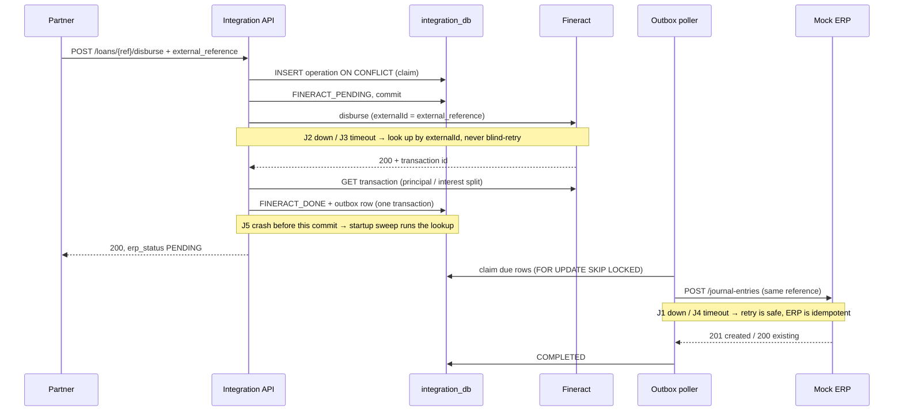
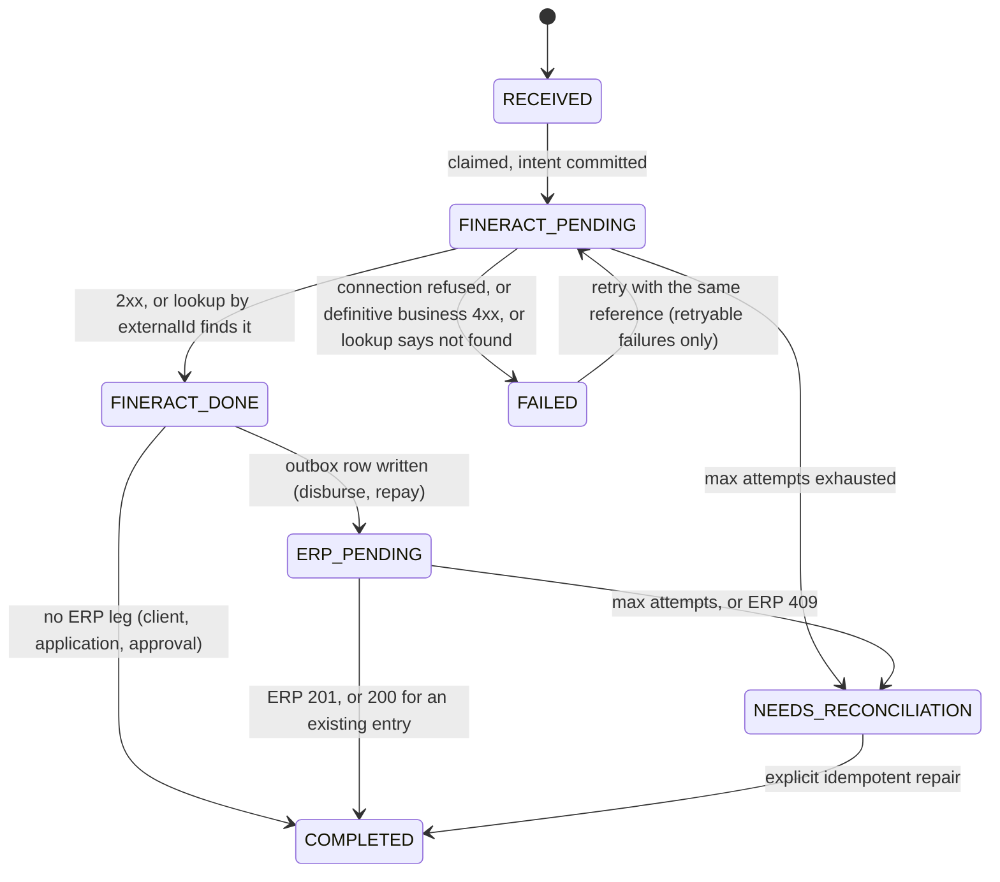

# Architecture

> **Status:** design. Sections describe the intended system; each will be checked against the running code and evidence before submission.

## Components

| Component | Language | Role |
|---|---|---|
| **Customised Fineract** | Java 21 / Spring Boot (Fineract 1.15.0) | System of record for clients, loans, disbursements, repayments, balances. Our GL sync module enforces ERP-reference idempotency inside Fineract. |
| **Integration Service** | Python (FastAPI) | The only partner-facing API. Owns business identifiers, idempotency, the operation state machine, the ERP outbox, recovery and reconciliation. |
| **Mock ERP** | Python (FastAPI) | Accounting master: chart of accounts and balanced journal entries. Enforces its own uniqueness. Has a fault-injection switch. |
| **PostgreSQL 18.3** | — | One server, one database and user per owner: `fineract_tenants` + `fineract_default`, `integration_db`, `erp_db`. |

No message broker, cache or separate worker. See [DECISIONS.md](DECISIONS.md#sync-vs-async).

```mermaid
flowchart LR
  P[Financing partner] -->|REST, business IDs only| IS
  subgraph compose [docker compose]
    IS[Integration Service<br/>FastAPI]
    F[Customised Fineract 1.15.0<br/>+ glsync module]
    E[Mock ERP<br/>FastAPI]
    DB[(PostgreSQL 18.3<br/>fineract_tenants · fineract_default<br/>integration_db · erp_db)]
  end
  IS -->|sync: clients, loans, disburse, repay<br/>externalId = our reference| F
  IS -->|outbox: journal entries| E
  E -.->|chart of accounts| IS
  IS -->|GL sync: PUT /v1/erp-accounts/{erpReference}| F
  IS --- DB
  F --- DB
  E --- DB
```

Every request carries `X-Correlation-ID`; every state-changing request carries an `external_reference`.

## Data flow

1. **GL sync (Part A).** `POST /api/accounts/sync` reads the ERP chart of accounts, upserts `gl_sync` rows as `SYNC_PENDING`, maps each ERP type to a Fineract GL type, and calls the glsync endpoint in Fineract. On success the row becomes `SYNCED` with the Fineract GL id stored internally. Runs before the loan product is created.
2. **Partner operations (Parts C–F).** The Integration Service claims the operation in `integration_db` (unique on operation type + reference), commits intent, calls Fineract synchronously with our reference as Fineract's `externalId`, then records the result.
3. **ERP posting (Part H).** For disbursements and repayments, the journal entry is built from Fineract's transaction breakdown and written to the outbox in the same transaction as `FINERACT_DONE`. An in-process poller delivers it to the ERP with backoff.
4. **Reconciliation (Part K).** Reads Fineract's transactions from Fineract itself and the ERP's journal entries, joins on `external_reference`, reports `MATCHED`, `MISSING_IN_ERP`, `MISSING_IN_FINERACT`, `AMOUNT_MISMATCH`. Read-only.

## Disbursement sequence



## Fineract customisation

- **Base:** `fineract-customization/fineract` is a git submodule pinned to tag `1.15.0`. It is never edited.
- **Mechanism:** Fineract 1.15.0 auto-includes Gradle modules under `custom/<company>/<category>/<module>` (`settings.gradle`) and ships an example in `custom/acme/`. Our module lives at `fineract-customization/custom/inkomoko/glsync/` and is copied into that tree for the build.
- **One module, two sub-projects** (the upstream convention). Everything outside Part A uses configuration or built-in Fineract features, so no other Fineract module is needed.

  ```
  custom/inkomoko/glsync/
  ├── service/   API resource + Swagger schemas, command handler, @Transactional service,
  │              external-ref entity + repository, payload hasher, conflict exception + 409 mapper
  └── starter/   auto-configuration, Liquibase db/custom-changelog/*, JUnit tests
  ```
- **OpenAPI:** the resource carries Swagger annotations like core's `GLAccountsApiResource`. Fineract's own `fineract.json` is generated at build time from `fineract-provider` only, so the module generates and serves its own `glsync.json`, exported to `docs/openapi/fineract-erp-accounts.yaml`.
- **What it enforces, in one `@Transactional` boundary inside Fineract** (built in M3, verified against the running image):
  1. ERP `external_reference` persisted against the GL account and unique (side table `glsync_external_ref`, unique index). Checked: `GLAccount` in 1.15.0 has no external-id column.
  2. Same reference + identical payload → returns the existing GL account.
  3. Same reference + different payload → 409.
  4. Endpoint guarded by a new Fineract permission `SYNC_GLACCOUNT` through the standard command pipeline (permission check + `m_portfolio_command_source` audit).
  5. Schema and permission ship as a Liquibase changelog in the module.
  6. JUnit unit and integration tests.
- **Concurrency:** the service takes Postgres transaction-scoped advisory locks on the ERP reference and the GL code (sorted, so no deadlock) before reading. A second request waits, then sees the committed row. Unique indexes stay as the backstop. A re-read after a unique violation isn't possible: Postgres aborts the command transaction on a constraint violation.
- **Image:** the Dockerfile checks out 1.15.0, copies our modules into `custom/`, runs the module tests, and builds the image. The build log and `git diff 1.15.0` are kept as evidence.

## Where data comes from

The Fineract database starts empty. Fineract's own migrations create its schema and baseline (Head Office, admin user, permissions); our module's migration adds only structure.

| Data | Origin |
|---|---|
| Office, RWF, loan product, API role and user | Setup script through Fineract's REST API |
| Chart of accounts | Seeded in the Mock ERP (the accounting master) |
| GL accounts in Fineract | ERP → Integration Service → glsync endpoint, nothing else |
| Clients, loans, transactions | Partner → Integration Service → Fineract, nothing else |

## Idempotency keys

| Key | Generated by | Value |
|---|---|---|
| `external_reference` | The partner, once per business action | e.g. `DSB-2026-000123` |
| Fineract `Idempotency-Key` header | Integration Service, stored on the operation row before the call | `DSB:DSB-2026-000123:1` |
| Fineract transaction `externalId` | Integration Service | `DSB-2026-000123`, never changes |
| ERP journal entry reference | Integration Service, from the Fineract transaction | `DSB-2026-000123`; reversal `DSB-2026-000123:REV` |

The attempt suffix moves from `:1` to `:2` only after a lookup by `externalId` proves Fineract has no such transaction. Fineract enforces `external_id` as unique on `m_loan_transaction`, so a new attempt still can't create a second transaction.

## Data model *(planned)*

**integration_db**

| Table | Key columns | Constraints |
|---|---|---|
| `operations` | `operation_type, external_reference, scope_key, request_hash, status, attempts, next_attempt_at, response_body, fineract_tx_id, erp_entry_id, correlation_id` | `UNIQUE(operation_type, external_reference)`; partial `UNIQUE(scope_key) WHERE operation_type IN ('APPROVE','DISBURSE') AND status <> 'FAILED'` |
| `operation_events` | `operation_id, from_status, to_status, at, detail` | append-only timeline |
| `clients` | `client_uid, fineract_client_id (internal), name, status` | `UNIQUE(client_uid)` |
| `loans` | `loan_reference, client_uid, fineract_loan_id (internal), status` | `UNIQUE(loan_reference)` |
| `gl_sync` | `erp_code, external_reference, fineract_gl_id (internal), sync_status, attempts` | `UNIQUE(erp_code)`, `UNIQUE(external_reference)` |
| `outbox` | `operation_id, payload, status, attempts, next_attempt_at` | |

**erp_db**: `accounts (code PK, external_reference UNIQUE, name, type, currency)`, `journal_entries (external_reference UNIQUE, request_hash, entry_date, source_tx_type)`, `journal_lines (entry_id, account_code FK, debit, credit)` with Σdebit = Σcredit enforced in the service and by a deferred trigger.

**fineract_default** (Fineract): core tables untouched, plus `glsync_external_ref (gl_account_id FK UNIQUE, external_reference UNIQUE, payload_hash, created_at)`. Our identifiers are stored in Fineract's own `external_id` columns: `m_client` = `client_uid`, `m_loan` = `loan_reference`, `m_loan_transaction` = operation `external_reference`.

Fineract numeric IDs exist only in internal mapping columns and never appear in a public response.

## Operation state machine *(planned)*



GL sync has its own machine: `SYNC_PENDING → SYNCED | FAILED`, `FAILED → SYNC_PENDING` on the next sync call.

**Retry policy:** exponential backoff 1 s, 2 s, 4 s … capped at 60 s, with jitter, max 8 attempts. `attempts` and `next_attempt_at` are persisted, so the policy survives restarts. Nothing calls Fineract twice without first looking up the reference.

**Recovery:** on startup and on a loop, the service re-examines every `*_PENDING` row whose `next_attempt_at` has passed. `POST /admin/recover` forces a pass.

## Double-disbursement defences

| Layer | Mechanism | Limit |
|---|---|---|
| L1 | API idempotency: same reference replays | Different references pass |
| L2 | Partial unique index: one live disbursement per loan | Only covers callers that go through us |
| L3 | Per-loan Postgres advisory lock around the Fineract call | Same |
| L4 | Fineract transaction `externalId` (unique column) + `Idempotency-Key` header (replays the stored response) | Reference-scoped |
| L5 | Fineract loan state: single-tranche loan can only go APPROVED → ACTIVE once | **Last line of defence**; rejects late, after a remote call |

Repayments rely on L1, L3 and L4: many repayments per loan are legitimate, but they are serialised per loan.
