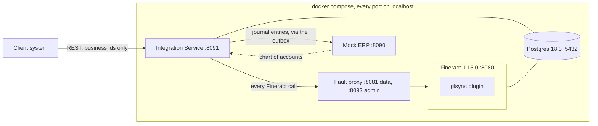
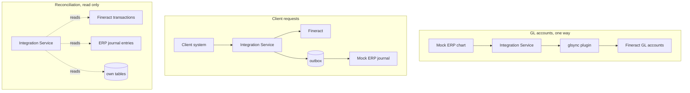
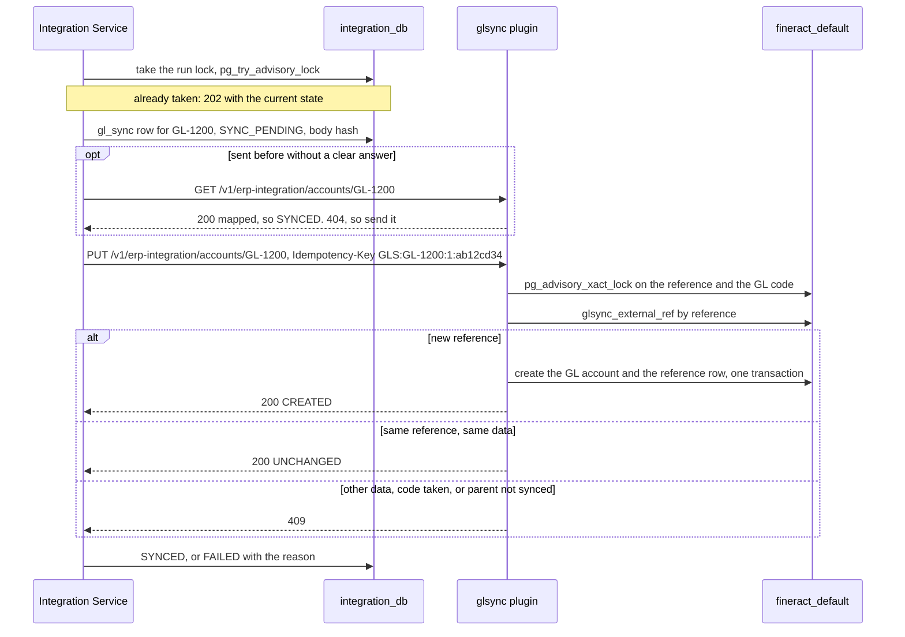
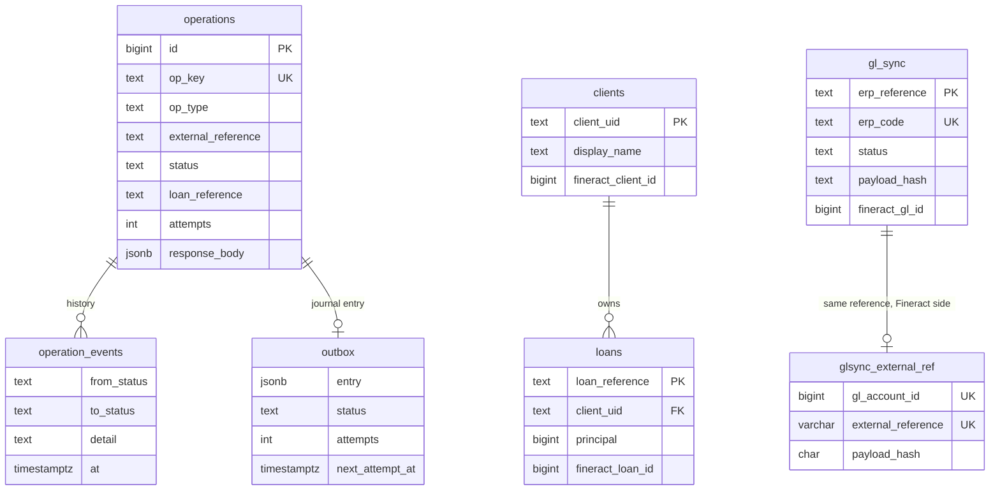
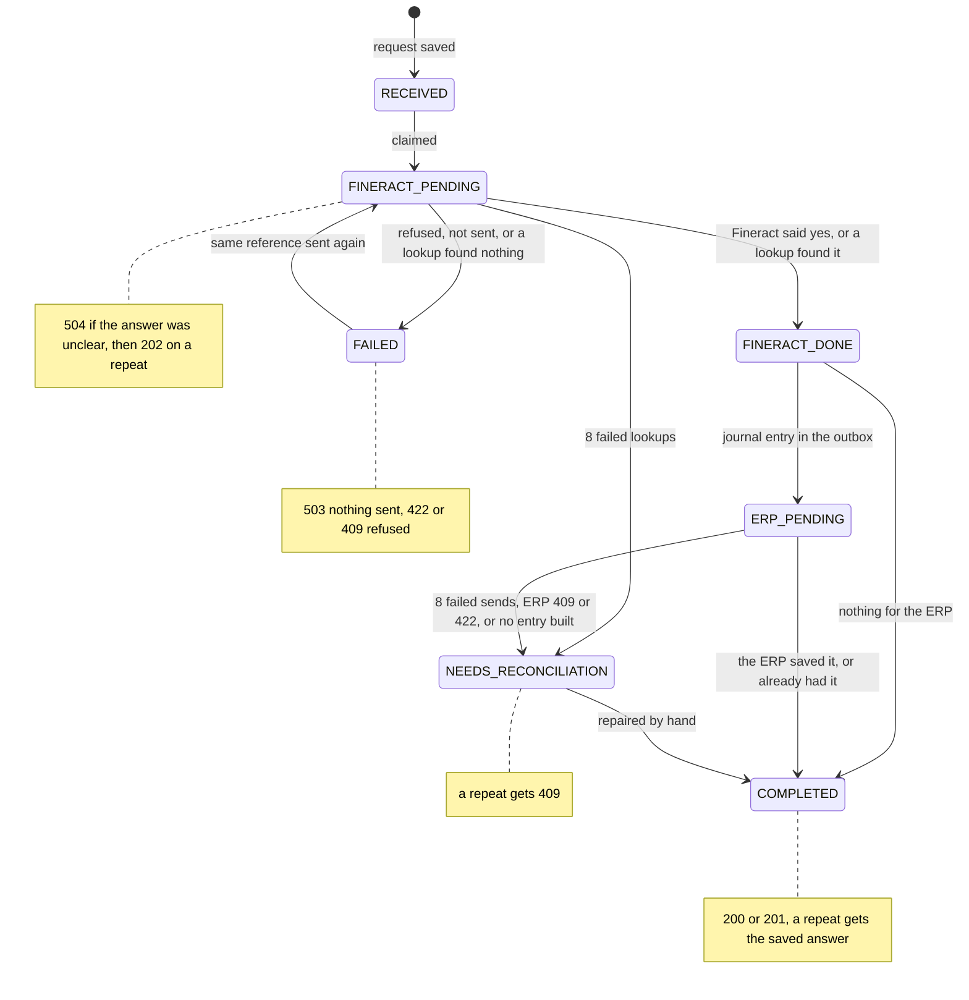
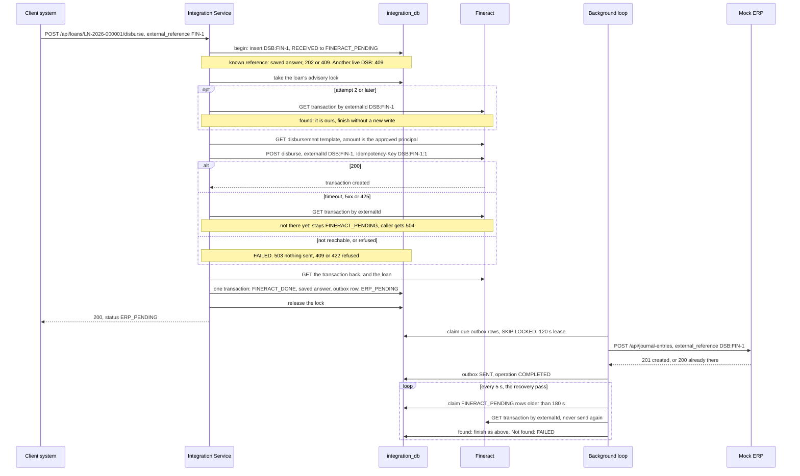
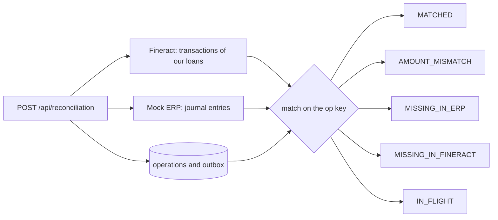

# Architecture

How the system fits together, and why. [README.md](README.md) runs it, [API.md](API.md) lists the endpoints, [DECISIONS.md](DECISIONS.md) weighs the trade-offs and [SIMULATIONS.md](SIMULATIONS.md) breaks it on purpose.

## The parts

The client system talks only to the Integration Service. Fineract keeps clients, loans and balances. The Mock ERP owns the chart of accounts and stores the journal entries. One Postgres server holds four databases, each with its own user: `fineract_tenants`, `fineract_default`, `integration_db` and `erp_db`.

There is no queue and no separate worker. An outbox table and a background thread do that job. An `X-Correlation-ID` follows every request through every log line, even the ERP send seconds later.

## How data moves

Three flows, and they never mix. The chart only flows from the ERP into Fineract, and only creates accounts. A money movement reaches the ERP from the outbox, never straight from the request. Reconciliation reads everything and changes nothing.

## GL sync

Fineract takes plugins and custom modules, so the customisation is a plugin beside Fineract's code, never a change to its core. It lives under `custom/inkomoko/glsync` and only the new `SYNC_GLACCOUNT` permission may call it. Fineract's GL table has no column for an outside reference, so the plugin keeps its own in `glsync_external_ref`. The advisory locks make two syncs of one account queue up instead of racing.

Sync walks the chart parents first. An unclear earlier attempt is looked up, never sent again blindly. Sync only creates: an account the ERP changes later stays `SYNCED`, with a note in `last_error`.

## What we store

`operations` is the heart of it: one row per client request, keyed by `op_key`, like `DSB:FIN-2026-000123`. The same key is Fineract's `externalId` and the ERP's `external_reference`, so reconciliation needs no lookup table. Each row keeps the request hash, the status and the exact answer we gave. Fineract's numeric ids stay here and never reach a response.

Unique rules do most of the duplicate protection. `(op_type, external_reference)` is unique. Partial indexes allow one live client creation per `client_uid`, one approval per loan and one disbursement per loan.

## The life of a request

Every status change goes through one table of allowed moves in `state_machine.py`. Anything else raises, and a unit test tries every pair. `begin()` inserts with `ON CONFLICT DO NOTHING` and, if the row exists, decides from it. Different data or a different API key gets `409`. A `FAILED` row is reused with the attempt number raised, so ten retries at once make one new attempt.

## A disbursement, step by step

The loan's advisory lock is held until the result commits. The template is read under it because it sets the amount and must not go stale. A success is read back, so the answer and the journal entry come from Fineract's own transaction. A crash before the final commit leaves `FINERACT_PENDING`, and a crash after it leaves an outbox row. The background loop finishes both.

The loop runs in each gunicorn worker, every 5 seconds and once at start-up. An ERP outage backs off 1, 2, 4, up to 60 seconds with jitter, 8 times. A `429` waits for `Retry-After` without counting. A repayment takes the same path, and Fineract must also show the loan `ACTIVE`.

## Paying out once

Five layers stop a loan being paid out twice. Three are mine, two are Fineract's, and [SIMULATIONS.md](SIMULATIONS.md) hammers the first three.

1. The saved answer per reference: a repeat never reaches Fineract.
2. The one-live-disbursement index: a second reference gets `409 LOAN_ALREADY_DISBURSED`, even mid-flight.
3. The per-loan advisory lock: two writes to one loan never run at once.
4. Fineract's unique `externalId` and our per-attempt `Idempotency-Key`: a retry cannot create a second transaction.
5. Fineract's own loan state: a single-tranche loan pays out once, whatever path the request took.

Only the last layer covers writes that bypass us.

## Where journal entries come from

`mapping/journal.py` turns Fineract's transaction into an ERP entry, and nothing more. A disbursement debits Loan Receivable `1200` and credits Bank `1100`. A repayment debits Bank and credits Loan Receivable, Interest Income `4100` and Overpayment Liability `2100` by the portions Fineract reports. The codes match the loan product's GL roles, so I never do my own interest maths. Anything unexpected, like fees or a reversal, builds no entry and goes to `NEEDS_RECONCILIATION` instead of a guess.

## The Mock ERP

A small Flask app on the same stack as the Integration Service. It seeds a chart of four HEADER groups and nine DETAIL accounts. Entries must balance, checked in Python for a clear `422` and again by a Postgres trigger at commit. A racing repeat of the same `external_reference` answers `200`. One row in `fault_settings` switches it to `down`, `timeout`, `timeout_after_write` or `rate_limited`.

## Breaking things on purpose

The fault proxy sits in front of Fineract, with data on port 8081 and admin on 8092. `down` refuses connections and `delay` slows everything. `timeout_after_send` lets the write reach Fineract, drops the answer and then goes down, so the follow-up lookup fails too.

The crash hook in `faults.py` covers the one gap the proxy cannot reach: a crash after the Fineract result commits and before the ERP call. It is off unless `FAULT_CRASH_AFTER_FINERACT_DONE` holds a matching reference prefix. It kills the gunicorn master, compose restarts the container, and the start-up pass sends the entry left behind.

## Reconciliation

Reconciliation takes up to 31 days or up to 100 references. `MATCHED` means the ERP entry equals what my mapping builds from Fineract, line for line. `IN_FLIGHT` means the outbox will still send it, so it is not reported as missing. If either side cannot be read the call fails with `502`, `503` or `504`, because a half-read report would show false gaps.
