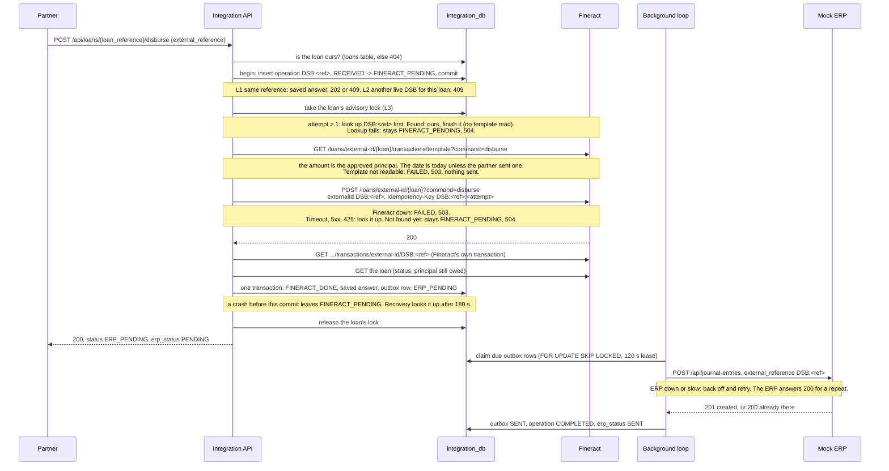
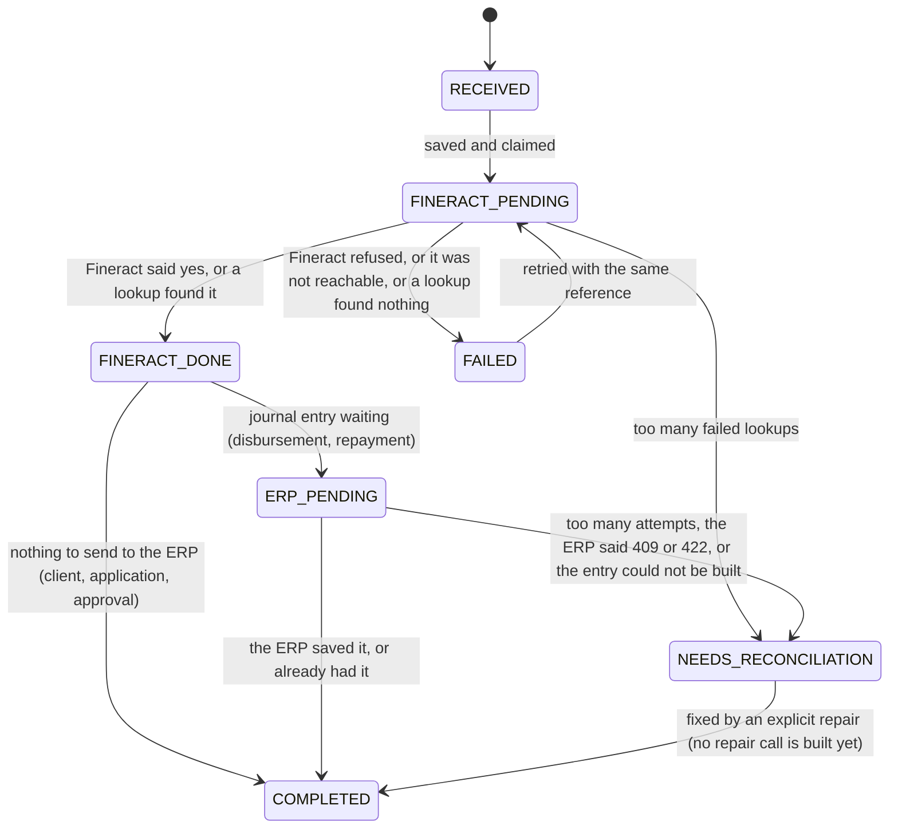

# Architecture

> **Status:** the Fineract plugin, the Mock ERP, the Fineract setup step and the Integration Service are built and tested: GL sync, clients, loans, disbursements, repayments, duplicate protection, journal entries through an outbox, and recovery. They were run on a clean stack (`evidence/P2/`), and again after the loan steps moved to Fineract's templates (`evidence/P2.5/`). Reconciliation (Part K) is still a design. Sections marked *planned* describe what I will build.

## The parts

| Part | Language | What it does |
|---|---|---|
| **Fineract** (with my plugin) | Java 21, Fineract 1.15.0 | The bank's record of clients, loans, payments and balances. My plugin adds GL accounts from the ERP safely. |
| **Integration Service** | Python 3.13, Flask | The only API that partners call. It syncs the ERP chart of accounts to Fineract, keeps track of every request, stops duplicates, calls Fineract and sends journal entries to the ERP. |
| **Setup** | Python (same image as the Integration Service) | A one-shot job that prepares Fineract: office, currency, role, API user, GL accounts and the loan product. |
| **Mock ERP** | Python 3.13, Flask | The accounting system. It owns the chart of accounts and stores journal entries. It can pretend to be down or slow, for testing. It has a small web UI. |
| **PostgreSQL 18.3** | — | One server. Each part has its own database and its own user: `fineract_tenants` and `fineract_default` for Fineract, `integration_db`, `erp_db`. |

There is no message queue, cache or separate worker. [DECISIONS.md](DECISIONS.md) explains why.

```mermaid
flowchart LR
  P[Financing partner] -->|REST, business IDs only| IS
  subgraph compose [docker compose]
    IS[Integration Service<br/>Flask]
    F[Fineract 1.15.0<br/>+ glsync plugin]
    E[Mock ERP<br/>Flask]
    DB[(PostgreSQL 18.3<br/>fineract_tenants · fineract_default<br/>integration_db · erp_db)]
  end
  IS -->|clients, loans, disbursements, repayments<br/>externalId = our reference| F
  IS -->|journal entries, via an outbox| E
  E -.->|chart of accounts| IS
  IS -->|GL sync: PUT /v1/erp-integration/accounts/{erpReference}| F
  IS --- DB
  F --- DB
  E --- DB
```

Every request carries an `X-Correlation-ID`, so one request can be followed through all the logs. Every request that changes something carries an `external_reference`.

## How data moves

1. **GL accounts (Part A).** The Integration Service reads the ERP's chart of accounts. For each account it calls my Fineract plugin. The plugin creates the matching GL account in Fineract, once. The setup step runs this before it creates the loan product. Details are in "GL sync" below.
2. **Partner requests (Parts C–F).** The Integration Service first saves the request in its own database. Then it calls Fineract and sends our reference as Fineract's `externalId`. Then it saves the result. Details are in "Partner requests" below.
3. **Journal entries (Part H).** After a disbursement or a repayment, the Integration Service reads Fineract's transaction back and takes Fineract's own split (principal, interest, overpayment). It builds the journal entry from that. It saves the entry in an outbox table, in the same database transaction as the Fineract result. A background loop sends it to the ERP and retries if the ERP is down.
4. **Reconciliation (Part K).** *(planned)* It reads transactions from Fineract and journal entries from the ERP. It matches them by `external_reference`. It reports each one as `MATCHED`, `MISSING_IN_ERP`, `MISSING_IN_FINERACT` or `AMOUNT_MISMATCH`. It never changes anything.

## The Mock ERP

It is a small Flask app. Gunicorn runs it with 2 worker processes and 4 threads each. It listens on port 8090, and only on `localhost`. The image is `python:3.13.16-alpine3.24` and it runs as a non-root user.

| Layer | What it uses |
|---|---|
| HTTP and checks | Flask 3 and flask-openapi3. Each request and response is a Pydantic model, so bad input gets a `422` and the OpenAPI spec is generated from the code. |
| Rules | Plain Python in `services/`. No Flask code there. |
| Database | SQLAlchemy 2 Core (no ORM) with psycopg 3. Alembic creates the tables when the container starts. |
| Web UI | Jinja2 templates with HTMX, under `/ui`. |

**How a request goes through it.** Every `/api` call takes the same path:

1. The correlation id is read from `X-Correlation-ID`, or a new one is made. It is sent back on the response.
2. The API key is checked (`X-API-Key`). A wrong or missing key gets `401` and stops here.
3. The fault switch is checked. If a fault is on, the request may fail here on purpose.
4. Pydantic checks the body or the query. A bad one gets `422`.
5. The service applies the rules and writes to Postgres in one short transaction.
6. One JSON log line is written, with the correlation id, the status and the fault, if any.

Every error has the same shape: `{"error": {"code", "message", "details", "correlation_id"}}`.

**The fault switch.** It is one row in the `fault_settings` table, not a value in memory. So both Gunicorn workers always see the same setting. A fault can be limited to a number of calls, like "fail the next 2 calls". Each call it hits takes one from the count, in a single `UPDATE … RETURNING` statement. So the count stays exact, even when calls arrive at the same time. The last one switches the fault off. This needs `RETURNING old.*`, which is new in Postgres 18.

| Mode | What the caller sees |
|---|---|
| `down` | `503` at once. Nothing is saved. |
| `timeout` | Waits, then `504`. Nothing is saved. |
| `timeout_after_write` | The entry is saved. Then it waits, then sends the real answer. The caller has usually given up by then. |
| `rate_limited` | `429` with a `Retry-After` header |

`/health`, `/admin`, `/ui` and `/openapi` never fail on purpose. So you can always check health and switch a fault off. Gunicorn's timeout (180 s) is longer than the longest fault wait (120 s).

**Debits must equal credits, checked twice.** Python checks it first and gives a clear `422`. A Postgres trigger checks it again when the transaction commits, after all the lines are in. The trigger also refuses lines on a HEADER account. So even a write that skips the Python code can't save an unbalanced entry.

**Requests at the same time.** A new account or journal entry is saved with `INSERT … ON CONFLICT DO NOTHING` on the unique `external_reference`. If two requests with the same reference race, one row is saved. The other request then reads that row and answers as a repeat. The tests send 10 at the same time and check this.

## The Integration Service

It is built the same way as the Mock ERP: Flask 3 and flask-openapi3 with Pydantic, SQLAlchemy 2 Core with psycopg 3, Alembic, and Gunicorn (2 workers, 4 threads each). It calls Fineract and the ERP with httpx. It listens on port 8091, only on `localhost`, and runs as a non-root user.

**How a request goes through it.** Every `/api` call:

1. The correlation id is read from `X-Correlation-ID`, or a new one is made. It is sent back on the response.
2. The partner's `X-API-Key` is checked. A wrong or missing key gets `401` and stops here.
3. Pydantic checks the input. A bad one gets `422`.
4. The work is done. Every error, even a crash, comes back as `{"error": {"code", "message", "correlation_id", "details"}}`.
5. One JSON log line is written, with the correlation id, the partner, the status and the time taken.

Every status change of a request also writes a JSON log line with `correlation_id`, `external_reference`, `client_uid`, `loan_reference`, `fineract_transaction_id`, `erp_transaction_id`, `status` and `timestamp`. Fineract's transaction id is only in the logs, never in a response. The outbox keeps the request's correlation id, so the ERP send seconds later carries it too (`evidence/P2/log-trail.txt`).

The service logs in to Fineract as `integration-api`, a user with only the permissions it needs. It never uses the admin user.

### GL sync

`POST /api/accounts/sync` runs one sync of the whole ERP chart. `POST /api/accounts/{erp_reference}/sync` does the same for one account. One run:

1. Read the ERP chart (`GET /api/accounts`). Put parents before children.
2. Save each account in the `gl_sync` table with a hash of the body we will send. A new account is `SYNC_PENDING`.
3. For each account that is not `SYNCED`, parents first:
   - If its parent is not synced, skip it.
   - If an earlier send got no clear answer, look it up first (`GET` on the plugin). Never send it again blindly.
   - Otherwise `PUT` it to the plugin with `Idempotency-Key: GLS:<reference>:<attempt>:<first 8 characters of the hash>`.
   - `200` makes it `SYNCED`. `409` or another `4xx` makes it `FAILED`, with the reason. If Fineract can't be reached, it stays `SYNC_PENDING` and the run stops calling Fineract. A timeout or `5xx` leads to a lookup at once.
4. Answer with the state of every account.

Only one run happens at a time. A Postgres advisory lock covers the whole run. A second caller does not wait. It gets `202` with the current state, and nothing is sent. To finish a sync after Fineract was down, call it again. There is no background loop for GL sync.

Sync only creates accounts. If the ERP later changes a synced account, it stays `SYNCED` and `last_error` holds the warning `changed in ERP; updates are out of scope`. An account that was never accepted by Fineract takes the new ERP data.

The ERP type and usage are turned into Fineract's numbers in one place (`mapping/account_types.py`): ASSET 1, LIABILITY 2, EQUITY 3, INCOME 4, EXPENSE 5, DETAIL 1, HEADER 2. DETAIL accounts allow manual entries. HEADER accounts don't.

### The setup step

`python -m integration_service.setup` runs as the compose service `setup`, once, before the Integration Service starts. It uses Fineract's admin user. The order matters:

1. Wait until Fineract and the ERP are healthy.
2. Office `Kigali Main Office`, under Head Office.
3. Add RWF to the organisation currencies. The other currencies are kept, because Fineract replaces the whole list.
4. Role `Integration Service`, with exactly the permissions in `role.json`. Missing ones are added and extra ones are removed.
5. API user `integration-api`, in the new office, with only that role. Then one call logged in as it, to prove the password and permissions work.
6. GL sync of the whole ERP chart.
7. Stop unless every GL account the loan product needs is `SYNCED`.
8. Loan product `SME Asset Finance`, with each GL role pointing at a synced account.

Each step first looks for what it would create. If it is there, it is left alone, so a second run creates nothing. Two things are never changed on a re-run: the API user's password, and an existing loan product. If the product has other settings, setup stops and lists the differences, because loans may already use it.

### Partner requests (Parts C to F)

Every request that changes something takes the same path. The code is in `services/operations.py`, `services/fineract_calls.py`, `services/templates.py`, `services/clients.py`, `services/loans.py` and `services/money.py`.

1. **Check the input.** Pydantic checks the body. Date rules use the Kigali date. Nothing is saved for a bad request.
2. **Save and claim it (`begin`).** One database transaction inserts the operation, keyed by type and `external_reference`, with a hash of the body and the partner. It moves `RECEIVED -> FINERACT_PENDING` and sets `attempts` to 1. If the row already exists, the saved answer, a `202` or a `409` is returned here, and Fineract is not called.
3. **Read the rules from Fineract.** A retry first looks up its earlier attempt by our key. If it landed late, it is ours and is finished here. If the lookup fails, the request stays `FINERACT_PENDING` and the partner gets `504`. Otherwise the service reads Fineract's template for the step (`services/templates.py`) and checks the request against it: the principal range for an application, the amount and date for an approval, the approved amount for a payout, the payment types for a repayment. A value that does not fit is `422` with `details.problems`, and the request is `FAILED`. A template that can't be read means nothing was sent: `FAILED`. For a payout or a repayment this read happens under the loan's lock, just before the write.
4. **Write to Fineract once.** Writes to a loan (approve, disburse, repay) run under a Postgres advisory lock for that loan. Our op key goes to Fineract as `externalId`, and `<op key>:<attempt>` as `Idempotency-Key`. A second attempt is looked up first.
5. **Decide from the answer.** A clear yes, or a lookup that finds it, is done. Not sent, or a clear refusal, is `FAILED`. A timeout, `5xx` or `425` is looked up by `externalId` straight away. If the lookup does not find it, the request stays `FINERACT_PENDING` and the partner gets `504`. Recovery decides later.
6. **Finish in one transaction.** For a disbursement or a repayment, the service reads Fineract's own transaction back and builds the journal entry from it. Then one transaction marks the operation `FINERACT_DONE`, saves the answer, writes the outbox row and moves to `ERP_PENDING`. For a client, an application or an approval, the same transaction writes our `clients` or `loans` row and moves to `COMPLETED`.

Fineract's error text is never passed on. Partners only see our own messages and, where useful, Fineract's error codes.

### Fineract templates and the form endpoints

`services/templates.py` reads Fineract's template APIs and turns each one into a typed form: the client template, the loan template for the product, the approval template, and the transaction templates for `disburse`, `repayment` and `prepayLoan`. It has three parts:

- **parse:** pure functions from a template's JSON to a frozen form. A shape we do not expect is treated as a failed read.
- **fetch:** one Fineract read each (two for the loan application form: the product by its external id, then the template).
- **check and view:** pure checks of a partner's value against a form (a list of field problems, which become `details.problems` in a `422`), and the partner view of a form.

The forms keep the Fineract ids that a Fineract body needs (product, office, payment type, enum ids). The partner views never show them: an option's value is a name or a code.

The writes in `services/clients.py`, `services/loans.py` and `services/money.py` use these forms (step 3 above). `api/templates.py` serves the same forms to partners, read only:

| Route | Fineract template |
|---|---|
| `GET /api/clients/template` | `GET /clients/template` |
| `GET /api/loans/template[?client_uid=]` | `GET /loans/template?templateType=individual&productId=..[&clientId=..]` |
| `GET /api/loans/{loan_reference}/template?step=approval` | `GET /loans/external-id/{ref}/template?templateType=approval` |
| `...?step=disbursement`, `repayment`, `payoff` | `GET /loans/external-id/{ref}/transactions/template?command=disburse`, `repayment`, `prepayLoan` |

Fineract answers a template whatever the loan's status, so the step form also reads the loan and sets `available` from its status. [DECISIONS.md](DECISIONS.md) has the reasons and what the probe found.

### The outbox and the recovery loop

There is no separate worker. Each Gunicorn worker starts one background thread (`BackgroundLoop` in `services/recovery.py`). Every 5 seconds (`OUTBOX_POLL_SECONDS`) it runs one pass. `POST /admin/recover` runs the same pass now. `OUTBOX_ENABLED=false` turns the thread off, which the tests and the OpenAPI export use.

One pass:

1. **Stuck requests.** It claims operations in `FINERACT_PENDING` that are older than 180 s, or whose `next_attempt_at` has come, with `FOR UPDATE SKIP LOCKED` and a lease. For a loan, it takes the loan's lock, and skips the loan if it is busy. It looks each one up in Fineract by `externalId` and never sends it again. Found: it is finished the same way the request would have finished, with the same saved answer. Not found: `FAILED`, and the partner can send the same reference again. Lookup failed: it counts in `recovery_lookups` and tries again later. After 8 failed lookups it goes to `NEEDS_RECONCILIATION`.
2. **The outbox.** It claims due rows with `FOR UPDATE SKIP LOCKED` and a 120 s lease, renews the lease just before each send, and posts the entry to the ERP outside any transaction. The result is saved only if the row is still the one it claimed.
   - `201` or `200`: `SENT`, and the operation moves to `COMPLETED` with `erp_status` `SENT` and the ERP's `erp_transaction_id`.
   - ERP down, timeout or `5xx`: wait 1, 2, 4, 8 ... up to 60 s, plus up to 25% random extra, then try again. After 8 attempts: `NEEDS_RECONCILIATION`.
   - `429`: wait for `Retry-After`. This does not count as an attempt.
   - `401` or `403` (our ERP key is wrong): retried with the same backoff.
   - `409` (the ERP holds the reference with other content) or `422`: `NEEDS_RECONCILIATION` at once.

A retry to the ERP is always safe: the ERP answers `200` for an entry it already has. Each failed send is written to `operation_events` as `ERP_PENDING -> ERP_PENDING`, with the reason.

### Journal entries (Part H)

`mapping/journal.py` is a pure function. It takes Fineract's transaction, as read back by `externalId`, and the GL roles of the loan product. The account codes come from `fineract/configuration/loan-product.json`, the same file setup used for the product. `GL-1100` there becomes code `1100`. So the ERP entry uses the same synced accounts that Fineract posts to.

| Fineract transaction | ERP lines |
|---|---|
| Disbursement | DR 1200 Loan Receivable, CR 1100 Bank, both the transaction `amount` |
| Repayment | DR 1100 Bank `amount`; CR 1200 `principalPortion`; CR 4100 Interest Income `interestPortion`; CR 2100 Overpayment Liability `overpaymentPortion`. A zero line is left out. |

The entry date is Fineract's transaction date. The ERP reference is the op key, like `RPY:FIN-2026-000007`, which is also the Fineract transaction's `externalId`.

The function does not guess. It gives no entry, and the operation goes to `NEEDS_RECONCILIATION`, when the transaction has fees, penalties or unrecognized income, is reversed, has portions that do not add up to the amount, has the wrong type or `externalId`, is not in RWF, or has a fraction of a franc. The Fineract success is still saved, and the outbox row is kept with the reason but never sent.

In D-1 the ERP totals for each account equalled Fineract's own GL entries for the loan after every stage (`evidence/P2/D-1.txt`).

## A disbursement, step by step

This is what `services/money.py` does. The log lines of the D-1 disbursement are in `evidence/P2/log-trail.txt`.



A repayment is the same, with the repayment template in place of the disbursement template, and one more check under the lock: the loan must be `ACTIVE` in Fineract. A `payment_type` that is not one of the partner payment types in the template is refused before anything is sent.

## The Fineract plugin

- **Fineract source.** `fineract-customization/fineract` is Fineract 1.15.0 as a git submodule. I never edit it.
- **How the plugin gets in.** Fineract 1.15.0 picks up any module placed under `custom/<company>/<category>/<module>`. It even ships an example. My module is `custom/inkomoko/glsync/`. The build copies it into the Fineract source and compiles them together. At runtime the plugin is two jar files next to the unchanged Fineract jar.
- **One module, two parts.** This is how Fineract's own example is laid out:

  ```
  custom/inkomoko/glsync/
  ├── service/   the API, the rules, the database table code, the error handling, the tests
  └── starter/   switches the plugin on, and the database migrations
  ```

  Everything outside Part A uses Fineract's normal settings or built-in features. So no other plugin is needed.
- **The API.** `PUT /v1/erp-integration/accounts/{erpReference}` creates the GL account for an ERP account. `GET` on the same path shows which GL account an ERP account belongs to. Full rules are in [API.md](API.md).
- **Its own path.** Every integration endpoint sits under `/api/v1/erp-integration/`, apart from Fineract's core APIs. This keeps the integration layer separate, and lets a proxy allow only that prefix. It stays under `/api` so Fineract's login, tenant, permission and audit checks still apply. [DECISIONS.md](DECISIONS.md) has the full reasons.
- **What it guarantees.** All of this runs inside one Fineract database transaction:
  1. The ERP reference is saved with the GL account, in its own table `glsync_external_ref`, and it is unique. (Fineract's GL account table has no column for it.)
  2. Same reference and same data: you get the existing account back. Nothing new is created.
  3. Same reference but different data: 409 conflict.
  4. Only users with the new `SYNC_GLACCOUNT` permission can call it. Fineract checks this itself.
  5. The new table and permission are added by Liquibase migrations.
  6. It is covered by JUnit unit and integration tests.
- **Parent accounts.** An account can name its parent with `parentAccount`. The parent must already be synced, must be a HEADER account (a heading that nothing posts to), and must be the same type. The account itself can be a HEADER or a DETAIL account. DETAIL means a sub-ledger that transactions post to. Fineract then records the hierarchy path.
- **Requests at the same time.** Before reading anything, the plugin takes a Postgres lock on the reference and on the GL code. A second request with the same reference waits. When the first one finishes, the second sees the saved row. The unique indexes are a second safety net.
- **OpenAPI.** The build generates the spec from annotations in the Java code. Fineract serves it at `/fineract-provider/glsync.json`. A copy is in `docs/openapi/fineract-erp-integration.yaml`.
- **Building.** The Dockerfile downloads Fineract 1.15.0, checks it is the exact commit, adds my plugin, runs the unit tests and builds the image. See [BUILD.md](fineract-customization/BUILD.md).

## Where data comes from

The Fineract database starts empty. Fineract creates its own tables when it starts. My plugin only adds one table and one permission.

| Data | Where it comes from |
|---|---|
| Office, currency, loan product, API user | The setup step, through Fineract's API. Settings in `fineract/configuration/`. |
| Chart of accounts | Seeded in the Mock ERP by its second migration: 4 HEADER groups (1000, 2000, 4000, 5000) and 9 DETAIL accounts under them |
| GL accounts in Fineract | Only from the ERP, through the Integration Service and my plugin |
| Clients, loans, payments | Only from partners, through the Integration Service |

## Duplicate-request keys

| Key | Who makes it | Example |
|---|---|---|
| `external_reference` | The partner, once per business action | `FIN-2026-000123` |
| Op key | The Integration Service: `<type>:<external_reference>` | `DSB:FIN-2026-000123`. Unique in `operations`. |
| Fineract `Idempotency-Key` header | The Integration Service: `<op key>:<attempt>` | `DSB:FIN-2026-000123:1` |
| Fineract loan transaction `externalId` | The op key, for disbursements and repayments | `DSB:FIN-2026-000123`. It never changes. |
| ERP journal entry `external_reference` | The op key | `DSB:FIN-2026-000123`. A reversal would be `DSB:FIN-2026-000123:REV` (*planned*). |
| Fineract client `externalId` | The partner's `client_uid` | `SME-000001` |
| Fineract loan `externalId` | Our `loan_reference` | `LN-2026-000001` |

The attempt number goes up only when a `FAILED` request is sent again with the same reference. A new attempt always looks the transaction up first. Fineract keeps `externalId` unique across all loans, so a second attempt can never create a second transaction.

The probe showed that Fineract's `Idempotency-Key` is not tied to a loan or to the body: a key used once returns its first answer, whatever is sent with it. So the key must be unique per attempt everywhere. `<op key>:<attempt>` is.

## Database tables

**integration_db** (built: migrations `0001` to `0003`)

| Table | Main columns | Rules |
|---|---|---|
| `operations` | `op_type` (CLI, APP, APR, DSB, RPY), `external_reference`, `op_key`, `partner`, `request_hash`, `request_payload`, `status`, `client_uid`, `loan_reference`, `attempts`, `recovery_lookups`, `next_attempt_at`, `last_error`, `response_status`, `response_body`, `erp_status`, `erp_transaction_id`, Fineract loan and transaction ids (internal only), `correlation_id`, times | Unique on (`op_type`, `external_reference`) and on `op_key`. CHECK rules for the type, the status, `op_key = op_type:external_reference`, a `client_uid` on CLI and a `loan_reference` on APR, DSB and RPY. Partial unique indexes allow only one live (not `FAILED`) client creation per `client_uid`, approval per loan and disbursement per loan. |
| `operation_events` | operation, from status, to status, detail, correlation id, time | One row for every status change, written in the same transaction as the change |
| `clients` | `client_uid`, `external_reference`, names, Fineract client id (internal only), status | `client_uid` is the key |
| `loans` | `loan_reference`, `client_uid`, `external_reference`, Fineract loan id (internal only), principal, status | `loan_reference` is the key. `principal > 0`. `loan_reference` comes from the sequence `loan_reference_seq`. |
| `outbox` | operation, journal entry (JSON), status (`PENDING`, `SENT`, `NEEDS_RECONCILIATION`), attempts, next attempt time, `last_error`, `erp_transaction_id` | One row per operation at most |
| `gl_sync` | `erp_reference`, `erp_code`, name, type, usage, parent reference, payload hash, status, Fineract GL id (internal only), attempts, `last_error`, times | `erp_reference` is the key. `erp_code` is unique. Status is `SYNC_PENDING`, `SYNCED` or `FAILED` (a CHECK rule). |

**erp_db** (built)

| Table | Main columns | Rules |
|---|---|---|
| `accounts` | `code`, `external_reference`, name, type, usage (HEADER or DETAIL), `parent_code`, currency, request hash | `code` is the key. `external_reference` is unique. Type is one of the five account types. |
| `journal_entries` | id (a UUID, shown as `erp_transaction_id`), `external_reference`, request hash, entry date, source, `reverses`, description, correlation id | `external_reference` is unique. Source is DISBURSEMENT, REPAYMENT, REVERSAL or MANUAL. |
| `journal_lines` | entry, account code, debit, credit | Each line is a debit or a credit, never both. Amounts are whole RWF. A trigger checks at commit that debits equal credits and that no line uses a HEADER account. |
| `fault_settings` | mode, path prefix, delay, remaining uses, Retry-After | Always exactly one row |

**fineract_default** (Fineract): Fineract's own tables, unchanged, plus my table `glsync_external_ref` (GL account id, ERP reference, payload hash, created at). Our IDs go in Fineract's own `external_id` columns: `client_uid` on clients, `loan_reference` on loans, and the operation's `external_reference` on loan transactions.

Fineract's numeric IDs are only stored in our own tables. They never appear in a public response.

## Request status

The rules are a table in `state_machine.py`. Every status change goes through it and is written to `operation_events` in the same transaction. A unit test tries every pair of states: the 10 moves below are allowed, every other one is refused.



The real history of a disbursement, from `GET /api/transactions/DSB-BE75C7-74d4` in D-1: `RECEIVED -> FINERACT_PENDING -> FINERACT_DONE -> ERP_PENDING -> COMPLETED`.

GL sync has its own simple status: `SYNC_PENDING`, then `SYNCED` or `FAILED`. A `FAILED` account is tried again on the next sync, with a new attempt number.

**Retries.** A Fineract write is never sent twice without a lookup by `externalId` first. The ERP retry policy is in "The outbox and the recovery loop" above. Attempts, lookups and next attempt times are saved in the database, so they survive a restart.

## How a loan is protected from being paid out twice

| Layer | How | Where | Shown by |
|---|---|---|---|
| L1 | Same reference: the saved answer is returned, a running one gets `202` | Unique (`op_type`, `external_reference`) in `operations`, `begin()` in `services/operations.py` | I-1: 4 requests, 1 Fineract disbursement, 1 ERP entry, 1 operation (`evidence/P2/I-1.txt`). Test `test_ten_requests_with_one_reference_pay_out_once`. |
| L2 | Only one live disbursement per loan. Another reference gets `409 LOAN_ALREADY_DISBURSED`. | Partial unique index `operations_one_live_disbursement` | Tests `test_ten_references_for_one_loan_pay_out_once` and `test_another_reference_for_the_same_loan_is_409` |
| L3 | A Postgres advisory lock per loan around every Fineract write to it (approve, disburse, repay, and recovery of them). Waits up to 30 s. | `services/loan_locks.py` | Test `test_parallel_repayments_each_land_once`. It fails when the lock is removed, because Fineract then loses parallel writes to its own `409`. |
| L4 | Fineract's unique transaction `externalId` (`DSB:<ref>`), plus the `Idempotency-Key` per attempt | Fineract | The probe: a second transaction with the same `externalId` gets `400 value.must.be.unique` and nothing is created |
| L5 | Fineract's loan state: a single-tranche loan is paid out once | Fineract | The probe: 5 disbursements at once with different keys gave 1 success and 4 `403`. Test `test_fineract_refuses_a_loan_paid_out_elsewhere_and_we_say_409`: a loan paid out outside the service is refused by Fineract, and we answer `409 LOAN_ALREADY_DISBURSED`. |

All five are enforced. L1 to L3 only cover requests that come through us. L5 covers everything, but it only refuses after the call reaches Fineract.

Repayments use L1, L3 and L4. A loan can have many repayments, so L2 does not apply. They still go one at a time per loan.

The concurrency simulations I-2a, I-2b and I-3 are not run yet. The tests above cover the same cases.
