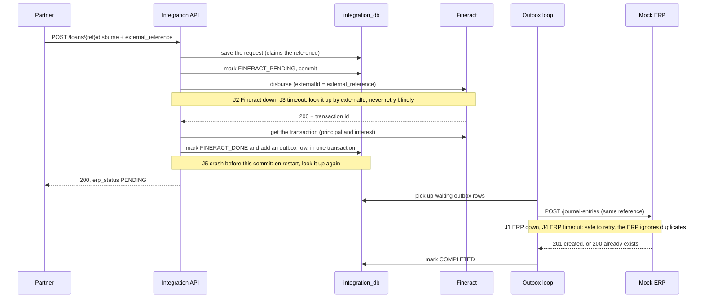
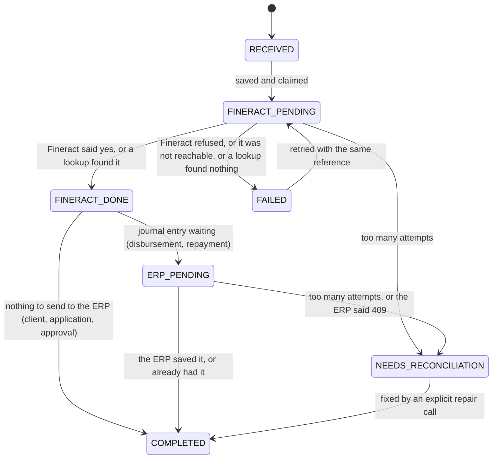

# Architecture

> **Status:** the Fineract plugin is built and tested. The Python parts are still a design. Sections marked *planned* describe what I will build.

## The parts

| Part | Language | What it does |
|---|---|---|
| **Fineract** (with my plugin) | Java 21, Fineract 1.15.0 | The bank's record of clients, loans, payments and balances. My plugin adds GL accounts from the ERP safely. |
| **Integration Service** | Python, FastAPI | The only API that partners call. It keeps track of every request, stops duplicates, calls Fineract and sends journal entries to the ERP. |
| **Mock ERP** | Python, FastAPI | The accounting system. It owns the chart of accounts and stores journal entries. It can pretend to be down or slow, for testing. |
| **PostgreSQL 18.3** | — | One server. Each part has its own database and its own user: `fineract_tenants` and `fineract_default` for Fineract, `integration_db`, `erp_db`. |

There is no message queue, cache or separate worker. [DECISIONS.md](DECISIONS.md) explains why.

```mermaid
flowchart LR
  P[Financing partner] -->|REST, business IDs only| IS
  subgraph compose [docker compose]
    IS[Integration Service<br/>FastAPI]
    F[Fineract 1.15.0<br/>+ glsync plugin]
    E[Mock ERP<br/>FastAPI]
    DB[(PostgreSQL 18.3<br/>fineract_tenants · fineract_default<br/>integration_db · erp_db)]
  end
  IS -->|clients, loans, disbursements, repayments<br/>externalId = our reference| F
  IS -->|journal entries, via an outbox| E
  E -.->|chart of accounts| IS
  IS -->|GL sync: PUT /v1/erp-accounts/{erpReference}| F
  IS --- DB
  F --- DB
  E --- DB
```

Every request carries an `X-Correlation-ID`, so one request can be followed through all the logs. Every request that changes something carries an `external_reference`.

## How data moves

1. **GL accounts (Part A).** The Integration Service reads the ERP's chart of accounts. For each account it calls my Fineract plugin. The plugin creates the matching GL account in Fineract, once. This happens before the loan product is set up.
2. **Partner requests (Parts C–F).** *(planned)* The Integration Service first saves the request in its own database. Then it calls Fineract and sends our reference as Fineract's `externalId`. Then it saves the result.
3. **Journal entries (Part H).** *(planned)* After a disbursement or a repayment, the Integration Service reads how Fineract split the money (principal and interest). It builds the journal entry from that. It saves the entry in an outbox table, in the same database transaction as the Fineract result. A background loop sends it to the ERP and retries if the ERP is down.
4. **Reconciliation (Part K).** *(planned)* It reads transactions from Fineract and journal entries from the ERP. It matches them by `external_reference`. It reports each one as `MATCHED`, `MISSING_IN_ERP`, `MISSING_IN_FINERACT` or `AMOUNT_MISMATCH`. It never changes anything.

## A disbursement, step by step *(planned)*



## The Fineract plugin

- **Fineract source.** `fineract-customization/fineract` is Fineract 1.15.0 as a git submodule. I never edit it.
- **How the plugin gets in.** Fineract 1.15.0 picks up any module placed under `custom/<company>/<category>/<module>`. It even ships an example. My module is `custom/inkomoko/glsync/`. The build copies it into the Fineract source and compiles them together. At runtime the plugin is two jar files next to the unchanged Fineract jar.
- **One module, two parts.** This is how Fineract's own example is laid out:

  ```
  custom/inkomoko/glsync/
  ├── service/   the API, the rules, the database table code, the error handling, the tests
  └── starter/   switches the plugin on, and the database migrations
  ```

  Everything outside Part A uses Fineract's normal settings or built-in features. So no other plugin is needed.
- **The API.** `PUT /v1/erp-accounts/{erpReference}` creates the GL account for an ERP account. `GET` on the same path shows which GL account an ERP account belongs to. Full rules are in [API.md](API.md).
- **What it guarantees.** All of this runs inside one Fineract database transaction:
  1. The ERP reference is saved with the GL account, in its own table `glsync_external_ref`, and it is unique. (Fineract's GL account table has no column for it.)
  2. Same reference and same data: you get the existing account back. Nothing new is created.
  3. Same reference but different data: 409 conflict.
  4. Only users with the new `SYNC_GLACCOUNT` permission can call it. Fineract checks this itself.
  5. The new table and permission are added by Liquibase migrations.
  6. It is covered by JUnit unit and integration tests.
- **Parent accounts.** An account can name its parent with `parentAccount`. The parent must already be synced, must be a HEADER account (a heading that nothing posts to), and must be the same type. The account itself can be a HEADER or a DETAIL account. DETAIL means a sub-ledger that transactions post to. Fineract then records the hierarchy path.
- **Requests at the same time.** Before reading anything, the plugin takes a Postgres lock on the reference and on the GL code. A second request with the same reference waits. When the first one finishes, the second sees the saved row. The unique indexes are a second safety net.
- **OpenAPI.** The build generates the spec from annotations in the Java code. Fineract serves it at `/fineract-provider/glsync.json`. A copy is in `docs/openapi/fineract-erp-accounts.yaml`.
- **Building.** The Dockerfile downloads Fineract 1.15.0, checks it is the exact commit, adds my plugin, runs the unit tests and builds the image. See [BUILD.md](fineract-customization/BUILD.md).

## Where data comes from

The Fineract database starts empty. Fineract creates its own tables when it starts. My plugin only adds one table and one permission.

| Data | Where it comes from |
|---|---|
| Office, currency, loan product, API user | A setup script, through Fineract's API *(planned)* |
| Chart of accounts | Seeded in the Mock ERP *(planned)* |
| GL accounts in Fineract | Only from the ERP, through the Integration Service and my plugin |
| Clients, loans, payments | Only from partners, through the Integration Service |

## Duplicate-request keys

| Key | Who makes it | Example |
|---|---|---|
| `external_reference` | The partner, once per business action | `DSB-2026-000123` |
| Fineract `Idempotency-Key` header | The Integration Service, saved before the call | `DSB:DSB-2026-000123:1` |
| Fineract transaction `externalId` | The Integration Service | `DSB-2026-000123`. It never changes. |
| ERP journal entry reference | The Integration Service, from the Fineract transaction | `DSB-2026-000123`. A reversal is `DSB-2026-000123:REV`. |

The `:1` at the end only becomes `:2` after we check Fineract and see the transaction does not exist. Fineract keeps `externalId` unique, so a second try can never create a second transaction.

## Database tables *(planned, except the plugin table)*

**integration_db**

| Table | Main columns | Rules |
|---|---|---|
| `operations` | type, `external_reference`, request hash, status, attempts, next attempt time, saved response, correlation id | One row per type and reference. Only one live approval or disbursement per loan. |
| `operation_events` | operation, from status, to status, time | History of every status change |
| `clients` | `client_uid`, Fineract client id (internal only), name, status | `client_uid` is unique |
| `loans` | `loan_reference`, `client_uid`, Fineract loan id (internal only), status | `loan_reference` is unique |
| `gl_sync` | ERP code, ERP reference, Fineract GL id (internal only), sync status, attempts | Code and reference are unique |
| `outbox` | operation, journal entry, status, attempts, next attempt time | |

**erp_db**: `accounts` (code, unique reference, name, type, currency), `journal_entries` (unique reference, request hash, date, source), `journal_lines` (entry, account, debit, credit). Debits must equal credits.

**fineract_default** (Fineract): Fineract's own tables, unchanged, plus my table `glsync_external_ref` (GL account id, ERP reference, payload hash, created at). Our IDs go in Fineract's own `external_id` columns: `client_uid` on clients, `loan_reference` on loans, and the operation's `external_reference` on loan transactions.

Fineract's numeric IDs are only stored in our own tables. They never appear in a public response.

## Request status *(planned)*



GL sync has its own simple status: `SYNC_PENDING`, then `SYNCED` or `FAILED`. A failed one goes back to `SYNC_PENDING` on the next sync.

**Retries:** wait 1 s, 2 s, 4 s and so on, up to 60 s, with some randomness. Stop after 8 attempts. The attempt count and the next attempt time are saved, so they survive a restart. We never call Fineract twice without first checking if the first call worked.

**Recovery:** on start-up, and then in a loop, the service looks at every request still marked `..._PENDING`. `POST /admin/recover` runs this on demand.

## How a loan is protected from being paid out twice *(planned)*

| Layer | How | Limit |
|---|---|---|
| L1 | Same reference: the saved answer is returned | A different reference gets through |
| L2 | Database rule: only one live disbursement per loan | Only for requests that come through us |
| L3 | A Postgres lock per loan around the Fineract call | Same |
| L4 | Fineract's unique transaction `externalId`, plus its `Idempotency-Key` header | Only for the same reference |
| L5 | Fineract's loan state: a single-tranche loan can only be disbursed once | **The last safety net.** It works even if everything else fails, but it only rejects after the call reaches Fineract. |

Repayments use L1, L3 and L4. A loan can have many repayments, so L2 does not apply. They are still handled one at a time per loan.
