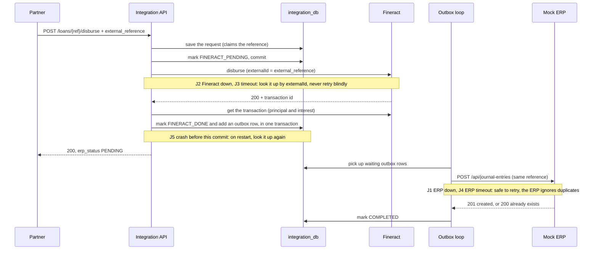
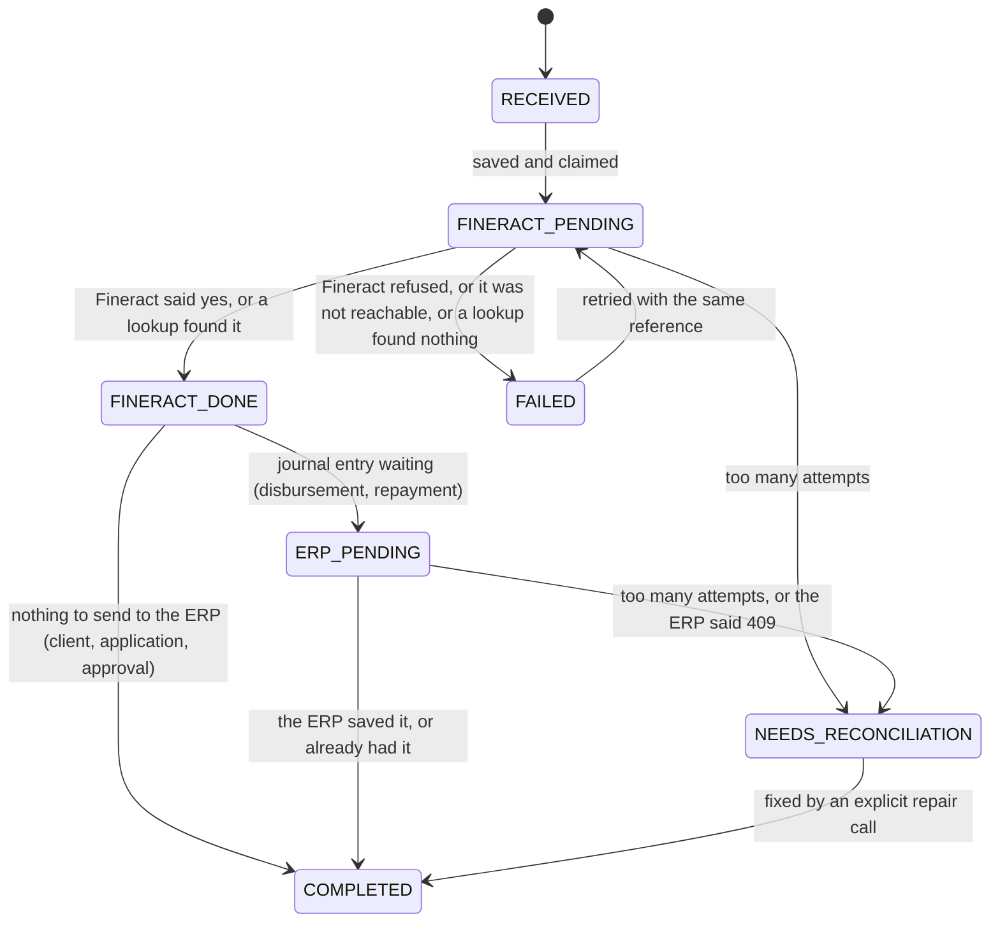

# Architecture

> **Status:** the Fineract plugin, the Mock ERP, the Fineract setup step and the Integration Service's GL sync are built and tested. The rest of the Integration Service (clients, loans, payments, journal entries, reconciliation) is still a design. Sections marked *planned* describe what I will build.

## The parts

| Part | Language | What it does |
|---|---|---|
| **Fineract** (with my plugin) | Java 21, Fineract 1.15.0 | The bank's record of clients, loans, payments and balances. My plugin adds GL accounts from the ERP safely. |
| **Integration Service** | Python 3.13, Flask | The only API that partners call. Today it syncs the ERP chart of accounts to Fineract. *(planned)* It will keep track of every request, stop duplicates, call Fineract and send journal entries to the ERP. |
| **Setup** | Python (same image as the Integration Service) | A one-shot job that prepares Fineract: office, currency, role, API user, GL accounts and the loan product. |
| **Mock ERP** | Python 3.13, Flask | The accounting system. It owns the chart of accounts and stores journal entries. It can pretend to be down or slow, for testing. It has a small web UI. |
| **PostgreSQL 18.3** | — | One server. Each part has its own database and its own user: `fineract_tenants` and `fineract_default` for Fineract, `integration_db`, `erp_db`. |

There is no message queue, cache or separate worker. [DECISIONS.md](DECISIONS.md) explains why.

```mermaid
flowchart LR
  P[Financing partner] -->|REST, business IDs only| IS
  subgraph compose [docker compose]
    IS[Integration Service<br/>Flask]
    F[Fineract 1.15.0<br/>+ glsync plugin]
    E[Mock ERP<br/>Flask]
    DB[(PostgreSQL 18.3<br/>fineract_tenants · fineract_default<br/>integration_db · erp_db)]
  end
  IS -->|clients, loans, disbursements, repayments<br/>externalId = our reference| F
  IS -->|journal entries, via an outbox| E
  E -.->|chart of accounts| IS
  IS -->|GL sync: PUT /v1/erp-integration/accounts/{erpReference}| F
  IS --- DB
  F --- DB
  E --- DB
```

Every request carries an `X-Correlation-ID`, so one request can be followed through all the logs. Every request that changes something carries an `external_reference`.

## How data moves

1. **GL accounts (Part A).** The Integration Service reads the ERP's chart of accounts. For each account it calls my Fineract plugin. The plugin creates the matching GL account in Fineract, once. The setup step runs this before it creates the loan product. Details are in "GL sync" below.
2. **Partner requests (Parts C–F).** *(planned)* The Integration Service first saves the request in its own database. Then it calls Fineract and sends our reference as Fineract's `externalId`. Then it saves the result.
3. **Journal entries (Part H).** *(planned)* After a disbursement or a repayment, the Integration Service reads how Fineract split the money (principal and interest). It builds the journal entry from that. It saves the entry in an outbox table, in the same database transaction as the Fineract result. A background loop sends it to the ERP and retries if the ERP is down.
4. **Reconciliation (Part K).** *(planned)* It reads transactions from Fineract and journal entries from the ERP. It matches them by `external_reference`. It reports each one as `MATCHED`, `MISSING_IN_ERP`, `MISSING_IN_FINERACT` or `AMOUNT_MISMATCH`. It never changes anything.

## The Mock ERP

It is a small Flask app. Gunicorn runs it with 2 worker processes and 4 threads each. It listens on port 8090, and only on `localhost`. The image is `python:3.13.16-alpine3.24` and it runs as a non-root user.

| Layer | What it uses |
|---|---|
| HTTP and checks | Flask 3 and flask-openapi3. Each request and response is a Pydantic model, so bad input gets a `422` and the OpenAPI spec is generated from the code. |
| Rules | Plain Python in `services/`. No Flask code there. |
| Database | SQLAlchemy 2 Core (no ORM) with psycopg 3. Alembic creates the tables when the container starts. |
| Web UI | Jinja2 templates with HTMX, under `/ui`. |

**How a request goes through it.** Every `/api` call takes the same path:

1. The correlation id is read from `X-Correlation-ID`, or a new one is made. It is sent back on the response.
2. The API key is checked (`X-API-Key`). A wrong or missing key gets `401` and stops here.
3. The fault switch is checked. If a fault is on, the request may fail here on purpose.
4. Pydantic checks the body or the query. A bad one gets `422`.
5. The service applies the rules and writes to Postgres in one short transaction.
6. One JSON log line is written, with the correlation id, the status and the fault, if any.

Every error has the same shape: `{"error": {"code", "message", "details", "correlation_id"}}`.

**The fault switch.** It is one row in the `fault_settings` table, not a value in memory. So both Gunicorn workers always see the same setting. A fault can be limited to a number of calls, like "fail the next 2 calls". Each call it hits takes one from the count, in a single `UPDATE … RETURNING` statement. So the count stays exact, even when calls arrive at the same time. The last one switches the fault off. This needs `RETURNING old.*`, which is new in Postgres 18.

| Mode | What the caller sees |
|---|---|
| `down` | `503` at once. Nothing is saved. |
| `timeout` | Waits, then `504`. Nothing is saved. |
| `timeout_after_write` | The entry is saved. Then it waits, then sends the real answer. The caller has usually given up by then. |
| `rate_limited` | `429` with a `Retry-After` header |

`/health`, `/admin`, `/ui` and `/openapi` never fail on purpose. So you can always check health and switch a fault off. Gunicorn's timeout (180 s) is longer than the longest fault wait (120 s).

**Debits must equal credits, checked twice.** Python checks it first and gives a clear `422`. A Postgres trigger checks it again when the transaction commits, after all the lines are in. The trigger also refuses lines on a HEADER account. So even a write that skips the Python code can't save an unbalanced entry.

**Requests at the same time.** A new account or journal entry is saved with `INSERT … ON CONFLICT DO NOTHING` on the unique `external_reference`. If two requests with the same reference race, one row is saved. The other request then reads that row and answers as a repeat. The tests send 10 at the same time and check this.

## The Integration Service

It is built the same way as the Mock ERP: Flask 3 and flask-openapi3 with Pydantic, SQLAlchemy 2 Core with psycopg 3, Alembic, and Gunicorn (2 workers, 4 threads each). It calls Fineract and the ERP with httpx. It listens on port 8091, only on `localhost`, and runs as a non-root user.

**How a request goes through it.** Every `/api` call:

1. The correlation id is read from `X-Correlation-ID`, or a new one is made. It is sent back on the response.
2. The partner's `X-API-Key` is checked. A wrong or missing key gets `401` and stops here.
3. Pydantic checks the input. A bad one gets `422`.
4. The work is done. Every error, even a crash, comes back as `{"error": {"code", "message", "correlation_id", "details"}}`.
5. One JSON log line is written, with the correlation id, the partner, the status and the time taken.

The service logs in to Fineract as `integration-api`, a user with only the permissions it needs. It never uses the admin user.

### GL sync

`POST /api/accounts/sync` runs one sync of the whole ERP chart. `POST /api/accounts/{erp_reference}/sync` does the same for one account. One run:

1. Read the ERP chart (`GET /api/accounts`). Put parents before children.
2. Save each account in the `gl_sync` table with a hash of the body we will send. A new account is `SYNC_PENDING`.
3. For each account that is not `SYNCED`, parents first:
   - If its parent is not synced, skip it.
   - If an earlier send got no clear answer, look it up first (`GET` on the plugin). Never send it again blindly.
   - Otherwise `PUT` it to the plugin with `Idempotency-Key: GLS:<reference>:<attempt>:<first 8 characters of the hash>`.
   - `200` makes it `SYNCED`. `409` or another `4xx` makes it `FAILED`, with the reason. If Fineract can't be reached, it stays `SYNC_PENDING` and the run stops calling Fineract. A timeout or `5xx` leads to a lookup at once.
4. Answer with the state of every account.

Only one run happens at a time. A Postgres advisory lock covers the whole run. A second caller does not wait. It gets `202` with the current state, and nothing is sent. To finish a sync after Fineract was down, call it again. There is no background loop for GL sync.

Sync only creates accounts. If the ERP later changes a synced account, it stays `SYNCED` and `last_error` holds the warning `changed in ERP; updates are out of scope`. An account that was never accepted by Fineract takes the new ERP data.

The ERP type and usage are turned into Fineract's numbers in one place (`mapping/account_types.py`): ASSET 1, LIABILITY 2, EQUITY 3, INCOME 4, EXPENSE 5, DETAIL 1, HEADER 2. DETAIL accounts allow manual entries. HEADER accounts don't.

### The setup step

`python -m integration_service.setup` runs as the compose service `setup`, once, before the Integration Service starts. It uses Fineract's admin user. The order matters:

1. Wait until Fineract and the ERP are healthy.
2. Office `Kigali Main Office`, under Head Office.
3. Add RWF to the organisation currencies. The other currencies are kept, because Fineract replaces the whole list.
4. Role `Integration Service`, with exactly the permissions in `role.json`. Missing ones are added and extra ones are removed.
5. API user `integration-api`, in the new office, with only that role. Then one call logged in as it, to prove the password and permissions work.
6. GL sync of the whole ERP chart.
7. Stop unless every GL account the loan product needs is `SYNCED`.
8. Loan product `SME Asset Finance`, with each GL role pointing at a synced account.

Each step first looks for what it would create. If it is there, it is left alone, so a second run creates nothing. Two things are never changed on a re-run: the API user's password, and an existing loan product. If the product has other settings, setup stops and lists the differences, because loans may already use it.

## A disbursement, step by step *(planned)*



## The Fineract plugin

- **Fineract source.** `fineract-customization/fineract` is Fineract 1.15.0 as a git submodule. I never edit it.
- **How the plugin gets in.** Fineract 1.15.0 picks up any module placed under `custom/<company>/<category>/<module>`. It even ships an example. My module is `custom/inkomoko/glsync/`. The build copies it into the Fineract source and compiles them together. At runtime the plugin is two jar files next to the unchanged Fineract jar.
- **One module, two parts.** This is how Fineract's own example is laid out:

  ```
  custom/inkomoko/glsync/
  ├── service/   the API, the rules, the database table code, the error handling, the tests
  └── starter/   switches the plugin on, and the database migrations
  ```

  Everything outside Part A uses Fineract's normal settings or built-in features. So no other plugin is needed.
- **The API.** `PUT /v1/erp-integration/accounts/{erpReference}` creates the GL account for an ERP account. `GET` on the same path shows which GL account an ERP account belongs to. Full rules are in [API.md](API.md).
- **Its own path.** Every integration endpoint sits under `/api/v1/erp-integration/`, apart from Fineract's core APIs. This keeps the integration layer separate, and lets a proxy allow only that prefix. It stays under `/api` so Fineract's login, tenant, permission and audit checks still apply. [DECISIONS.md](DECISIONS.md) has the full reasons.
- **What it guarantees.** All of this runs inside one Fineract database transaction:
  1. The ERP reference is saved with the GL account, in its own table `glsync_external_ref`, and it is unique. (Fineract's GL account table has no column for it.)
  2. Same reference and same data: you get the existing account back. Nothing new is created.
  3. Same reference but different data: 409 conflict.
  4. Only users with the new `SYNC_GLACCOUNT` permission can call it. Fineract checks this itself.
  5. The new table and permission are added by Liquibase migrations.
  6. It is covered by JUnit unit and integration tests.
- **Parent accounts.** An account can name its parent with `parentAccount`. The parent must already be synced, must be a HEADER account (a heading that nothing posts to), and must be the same type. The account itself can be a HEADER or a DETAIL account. DETAIL means a sub-ledger that transactions post to. Fineract then records the hierarchy path.
- **Requests at the same time.** Before reading anything, the plugin takes a Postgres lock on the reference and on the GL code. A second request with the same reference waits. When the first one finishes, the second sees the saved row. The unique indexes are a second safety net.
- **OpenAPI.** The build generates the spec from annotations in the Java code. Fineract serves it at `/fineract-provider/glsync.json`. A copy is in `docs/openapi/fineract-erp-integration.yaml`.
- **Building.** The Dockerfile downloads Fineract 1.15.0, checks it is the exact commit, adds my plugin, runs the unit tests and builds the image. See [BUILD.md](fineract-customization/BUILD.md).

## Where data comes from

The Fineract database starts empty. Fineract creates its own tables when it starts. My plugin only adds one table and one permission.

| Data | Where it comes from |
|---|---|
| Office, currency, loan product, API user | The setup step, through Fineract's API. Settings in `fineract/configuration/`. |
| Chart of accounts | Seeded in the Mock ERP by its second migration: 4 HEADER groups (1000, 2000, 4000, 5000) and 9 DETAIL accounts under them |
| GL accounts in Fineract | Only from the ERP, through the Integration Service and my plugin |
| Clients, loans, payments | Only from partners, through the Integration Service |

## Duplicate-request keys

| Key | Who makes it | Example |
|---|---|---|
| `external_reference` | The partner, once per business action | `DSB-2026-000123` |
| Fineract `Idempotency-Key` header | The Integration Service, saved before the call | `DSB:DSB-2026-000123:1` |
| Fineract transaction `externalId` | The Integration Service | `DSB-2026-000123`. It never changes. |
| ERP journal entry reference | The Integration Service, from the Fineract transaction | `DSB-2026-000123`. A reversal is `DSB-2026-000123:REV`. |

The `:1` at the end only becomes `:2` after we check Fineract and see the transaction does not exist. Fineract keeps `externalId` unique, so a second try can never create a second transaction.

## Database tables *(planned, except `gl_sync`, the plugin table and erp_db)*

**integration_db**

| Table | Main columns | Rules |
|---|---|---|
| `operations` | type, `external_reference`, request hash, status, attempts, next attempt time, saved response, correlation id | One row per type and reference. Only one live approval or disbursement per loan. |
| `operation_events` | operation, from status, to status, time | History of every status change |
| `clients` | `client_uid`, Fineract client id (internal only), name, status | `client_uid` is unique |
| `loans` | `loan_reference`, `client_uid`, Fineract loan id (internal only), status | `loan_reference` is unique |
| `gl_sync` (built) | `erp_reference`, `erp_code`, name, type, usage, parent reference, payload hash, status, Fineract GL id (internal only), attempts, `last_error`, times | `erp_reference` is the key. `erp_code` is unique. Status is `SYNC_PENDING`, `SYNCED` or `FAILED` (a CHECK rule). |
| `outbox` | operation, journal entry, status, attempts, next attempt time | |

**erp_db** (built)

| Table | Main columns | Rules |
|---|---|---|
| `accounts` | `code`, `external_reference`, name, type, usage (HEADER or DETAIL), `parent_code`, currency, request hash | `code` is the key. `external_reference` is unique. Type is one of the five account types. |
| `journal_entries` | id (a UUID, shown as `erp_transaction_id`), `external_reference`, request hash, entry date, source, `reverses`, description, correlation id | `external_reference` is unique. Source is DISBURSEMENT, REPAYMENT, REVERSAL or MANUAL. |
| `journal_lines` | entry, account code, debit, credit | Each line is a debit or a credit, never both. Amounts are whole RWF. A trigger checks at commit that debits equal credits and that no line uses a HEADER account. |
| `fault_settings` | mode, path prefix, delay, remaining uses, Retry-After | Always exactly one row |

**fineract_default** (Fineract): Fineract's own tables, unchanged, plus my table `glsync_external_ref` (GL account id, ERP reference, payload hash, created at). Our IDs go in Fineract's own `external_id` columns: `client_uid` on clients, `loan_reference` on loans, and the operation's `external_reference` on loan transactions.

Fineract's numeric IDs are only stored in our own tables. They never appear in a public response.

## Request status *(planned)*



GL sync has its own simple status: `SYNC_PENDING`, then `SYNCED` or `FAILED`. A `FAILED` account is tried again on the next sync, with a new attempt number.

**Retries:** wait 1 s, 2 s, 4 s and so on, up to 60 s, with some randomness. Stop after 8 attempts. The attempt count and the next attempt time are saved, so they survive a restart. We never call Fineract twice without first checking if the first call worked.

**Recovery:** on start-up, and then in a loop, the service looks at every request still marked `..._PENDING`. `POST /admin/recover` runs this on demand.

## How a loan is protected from being paid out twice *(planned)*

| Layer | How | Limit |
|---|---|---|
| L1 | Same reference: the saved answer is returned | A different reference gets through |
| L2 | Database rule: only one live disbursement per loan | Only for requests that come through us |
| L3 | A Postgres lock per loan around the Fineract call | Same |
| L4 | Fineract's unique transaction `externalId`, plus its `Idempotency-Key` header | Only for the same reference |
| L5 | Fineract's loan state: a single-tranche loan can only be disbursed once | **The last safety net.** It works even if everything else fails, but it only rejects after the call reaches Fineract. |

Repayments use L1, L3 and L4. A loan can have many repayments, so L2 does not apply. They are still handled one at a time per loan.
