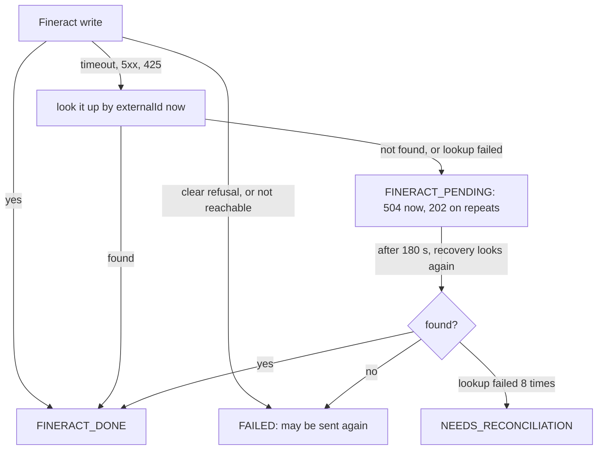

# Decisions

What I chose, why, and what I gave up. How the parts fit is in [ARCHITECTURE.md](ARCHITECTURE.md), the endpoints are in [API.md](API.md), and the runs behind each claim are in [SIMULATIONS.md](SIMULATIONS.md).

## 1. A plugin beside Fineract, never a change to its core

I extended Fineract with a plugin and never touched its core. Fineract is built to accommodate plugins and custom modules that run inside it, so my code sits in its `custom/` folder, beside a submodule pinned to the 1.15.0 commit. Fineract 1.15 has no external reference on GL accounts, so the plugin holds the ERP's reference and refuses a second account for it. Patching the core would make every upgrade a merge, and data tables cannot attach to GL accounts in 1.15.

The plugin never calls Fineract's REST API. `PUT /v1/erp-integration/accounts/{erpReference}` runs through Fineract's command pipeline, which brings the permission check and the audit row. Its handler calls Fineract's own `GLAccountWritePlatformService` in the same transaction, so the GL account, my reference row and the audit record commit together. The reference lives in one Liquibase table, `glsync_external_ref`. The same body again gives `UNCHANGED`; other data for the same reference gives `409`. The migration creates the `SYNC_GLACCOUNT` permission, and the API user's role holds 11 permissions and nothing else. A transaction-scoped advisory lock on the reference and GL code stops two parallel requests from both seeing "no row yet". Ten at once give one `CREATED`, nine `UNCHANGED` and one GL account. The price is a tie to Postgres, and the plugin only creates accounts.

## 2. Flask for both Python services, and a Makefile

I chose Flask 3 with flask-openapi3 and Pydantic for both the Integration Service and the Mock ERP. Pydantic checks every request, bad input gets `422` in one error shape, and the OpenAPI spec comes from the same models. One stack twice means one way to validate, log, migrate and test. Gunicorn runs 2 workers with 4 threads, so a slow ERP blocks one thread, not the service.

### The Makefile

Every task is one `make` word, such as `make up` or `make test-python`, over plain `docker`, `docker compose` and `uv`. It should work on macOS with Docker Desktop, Xcode's `make` and `uv`. macOS's old `make` ignores `.SHELLFLAGS`, so the two targets that pipe through `tee` set `pipefail` themselves. I have not run it on a Mac. The fallback is `docker compose up -d --no-build --wait`.

## 3. The reference names the operation

Every request gets a key `<operation>:<reference>`, such as `DSB:FIN-2026-000001` for one disbursement. The codes are `CLI`, `APP`, `APR`, `DSB` and `RPY`, plus `:REV` for a reversal. The same string is our row key, Fineract's `externalId` and the ERP's `external_reference`, so reconciliation matches three systems on one value. The cost: a reference ending in `:REV` would be misread. Loan references are ours too (`LN-<year>-<6 digits>`).

## 4. Idempotency lives in the database

Every request is a row in `operations`, unique on (type, reference). It holds a hash of the caller and body and, later, Fineract's exact answer.

| Repeat of a request | Answer |
|---|---|
| Same data, first one finished | The saved answer as `200`, even for a create |
| Same data, first one still running | `202` |
| Other data, or another caller | `409 IDEMPOTENCY_CONFLICT` |

The insert uses `ON CONFLICT DO NOTHING`, and `begin()` reads again when the loser trips the second unique rule (`test_ten_identical_requests_at_once_run_once`).

Fineract 1.15's own `Idempotency-Key` is a replay cache, not a guarantee. It replays the first answer even for another amount, answers `425` while the first call runs, and replays errors too. The real guard is the unique `externalId` on loan transactions: a second one gets `400 validation.msg.loan.transaction.externalId.value.must.be.unique`, even on another loan. I send both, with a fresh key per attempt, so a cached failure is never replayed. Neither covers the ERP; our row does.

## 5. Database constraints

Partial unique indexes allow one live client creation per `client_uid`, and one live approval and one live disbursement per loan, where live means `status <> 'FAILED'`. A second reference for a loan already being paid out fails the insert. Nothing is saved or sent, and the client system gets `409 LOAN_ALREADY_DISBURSED` at once. The brief's I-2b expects these to end `FAILED`. I chose no row, because `FAILED` means "we tried, send it again", and these were never tried. I-2b shows one `200`, nine `409` and zero rows.

Writes to one loan also queue on a per-loan advisory lock. Without it, ten parallel repayments lost five to Fineract's own `409 error.msg.platform.service.query.conflict`. With it they all land (`test_parallel_repayments_each_land_once`).

## 6. Sync or async

The call is synchronous up to Fineract and asynchronous to the ERP. The client system waits for Fineract's answer, because once Fineract says yes the money has moved. The ERP entry goes into an `outbox` table in the same transaction that marks the request `FINERACT_DONE`. Each worker sends due rows every 5 seconds, claimed with `FOR UPDATE SKIP LOCKED`. An ERP outage blocks nobody. The cost is polling even when idle.

### No Redis, no Kafka

I left out Redis and Kafka because neither adds correctness to this flow.

**Redis.** Fineract caches inside its own JVM: version 1.15 uses Ehcache through JCache, and its multi-node cache mode is not supported. Redis would therefore serve only my own services, and their shared state (idempotency records, the per-loan lock and the outbox) must be durable and commit in the same transaction as the operation. Postgres gives me that; Redis would not.

**Kafka.** Fineract can publish external events to Kafka, but they are off by default and are sent after the business write, at least once, from its `m_external_event` table. They cannot stop a duplicate write, and every consumer would need its own deduplication. Instead I enforce idempotency at the write over REST, with the operation key as Fineract's `externalId` and `Idempotency-Key` and a lookup before any retry. For GL accounts, the plugin calls Fineract's own accounting service inside the command transaction, so the rule holds before anything is written, with no topics or streams in between. The ERP leg still runs asynchronously, through a Postgres outbox.

## 7. Retries and partial failure

One rule: never send a Fineract write again until a lookup by `externalId` shows it did not happen. An unclear answer (a 30-second timeout, a `5xx` or a `425`) triggers that lookup at once. If the transaction is missing, Fineract may still be working, so the request stays `FINERACT_PENDING`. Recovery looks again after 180 seconds, and only that lookup may decide `FAILED`.



The cost: after J-3's cut the client system waits about three minutes for a final answer. ERP retries are always safe, because the ERP answers `200` for an entry it already holds. The outbox backs off up to 60 seconds with jitter and stops after 8 attempts at `NEEDS_RECONCILIATION`.

**A fault proxy, not toxiproxy.** Toxiproxy works on TCP and cannot tell one HTTP request from another, which J-3 needs. So I wrote `fault-proxy/`, about 250 lines, used only in tests.

**A crash hook.** J-5 needs the service to die right after `FINERACT_DONE` commits, which killing the container from outside cannot hit reliably. `faults.py` sends `SIGKILL` to the Gunicorn master only for references matching `FAULT_CRASH_AFTER_FINERACT_DONE`, and start-up recovery finishes the job.

## 8. Fineract's templates are the source of the rules

Before each write, the service reads Fineract's own template for that step and takes the amounts and rules from it, under the loan's lock. Deriving them from the loan product would be my guess at Fineract's rules. The cost is one extra read per write. In return there is no copy of Fineract's rules to keep in step.

| Step | Template | What we take |
|---|---|---|
| Application | `GET /loans/template?templateType=individual&productId=…` | Principal range and default, term, rate, schedule, currency |
| Approval | `…/template?templateType=approval` | The amount and the expected disbursement date |
| Disbursement | `…/transactions/template?command=disburse` | The amount (the approved principal) |
| Repayment | `…/transactions/template?command=repayment` | The currency step and the payment types |
| Payoff | `…/transactions/template?command=prepayLoan` | What clears the loan today |

Fineract 1.15 facts that became checks:

- Templates ignore the loan's status, so the forms check it.
- An approval after the expected disbursement date is refused, though the template proposes today. We answer `422` first.
- A payout before the expected date is allowed, so we default to today.
- A repayment on a closed loan becomes overpayment, so we accept repayments only on `ACTIVE` loans.
- `1000.6` RWF is rounded to `1001` silently, so we take whole francs.
- Two system-defined payment types are for Fineract's own adjustments, so we refuse them.
- 1.15 wants `allowPartialPeriodInterestCalculation` and `canDefineInstallmentAmount`.

## 9. Journal entries come from Fineract's own split

After Fineract says yes, the service reads the transaction back and builds the ERP entry from Fineract's own `principalPortion`, `interestPortion` and `overpaymentPortion`. It never uses the client system's amount or its own interest maths. The GL codes come from the loan product, and in D-1 the ERP totals per account equalled Fineract's GL after every stage. Anything the mapping would have to guess goes to `NEEDS_RECONCILIATION`.

| Payment | Debit | Credit |
|---|---|---|
| Payout | 1200 Loan Receivable | 1100 Bank |
| Repayment | 1100 Bank | 1200 principal, 4100 Interest Income, 2100 Overpayment Liability |

## 10. Reconciliation

The report is built live from Fineract, the ERP and our tables, keyed on the op key, and never stored. I added `IN_FLIGHT`, so an entry still in our outbox is not a false `MISSING_IN_ERP`. `AMOUNT_MISMATCH` compares the split, not just totals: K-1 caught a wrong split when both totals were 50,000. If either side cannot be read, the whole call fails rather than report false gaps.

## 11. What happened to FIN-2026-000001?

One call answers it, on a real run with fake data:

```
GET /api/transactions/FIN-2026-000001
-> 200 DISBURSEMENT, op_key DSB:FIN-2026-000001, loan LN-2026-000022, status COMPLETED, erp_status SENT, attempts 1
   history: RECEIVED -> FINERACT_PENDING -> FINERACT_DONE (Fineract said yes) -> ERP_PENDING -> COMPLETED (the ERP saved the journal entry)
```

Loan `LN-2026-000022` was paid out once, at the first attempt. The logs carry the correlation id across both services (trimmed to the lines that tell the story):

```
$ docker compose logs --no-log-prefix integration-service | grep -E "FIN-2026-000001|c-fin-2026-000001"
{"timestamp": "2026-10-14T10:22:10.249384+00:00", "level": "INFO", "message": "operation status", "correlation_id": "c-fin-2026-000001", "op_key": "DSB:FIN-2026-000001", "external_reference": "FIN-2026-000001", "client_uid": "SME-064407", "loan_reference": "LN-2026-000022", "fineract_transaction_id": 319, "erp_transaction_id": null, "status": "FINERACT_DONE", "previous_status": "FINERACT_PENDING", "detail": "Fineract said yes"}
{"timestamp": "2026-10-14T10:22:10.265811+00:00", "level": "INFO", "message": "request", "correlation_id": "c-fin-2026-000001", "method": "POST", "path": "/api/loans/LN-2026-000022/disburse", "status": "ERP_PENDING", "http_status": 200, "duration_ms": 549.5, "partner": "demo-partner", "external_reference": "FIN-2026-000001", "loan_reference": "LN-2026-000022", "client_uid": "SME-064407"}
{"timestamp": "2026-10-14T10:22:12.107445+00:00", "level": "INFO", "message": "operation status", "correlation_id": "c-fin-2026-000001", "op_key": "DSB:FIN-2026-000001", "external_reference": "FIN-2026-000001", "client_uid": "SME-064407", "loan_reference": "LN-2026-000022", "fineract_transaction_id": 319, "erp_transaction_id": "646fbfe7-dedd-482f-bcca-6430d72ad731", "status": "COMPLETED", "previous_status": "ERP_PENDING", "detail": "the ERP saved the journal entry"}

$ docker compose logs --no-log-prefix mock-erp | grep c-fin-2026-000001
{"timestamp": "2026-10-14T10:22:12.098378+00:00", "level": "INFO", "message": "request", "correlation_id": "c-fin-2026-000001", "method": "POST", "path": "/api/journal-entries", "status": 201, "duration_ms": 8.8, "external_reference": "DSB:FIN-2026-000001", "erp_transaction_id": "646fbfe7-dedd-482f-bcca-6430d72ad731"}
```

Fineract said yes with transaction `319`, the client system had `200` in 549 ms, and the ERP saved the entry two seconds later. Had it stuck at `NEEDS_RECONCILIATION`, `last_error` says why and `POST /api/reconciliation` shows both sides.

## 12. Assumptions

- A plugin in `custom/` counts as extending Fineract.
- A payout answers `200` while the ERP entry is pending.
- Each client system has its own API key.
- `FIN-2026-000001` is the client system's `external_reference`.
- Reconciliation matches reversed payments to their opposite entries.
- In I-2b, "nothing saved or sent" matters more than the word `FAILED`.
- `Kigali Main Office` sits under Head Office with the API user in it, because Fineract shows users only their own office and below.

## 13. What I chose not to build

Time went to the required tiers:

- Reversals, though reconciliation already knows their shape.
- A repair call for `NEEDS_RECONCILIATION`.
- The other Part L items: fees, metrics, scheduled reconciliation, signed webhooks.
- A message queue, Redis and OAuth (sections 6 and 12).
- A run from a fresh `git clone` on another machine.

## 14. Known weaknesses

- Reconciliation reads every loan. Fine for hundreds, not thousands.
- Test ERP entries show as `MISSING_IN_FINERACT` in a whole-day report (72 in K-1's).
- A reference ending in `:REV` is not refused yet.
- Reversals are unit-tested only.
- GL sync only creates. An ERP rename is warned about, not applied.
- Operator routes accept any client-system key. They need an operator key.
- Any client-system key can read or pay into any loan.
- A repayment finished by recovery can report a later `outstanding_after`.
