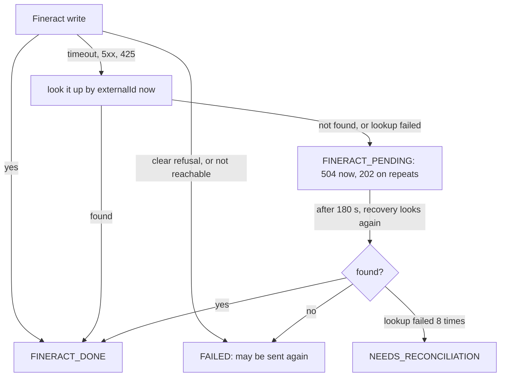

# Decisions

What I chose and why, in the order the questions usually come. The diagrams are in [ARCHITECTURE.md](ARCHITECTURE.md), the endpoints in [API.md](API.md), and the runs behind each claim in [SIMULATIONS.md](SIMULATIONS.md).

## I extended Fineract with a plugin, not a patch

Fineract is built to be extended: custom modules live in its `custom/` folder and are compiled in with the rest. Mine does one thing. Fineract 1.15 has nowhere to keep the ERP's reference on a GL account, so the plugin keeps it, and it refuses to create a second account for the same reference. Patching Fineract's own code would have been a smaller diff, but every upgrade would then be a merge. The upstream source stays a submodule pinned to 1.15.0, untouched.

The plugin runs inside Fineract, not around it. Its one write, `PUT /v1/erp-integration/accounts/{erpReference}`, takes the same path as Fineract's own commands, so Fineract checks the permission and writes its audit record, and then my handler calls Fineract's own GL service in the same transaction. The account, my reference row and the audit record commit together or not at all. The same data again answers `UNCHANGED`; different data for a known reference answers `409`. A database lock on the reference and the GL code stops two parallel requests from both seeing an empty table: ten at once give one `CREATED`, nine `UNCHANGED` and one account. That lock ties the plugin to Postgres, which this project runs on anyway.

## Flask for both Python services

Flask 3 with flask-openapi3 and Pydantic, twice. Pydantic validates every request, bad input gets `422` in one shape, and the OpenAPI spec is generated from the same models. One stack for both the Integration Service and the Mock ERP means one way to validate, log, migrate and test. Gunicorn runs two workers with four threads each, so a slow ERP ties up a thread, not the service.

Everything runs with plain `docker compose` commands.

## One key per operation

Every request gets a key like `DSB:FIN-2026-000001`: the operation (`CLI`, `APP`, `APR`, `DSB` or `RPY`) and the client system's own reference. That one string is my row key, the `externalId` I give Fineract and the `external_reference` I give the ERP, so reconciliation matches all three systems on a single value. A reversal would add `:REV`. The weak spot is a reference that itself ends in `:REV`; I do not refuse it yet.

## Idempotency lives in Postgres

Each request is a row in `operations`, unique on type and reference. It holds a hash of the caller and the body and, once done, Fineract's exact answer. Send the same thing again and you get that answer back as `200`, or `202` while the first one is still running. Send different data under the same reference and you get `409`. The database refuses a second row for the same key, so ten identical requests at once run exactly once.

Fineract's own `Idempotency-Key` only replays answers; it is not a guard. It replays the first answer even if the amount changed, replays errors too, and answers `425` while the first call is still running. The real guard on Fineract's side is the unique `externalId` on loan transactions. I send both, with a fresh key on every attempt so a cached failure is never replayed. Neither covers the ERP; my row does.

## The database refuses the second payout

A database rule allows one live client creation per `client_uid`, and one live approval and one live payout per loan, where live means anything but `FAILED`. A second reference for a loan that is already being paid out fails at the insert: nothing is saved, nothing is sent, and the caller gets `409 LOAN_ALREADY_DISBURSED` at once. The brief expected those to end as `FAILED`. I left them with no row at all, because `FAILED` means "I tried, send it again", and these were never tried.

Writes to one loan also wait their turn on a lock held in the database. Without it, ten parallel repayments lost five to Fineract's own `409` concurrency error. With it, all ten land.

## Synchronous to Fineract, asynchronous to the ERP

The caller waits for Fineract, because once Fineract says yes the money has moved and they need to know. The ERP entry goes into an `outbox` table in the same transaction that marks the request done, and each worker sends due rows every five seconds. An ERP outage therefore blocks nobody. The price is a poll every five seconds, even when nothing is waiting.

**Why no Redis and no Kafka.** Neither adds correctness here. Fineract keeps its cache in its own memory, and its shared-cache mode is not supported in 1.15, so Redis would serve only my services. Their shared state, the idempotency rows, the per-loan lock and the outbox, has to be durable and commit with the operation. Postgres does that; Redis cannot. Fineract can publish events to Kafka, but they are off by default and go out after the write, at least once, from its `m_external_event` table. They cannot stop a duplicate, and every consumer would need its own deduplication. So I enforce idempotency at the write, over REST, with the key above and a lookup before any retry, and for GL accounts the plugin enforces it inside Fineract's own transaction. The ERP leg keeps the asynchronous pattern through the outbox, without the broker.

## Never retry blind

A Fineract write is never sent again until a lookup by `externalId` shows it did not happen. A timeout, a `5xx` or a `425` triggers that lookup at once. If the transaction is not there, Fineract may still be working on it, so the request stays `FINERACT_PENDING`: the caller gets `504` now and `202` on repeats. Recovery looks again after 180 seconds, and only that second look may mark it `FAILED`.



The cost is that after a real network cut the caller waits about three minutes for a final answer. ERP retries are always safe, because the ERP answers `200` for an entry it already holds. The outbox backs off up to 60 seconds and gives up after eight tries at `NEEDS_RECONCILIATION`, where a person looks.

To test these paths I wrote a small fault proxy rather than use toxiproxy, which works on TCP and cannot drop the answer to one specific HTTP request. A crash hook, on only when `FAULT_CRASH_AFTER_FINERACT_DONE` names a reference prefix, kills the process right after the commit, so I can watch start-up recovery finish the job.

## Fineract's templates are the rulebook

Before each write I read Fineract's own template for that step and take the amounts and rules from it: the principal range for an application, the approved amount for a payout, the payment types for a repayment, the figure that clears a loan today. It costs one extra read per write, and it saves me a copy of Fineract's rules that would drift. A few things I learned from Fineract 1.15 along the way became checks. Templates ignore the loan's status, so the forms check it. An approval dated after the expected payout date is refused, and paying out before that date is fine. A repayment on a closed loan becomes overpayment, so I accept repayments on active loans only. A fraction of a franc is rounded silently, so I take whole francs.

## Journal entries come from Fineract's split

After Fineract says yes I read the transaction back and build the ERP entry from Fineract's own principal, interest and overpayment portions, never from the caller's amount or from interest maths of my own. The GL codes come from the loan product. Anything the mapping would have to guess goes to `NEEDS_RECONCILIATION` instead. In the full lifecycle run, the ERP's totals per account matched Fineract's ledger after every step.

## Reconciliation is a live report

It reads Fineract, the ERP and my tables on every call, keyed on the operation key, and stores nothing. I added a fifth outcome, `IN_FLIGHT`, so an entry still waiting in my outbox is not reported as missing. `AMOUNT_MISMATCH` compares the split, not just the total; in the K-1 run it caught a wrong split where both totals were 50,000. If either side cannot be read, the whole call fails rather than show false gaps.

## What happened to FIN-2026-000001?

One call answers it, on a real run with fake data:

```
GET /api/transactions/FIN-2026-000001
-> 200 DISBURSEMENT, op_key DSB:FIN-2026-000001, loan LN-2026-000022, status COMPLETED, erp_status SENT, attempts 1
   history: RECEIVED -> FINERACT_PENDING -> FINERACT_DONE (Fineract said yes) -> ERP_PENDING -> COMPLETED (the ERP saved the journal entry)
```

The loan was paid out once, at the first attempt. The same correlation id runs through both services' logs, trimmed here to the lines that tell the story:

```
$ docker compose logs --no-log-prefix integration-service | grep -E "FIN-2026-000001|c-fin-2026-000001"
{"timestamp": "2026-10-14T10:22:10.249384+00:00", "level": "INFO", "message": "operation status", "correlation_id": "c-fin-2026-000001", "op_key": "DSB:FIN-2026-000001", "external_reference": "FIN-2026-000001", "client_uid": "SME-064407", "loan_reference": "LN-2026-000022", "fineract_transaction_id": 319, "erp_transaction_id": null, "status": "FINERACT_DONE", "previous_status": "FINERACT_PENDING", "detail": "Fineract said yes"}
{"timestamp": "2026-10-14T10:22:10.265811+00:00", "level": "INFO", "message": "request", "correlation_id": "c-fin-2026-000001", "method": "POST", "path": "/api/loans/LN-2026-000022/disburse", "status": "ERP_PENDING", "http_status": 200, "duration_ms": 549.5, "partner": "demo-partner", "external_reference": "FIN-2026-000001", "loan_reference": "LN-2026-000022", "client_uid": "SME-064407"}
{"timestamp": "2026-10-14T10:22:12.107445+00:00", "level": "INFO", "message": "operation status", "correlation_id": "c-fin-2026-000001", "op_key": "DSB:FIN-2026-000001", "external_reference": "FIN-2026-000001", "client_uid": "SME-064407", "loan_reference": "LN-2026-000022", "fineract_transaction_id": 319, "erp_transaction_id": "646fbfe7-dedd-482f-bcca-6430d72ad731", "status": "COMPLETED", "previous_status": "ERP_PENDING", "detail": "the ERP saved the journal entry"}

$ docker compose logs --no-log-prefix mock-erp | grep c-fin-2026-000001
{"timestamp": "2026-10-14T10:22:12.098378+00:00", "level": "INFO", "message": "request", "correlation_id": "c-fin-2026-000001", "method": "POST", "path": "/api/journal-entries", "status": 201, "duration_ms": 8.8, "external_reference": "DSB:FIN-2026-000001", "erp_transaction_id": "646fbfe7-dedd-482f-bcca-6430d72ad731"}
```

Fineract said yes with transaction `319`, the caller had its `200` in 549 ms, and the ERP saved the entry two seconds later. Had it stuck at `NEEDS_RECONCILIATION`, `last_error` would say why, and `POST /api/reconciliation` would show both sides.

## Assumptions

Where the brief left room, I took these readings:

- A module in Fineract's `custom/` folder counts as extending Fineract.
- A payout may answer `200` while its ERP entry is still pending.
- Each client system has its own API key.
- `FIN-2026-000001` is the client system's `external_reference`.
- Reconciliation matches a reversed payment to its opposite entry.
- For the ten-at-once payout, "nothing saved or sent" matters more than the word `FAILED`.
- The Kigali office sits under Head Office, with the API user in it, because Fineract shows users only their own office and below.

## What I chose not to build

Time went to the required tiers, so I left out:

- Reversals, though reconciliation already understands their shape.
- A repair call for requests stuck at `NEEDS_RECONCILIATION`.
- The other Part L items: fees, metrics, scheduled reconciliation, signed webhooks.
- Redis and Kafka, for the reasons above.
- A run from a fresh clone on another machine.

## Known weaknesses

- Reconciliation reads every loan I know. Fine for hundreds, not thousands.
- Test entries in the ERP show as `MISSING_IN_FINERACT` in a whole-day report; the K-1 run had 72 of them.
- A reference ending in `:REV` is not refused yet.
- Reversals are unit-tested only.
- GL sync only creates. A renamed ERP account is warned about, not applied.
- Operator routes accept any client-system key. They need an operator key of their own.
- Any client-system key can read or pay into any loan.
- A repayment finished by recovery can report a later `outstanding_after` than the one at the time.
