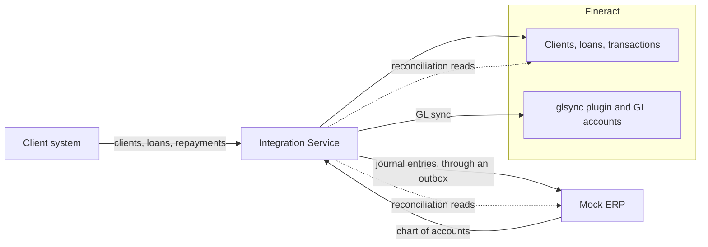

# Fineract and ERP integration

This is my take-home assessment: money moves exactly once between Fineract and the ERP, even when requests repeat, time out, crash halfway or arrive together. Apache Fineract is the core banking system. A Python Mock ERP owns the chart of accounts. A Python Integration Service sits between the client system and both of them. Fineract takes plugins and custom modules, so my Java customisation is a plugin beside Fineract's code, never a change to its core.

> **Status:** Tiers 1 and 2 (Parts A to K) are built, tested and run on the local stack. Tier 3 (Part L) is not built.



[ARCHITECTURE.md](ARCHITECTURE.md) explains each arrow.

## What is done

Every part has tests, and most have a `make` command that shows it live. [SIMULATIONS.md](SIMULATIONS.md) records the results.

| Part | What | Shown by |
|---|---|---|
| A | Fineract plugin: GL accounts from the ERP, once | `make demo-gl-sync` |
| B | Fineract setup | the `setup` service |
| C | Clients | `make demo-identity` |
| D | Loan lifecycle, application to Closed | `make demo-lifecycle` |
| E | The Integration Service API | [API.md](API.md) |
| F | Duplicate requests | `make simulate-duplicates` |
| G | Mock ERP, with fault switches | [API.md](API.md) |
| H | Journal entries, through an outbox | `make demo-lifecycle` |
| I | Concurrency, I-1 to I-3 | `make simulate-concurrent-disburse`, `make simulate-concurrent-repay` |
| J | Failures J-1 to J-5, with recovery | `make simulate-j1` to `make simulate-j5` |
| K | Reconciliation, all four outcomes | `make simulate-recon` |
| L | Stretch | not built |

## Versions

Everything is pinned.

| What | Version | Pinned in |
|---|---|---|
| Apache Fineract | `1.15.0`, commit `d5636847ac556c30b437254c353f05526d172b97` | submodule `fineract-customization/fineract` |
| JDK | 21 | Fineract's build file |
| Gradle | 8.14.5 | the wrapper in the tag |
| PostgreSQL | 18.3, Alpine image | `docker-compose.yml` |
| Python | 3.13, image `python:3.13.16-alpine3.24` | each `Dockerfile` |
| Packages | Flask 3, flask-openapi3, Pydantic 2, SQLAlchemy 2, Alembic, psycopg 3, Gunicorn; httpx in the Integration Service | `uv.lock` in each service |

## Run it

Two commands bring up the whole stack. The first one is slow because it builds Fineract from source.

```bash
git clone --recurse-submodules https://github.com/wmnjuguna/Inkomoko-Interview.git
cd Inkomoko-Interview
# or, if you already cloned without submodules:
git submodule update --init --depth 1

make build    # Fineract from source (runs the Java unit tests), then the Mock ERP, fault proxy and Integration Service images
make up       # Postgres, Fineract, the fault proxy, the Mock ERP, the setup step once, then the Integration Service
```

The Makefile only wraps plain docker and compose commands. Without make, copy `.env.example` to `.env` and run `docker compose up -d --no-build --wait`. A clean start took me about two minutes.

`fineract-customization/fineract` is the untouched Fineract 1.15.0 source. My plugin sits beside it in `fineract-customization/custom/`. [fineract-customization/patch/glsync.diff](fineract-customization/patch/glsync.diff) shows the same change as one diff.

> **The fault proxy** is a small pass-through between the Integration Service and Fineract. It lets the failure simulations cut Fineract off or drop its answer, and does nothing otherwise.

The `setup` service (Part B) runs once and is the only thing that logs in as Fineract's admin. It creates the office, RWF, a role, the `integration-api` user, the synced chart and the `SME Asset Finance` loan product. Its settings in `fineract/configuration/` hold names and codes only; the ids come from Fineract's templates. Running it again creates nothing:

```bash
docker compose run --rm setup
```

## How to use it

Six steps take you from a cold start to a reconciled loan. Ports bind to this computer only, and every credential is a placeholder from `.env.example`.

**1. Start the stack.** `make up` waits until every service is healthy.

```bash
make build
make up
curl http://127.0.0.1:8080/fineract-provider/actuator/health   # Fineract, answers "UP"
curl http://127.0.0.1:8090/health                               # Mock ERP
curl http://127.0.0.1:8091/health                               # Integration Service
curl http://127.0.0.1:8092/health                               # fault proxy, admin port
```

**2. Open the Mock ERP at http://127.0.0.1:8090/.** This is the accounting side, and its chart is what setup synced into Fineract.


*Chart of accounts (`/ui/accounts`) with live balances.*


*Journal (`/ui/journal`): every entry the ERP accepted.*


*One disbursement entry. "New entry" (`/ui/journal/new`) posts one by hand.*


*Fault switches (`/ui/faults`).*

**3. Explore the APIs.** Each service has a Swagger UI; click **Authorize** and paste its key.

- Integration Service: http://127.0.0.1:8091/openapi/swagger, key `change-me-partner-key` (from `PARTNER_API_KEYS`, `demo-partner:change-me-partner-key`).
- Mock ERP: http://127.0.0.1:8090/openapi/swagger, key `change-me-erp-key` (`ERP_API_KEY`).
- Fineract: http://127.0.0.1:8080/fineract-provider/swagger-ui/index.html. Pick **ERP integration (glsync plugin)** under **Select a definition**, then use `mifos` / `password` and `tenantid` `default`.
- Postman: import [postman/collection.json](postman/collection.json).


*The Integration Service in Swagger.*


*The Mock ERP in Swagger.*

**4. Sync the chart of accounts.** Setup already did it, so a second sync writes nothing.

```bash
BASE=http://127.0.0.1:8091
KEY="X-API-Key: change-me-partner-key"
curl -s -X POST $BASE/api/accounts/sync -H "$KEY"
```

**5. Run one loan.** Each write carries an `external_reference` you keep for retries, so a repeat gets the same answer and never a second payout.

```bash
JSON="Content-Type: application/json"
curl -s -X POST $BASE/api/clients -H "$KEY" -H "$JSON" \
  -d '{"external_reference": "MAN-CLI-0001", "client_uid": "SME-000001", "first_name": "Test", "last_name": "Client"}'
curl -s -X POST $BASE/api/loans -H "$KEY" -H "$JSON" \
  -d '{"external_reference": "MAN-APP-0001", "client_uid": "SME-000001", "principal": 5000000}'
LOAN=LN-2026-000001    # the loan_reference you got back
curl -s -X POST $BASE/api/loans/$LOAN/approve -H "$KEY" -H "$JSON" -d '{"external_reference": "MAN-APR-0001"}'
curl -s -X POST $BASE/api/loans/$LOAN/disburse -H "$KEY" -H "$JSON" -d '{"external_reference": "MAN-DSB-0001"}'
curl -s -X POST $BASE/api/loans/$LOAN/repayments -H "$KEY" -H "$JSON" \
  -d '{"external_reference": "MAN-RPY-0001", "amount": 500000}'
```

**6. Reconcile.** It compares Fineract with the ERP and gives each reference one outcome. A fresh write may show `IN_FLIGHT` for a few seconds, until the outbox sends its entry.

```bash
curl -s -X POST $BASE/api/reconciliation -H "$KEY" -H "$JSON" \
  -d '{"references": ["MAN-DSB-0001", "MAN-RPY-0001"]}'
```

**Then break things.** Switch the ERP off and a repayment still succeeds with `erp_status` `PENDING`. The outbox retries the journal entry until the ERP is back.

```bash
ERP="X-API-Key: change-me-erp-key"
curl -s -X PUT http://127.0.0.1:8090/admin/faults -H "$ERP" -H "$JSON" -d '{"mode": "down"}'
curl -s -X POST $BASE/api/loans/$LOAN/repayments -H "$KEY" -H "$JSON" \
  -d '{"external_reference": "MAN-RPY-0002", "amount": 100000}'          # 200, erp_status PENDING
curl -s -X DELETE http://127.0.0.1:8090/admin/faults -H "$ERP"           # fault off
curl -s $BASE/api/transactions/MAN-RPY-0002 -H "$KEY"                     # COMPLETED once the entry is sent
```

## Tests

Each language has one command, and both pass.

| Language | Command | Last result |
|---|---|---|
| Java | `make test-java` | 51 unit tests run in the build, then 10 integration tests passed. See [fineract-customization/BUILD.md](fineract-customization/BUILD.md). |
| Python | `make test-python` | ruff, strict mypy and pytest. On 2026-10-14: Mock ERP 216 passed, Integration Service 925 passed, ruff and mypy clean. |

The Python tests need two empty databases, `erp_test` and `integration_test`. A new data volume creates them; on an older one:

```bash
docker compose exec db createdb -U postgres -O erp erp_test
docker compose exec db createdb -U postgres -O integration integration_test
```

`make down` stops everything, `make reset` also deletes the data, and `make help` lists every command.

## Simulations

Each scenario is a `make` command that calls the Integration Service as the client system would. [SIMULATIONS.md](SIMULATIONS.md) lists every scenario with its recorded result. Two to start with:

```bash
make demo-lifecycle            # D-1: a 5,000,000 RWF loan from application to Closed
make simulate-j5               # J-5: the service crashes between Fineract and the ERP, then recovers
```

## Folders

```
├── README.md  ARCHITECTURE.md  API.md  SIMULATIONS.md  DECISIONS.md
├── Makefile
├── docker-compose.yml
├── docs/openapi/                  OpenAPI specs
├── docs/images/                   the screenshots above
├── infra/postgres/                creates one database per service
├── fineract-customization/
│   ├── fineract/                  Fineract 1.15.0 source (submodule, never edited)
│   ├── custom/inkomoko/glsync/    my Java plugin
│   ├── Dockerfile                 builds Fineract with the plugin
│   ├── patch/glsync.diff          my change as a diff against 1.15.0
│   └── BUILD.md, build.log, integration-test.log
├── fineract/configuration/        setup settings: office, currency, role, API user, loan product
├── integration-service/           Python: the Integration Service (Flask, Postgres) and the setup step
├── mock-erp/                      Python: the Mock ERP (Flask, Postgres, small web UI)
├── fault-proxy/                   Python: the fault proxy in front of Fineract (failure simulations only)
├── scripts/                       demos and simulations
└── postman/collection.json        every Integration Service endpoint, with fake data
```

## Use of AI

<!-- author: please review this section -->

I used AI assistance (Claude) while building this. The things I used it for include:

- writing unit tests
- writing and editing the documentation (the `.md` files)
- documenting the APIs in the Swagger/OpenAPI specs
- designing the simple interactive web UI of the Mock ERP

I reviewed the output, made the decisions, and can explain and change any part of the code.

## Not done

- Part L (stretch). [DECISIONS.md](DECISIONS.md) lists what I chose not to build, and why.
- I have not rehearsed a fresh `git clone` on another machine. Each part ran on a clean stack, but only on mine.
