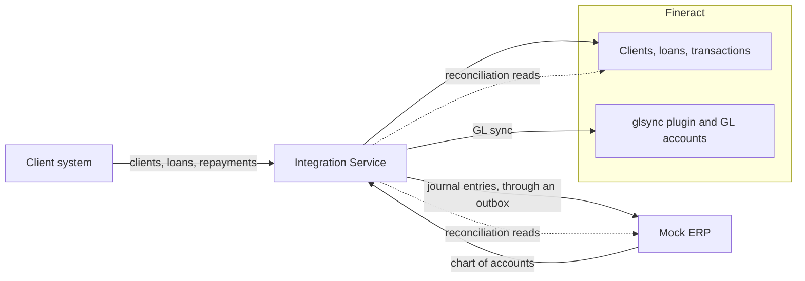
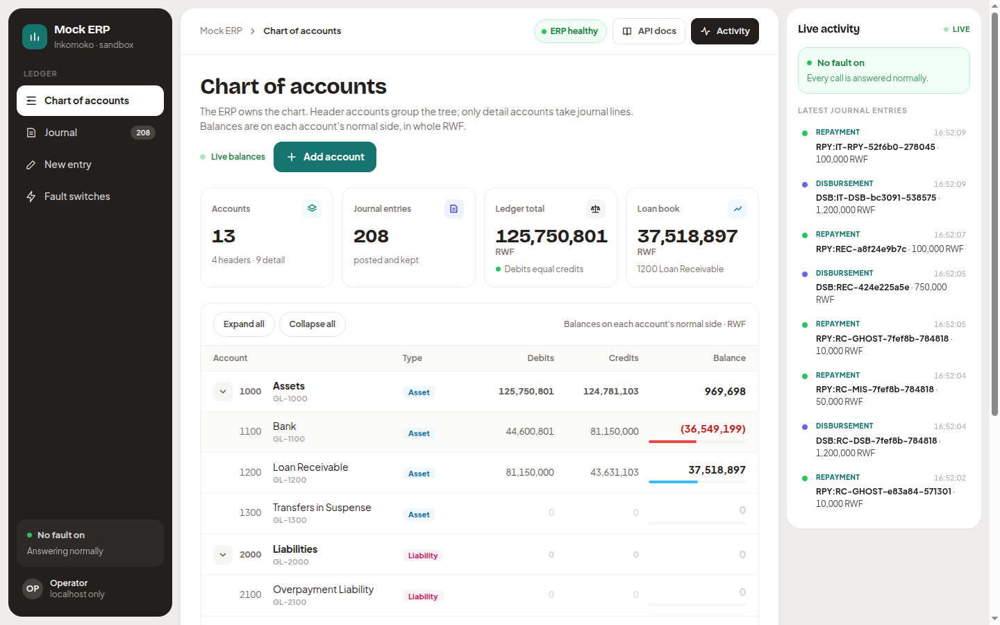
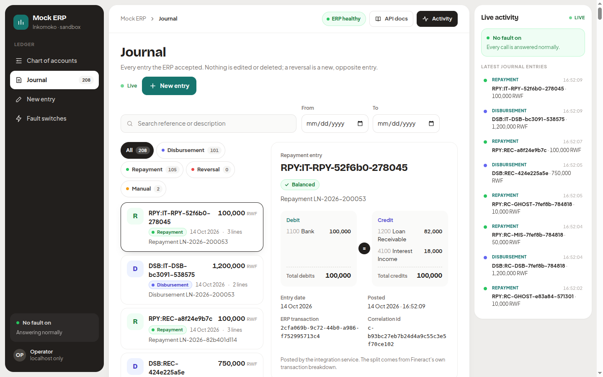
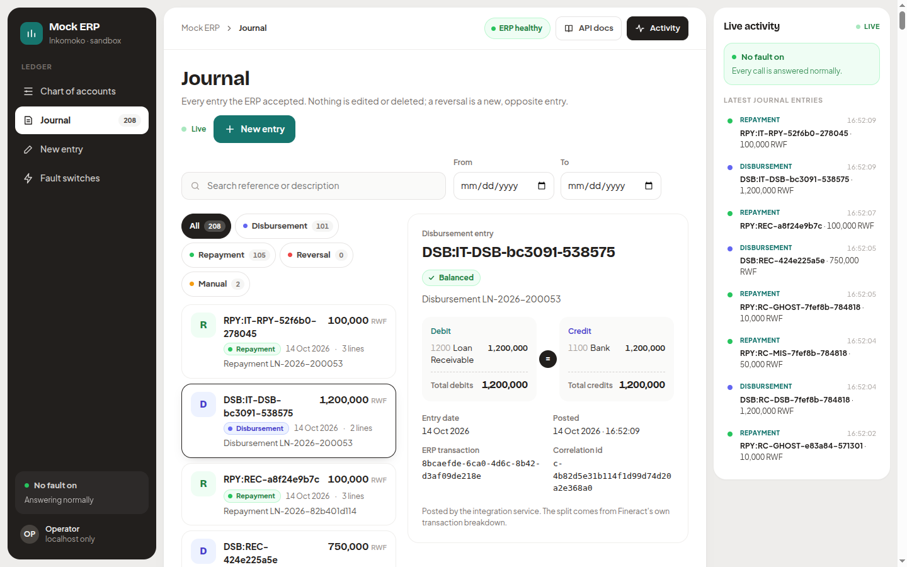
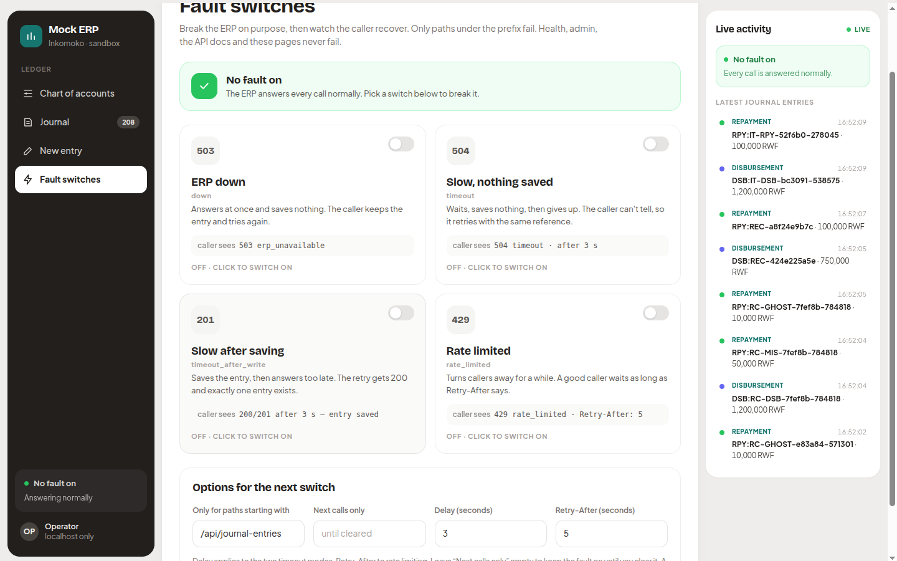
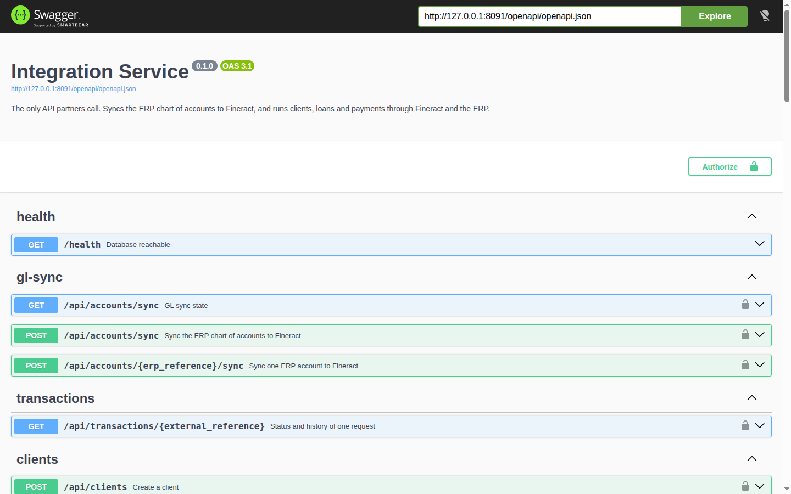
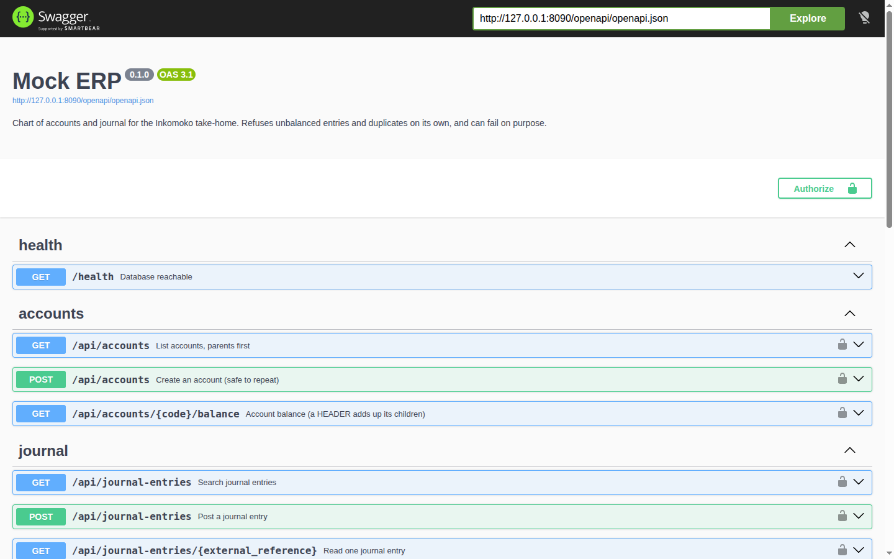

# Fineract and ERP integration

This is my take-home assessment: money moves exactly once between Fineract and the ERP, even when requests repeat, time out, crash halfway or arrive together. Apache Fineract is the core banking system. A Python Mock ERP owns the chart of accounts. A Python Integration Service sits between the client system and both of them. Fineract takes plugins and custom modules, so my Java customisation is a plugin beside Fineract's code, never a change to its core.

> **Status:** Tiers 1 and 2 (Parts A to K) are built, tested and run on the local stack. Tier 3 (Part L) is not built.



[ARCHITECTURE.md](ARCHITECTURE.md) explains each arrow.

## What is done

Every part has tests, and most have a `make` command that shows it live. [SIMULATIONS.md](SIMULATIONS.md) records the results.

| Part | What | Shown by |
|---|---|---|
| A | Fineract plugin: GL accounts from the ERP, once | `scripts/demo_gl_sync.py` |
| B | Fineract setup | the `setup` service |
| C | Clients | `scripts/demo_identity.py` |
| D | Loan lifecycle, application to Closed | `scripts/demo_lifecycle.py` |
| E | The Integration Service API | [API.md](API.md) |
| F | Duplicate requests | `scripts/simulate_duplicates.py` |
| G | Mock ERP, with fault switches | [API.md](API.md) |
| H | Journal entries, through an outbox | `scripts/demo_lifecycle.py` |
| I | Concurrency, I-1 to I-3 | `scripts/simulate_concurrent_disburse.py`, `scripts/simulate_concurrent_repay.py` |
| J | Failures J-1 to J-5, with recovery | `scripts/simulate_j1.py` to `scripts/simulate_j5.py` |
| K | Reconciliation, all four outcomes | `scripts/simulate_recon.py` |
| L | Stretch | not built |

## Versions

Everything is pinned.

| What | Version | Pinned in |
|---|---|---|
| Apache Fineract | `1.15.0`, commit `d5636847ac556c30b437254c353f05526d172b97` | submodule `fineract-customization/fineract` |
| JDK | 21 | Fineract's build file |
| Gradle | 8.14.5 | the wrapper in the tag |
| PostgreSQL | 18.3, Alpine image | `docker-compose.yml` |
| Python | 3.13, image `python:3.13.16-alpine3.24` | each `Dockerfile` |
| Packages | Flask 3, flask-openapi3, Pydantic 2, SQLAlchemy 2, Alembic, psycopg 3, Gunicorn; httpx in the Integration Service | `uv.lock` in each service |

## Run it

Everything runs in Docker. One command builds the images and starts the stack; the first run is slow because it builds Fineract from source.

```bash
git clone --recurse-submodules https://github.com/wmnjuguna/Inkomoko-Interview.git
cd Inkomoko-Interview
cp .env.example .env                   # placeholder passwords and keys, nothing secret
docker compose up -d --build --wait    # builds, then starts Postgres, Fineract, the fault proxy, the Mock ERP, the setup step once, and the Integration Service
```

Everything starts empty. The database volume is created on first start, Fineract builds its own schema, and the setup step adds the office, currency, role, API user and loan product. The Mock ERP seeds its own chart of accounts, because the ERP owns the chart. A clean start took me about two minutes, most of it Fineract. If you cloned without submodules, run `git submodule update --init --depth 1` first.

`fineract-customization/fineract` is the untouched Fineract 1.15.0 source. My plugin sits beside it in `fineract-customization/custom/`. [fineract-customization/patch/glsync.diff](fineract-customization/patch/glsync.diff) shows the same change as one diff.

> **The fault proxy** is a small pass-through between the Integration Service and Fineract. It lets the failure simulations cut Fineract off or drop its answer, and does nothing otherwise.

The `setup` service (Part B) runs once and is the only thing that logs in as Fineract's admin. It creates the office, RWF, a role, the `integration-api` user, the synced chart and the `SME Asset Finance` loan product. Its settings in `fineract/configuration/` hold names and codes only; the ids come from Fineract's templates. Running it again creates nothing:

```bash
docker compose run --rm setup
```

## How to use it

Five steps take you from a cold start to a reconciled loan. Ports bind to this computer only, and every credential is a placeholder from `.env.example`.

**1. Start the stack.** `docker compose up -d --build --wait` builds the images, starts everything and waits until each service is healthy. Open any of these to see a service answer: [Fineract](http://127.0.0.1:8080/fineract-provider/actuator/health), [Mock ERP](http://127.0.0.1:8090/health), [Integration Service](http://127.0.0.1:8091/health), [fault proxy](http://127.0.0.1:8092/health).

**2. Open the Mock ERP at http://127.0.0.1:8090/.** This is the accounting side, and its chart is what setup synced into Fineract.


*Chart of accounts (`/ui/accounts`) with live balances.*


*Journal (`/ui/journal`): every entry the ERP accepted.*


*One disbursement entry. "New entry" (`/ui/journal/new`) posts one by hand.*


*Fault switches (`/ui/faults`).*

**3. Read the APIs in Swagger.** Each service has a Swagger UI; click **Authorize** and paste its key.

- Integration Service: http://127.0.0.1:8091/openapi/swagger, key `change-me-partner-key` (from `PARTNER_API_KEYS`, `demo-partner:change-me-partner-key`).
- Mock ERP: http://127.0.0.1:8090/openapi/swagger, key `change-me-erp-key` (`ERP_API_KEY`).
- Fineract: http://127.0.0.1:8080/fineract-provider/swagger-ui/index.html. Pick **ERP integration (glsync plugin)** under **Select a definition**, then use `mifos` / `password` and `tenantid` `default`.


*The Integration Service in Swagger.*


*The Mock ERP in Swagger.*

**4. Call the APIs from Postman.** I put every call a reviewer needs into one collection, in the order to make them, with a test on each response. To load it:

1. In Postman, click **Import** (top left) and drop in [postman/collection.json](postman/collection.json) and [postman/local.postman_environment.json](postman/local.postman_environment.json). You get a collection called **Inkomoko Fineract integration** and an environment called **Local stack**.
2. In the environment picker (top right) choose **Local stack**. It holds the three local addresses and the placeholder keys, so nothing else needs setting.
3. Open the collection and go folder by folder: click a request, press **Send**, and read the **Test Results** tab under the response. To run everything at once, right-click the collection and choose **Run collection**; 37 requests take about half a minute.

Each run makes up its own client and references, so you can run it as often as you like.

| Folder | What it shows |
|---|---|
| 1 Health | Every service answers. |
| 2 GL sync | A repeat sync writes nothing: every account stays `SYNCED`. |
| 3 One loan, start to finish | Client, loan form, application, approval, payout, repayment, balances, and the full history of the payout. |
| 4 Idempotency, see for yourself | The same payout again returns the saved answer. A changed body, or a second reference for the same payout, is refused. |
| 5 Reconciliation | Fineract and the ERP agree on the references you just created. |
| 6 Break things on purpose | The ERP goes down and the repayment still succeeds, with the journal entry waiting in the outbox. Then Fineract goes down: nothing is sent, you get `503`, and the same reference succeeds once it is back. |
| 7 Mock ERP | The chart, a balance, the payout's journal entry with Fineract's own split, and one manual entry. |

From a terminal, `npx newman run postman/collection.json -e postman/local.postman_environment.json` runs the same collection (needs Node). The three OpenAPI files in [docs/openapi](docs/openapi) also import straight into Postman if you want to build your own requests.

**5. Watch the ERP catch up.** After folder 3, refresh the journal: the payout and the repayment are there, each with the split Fineract reported. Then run the scripted failure scenarios in [SIMULATIONS.md](SIMULATIONS.md).

## Tests

Both languages pass.

**Java.** 51 unit tests run inside the image build. The 10 integration tests run against the started stack; details in [fineract-customization/BUILD.md](fineract-customization/BUILD.md).

```bash
docker compose --profile test run --rm java-tests
```

**Python.** Needs [uv](https://docs.astral.sh/uv/). On 2026-10-14: Mock ERP 216 passed, Integration Service 925 passed, ruff and mypy clean.

```bash
cd mock-erp && uv run pytest -q
cd ../integration-service && uv run pytest -q
```

The Python tests need two empty databases, `erp_test` and `integration_test`. A new data volume creates them; on an older one:

```bash
docker compose exec db createdb -U postgres -O erp erp_test
docker compose exec db createdb -U postgres -O integration integration_test
```

`docker compose stop` stops everything, and `docker compose down -v` also deletes the data.

## Simulations

Each scenario is a script in `scripts/` that calls the Integration Service as the client system would, run with uv while the stack is up. [SIMULATIONS.md](SIMULATIONS.md) lists every scenario with its recorded result. Two to start with:

```bash
uv run --project integration-service python scripts/demo_lifecycle.py   # D-1: a 5,000,000 RWF loan from application to Closed
uv run --project integration-service python scripts/simulate_j5.py      # J-5: the service crashes between Fineract and the ERP, then recovers
```

## Folders

```
├── README.md  ARCHITECTURE.md  API.md  SIMULATIONS.md  DECISIONS.md
├── docker-compose.yml
├── docs/openapi/                  OpenAPI specs
├── docs/images/                   the screenshots above
├── infra/postgres/                creates one database per service
├── fineract-customization/
│   ├── fineract/                  Fineract 1.15.0 source (submodule, never edited)
│   ├── custom/inkomoko/glsync/    my Java plugin
│   ├── Dockerfile                 builds Fineract with the plugin
│   ├── patch/glsync.diff          my change as a diff against 1.15.0
│   └── BUILD.md, build.log, integration-test.log
├── fineract/configuration/        setup settings: office, currency, role, API user, loan product
├── integration-service/           Python: the Integration Service (Flask, Postgres) and the setup step
├── mock-erp/                      Python: the Mock ERP (Flask, Postgres, small web UI)
├── fault-proxy/                   Python: the fault proxy in front of Fineract (failure simulations only)
├── scripts/                       demos and simulations
└── postman/                       the collection and its environment: every call, in order, with tests
```

## Use of AI


I used AI assistance (Claude) while building this. The things I used it for include:

- writing unit tests
- writing and editing the documentation (the `.md` files)
- documenting the APIs in the Swagger/OpenAPI specs
- designing the simple interactive web UI of the Mock ERP

I reviewed the output, made the decisions, and can explain and change any part of the code.

## Not done

- Part L (stretch). [DECISIONS.md](DECISIONS.md) lists what I chose not to build, and why.
- I have not tried it on another machine or on macOS. On this one, a fresh `git clone` on 2026-10-15 went from nothing to healthy in two minutes with the commands above, and the Postman collection, the Java tests and the D-1 script all passed against it.
