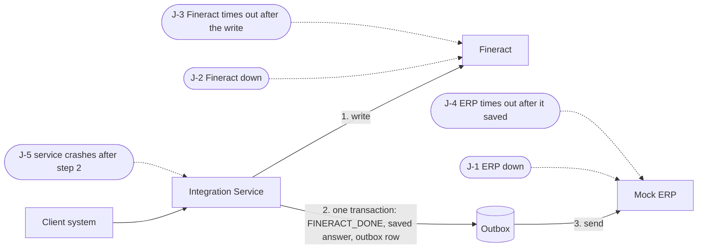

# Simulations

Fourteen scripted runs, one per scenario in the brief. Each calls the Integration Service the way a client system would, reads Fineract, the ERP and my own database before and after, and prints the brief's nine evidence points. The results below are from 2026-10-13 and 2026-10-14, and every script passed again on 2026-10-15. Run one yourself with `uv run --project integration-service python scripts/<file>` while the stack is up; the loan numbers change, the counts do not.

## Where the failures hit

## At a glance

| ID | Proves | Script | Result |
|---|---|---|---|
| A-1 | Plugin: one mapping per reference; same data accepted, different data refused, no permission refused | `scripts/demo_gl_sync.py` | `4 of 4 behaviours matched` |
| A-2 | New ERP account sent 4 times at once: 1 account everywhere | `scripts/simulate_gl_sync_4x.py` | `round 1: PASS, round 2: PASS` |
| C-1 | Client created once, found by `client_uid`, never duplicated | `scripts/demo_identity.py` | `5 of 5 steps matched` |
| D-1 | Loan from application to Closed, ERP equal to Fineract after every stage | `scripts/demo_lifecycle.py` | `8 of 8 checks matched` |
| I-1 | Same payout 4 times in a row: 1 payout | `scripts/simulate_duplicates.py` | 4 / 1 / 1 / 1, `PASS` |
| I-2a | 10 payouts at once, same reference: 1 wins, 9 wait | `scripts/simulate_concurrent_disburse.py` | `PASS` |
| I-2b | 10 payouts at once, different references: 1 wins, 9 refused | `scripts/simulate_concurrent_disburse.py` | `PASS` |
| I-3 | 10 repayments at once, 6 references plus copies: each applied once | `scripts/simulate_concurrent_repay.py` | 6 / 6 / 6 / 6, `PASS` |
| J-1 | ERP down after Fineract succeeds: entry waits, sent once | `scripts/simulate_j1.py` | `PASS` |
| J-2 | Fineract down: clean failure, safe retry | `scripts/simulate_j2.py` | `PASS` |
| J-3 | Fineract times out after the write: found by lookup, no second write | `scripts/simulate_j3.py` | `PASS` |
| J-4 | ERP times out after it saved: resend does not double post | `scripts/simulate_j4.py` | `PASS` |
| J-5 | Crash between Fineract and the ERP: nothing lost | `scripts/simulate_j5.py` | `PASS` |
| K-1 | Reconciliation names all four outcomes | `scripts/simulate_recon.py` | 2 `MATCHED`, 1 of each other, `PASS` |

## A-1: the plugin's four rules

| | |
|---|---|
| Start | Chart synced. `GL-1200` has 1 reference row and 1 GL account. A user with `READ_GLACCOUNT` only. |
| Request | `GET` the mapping; `PUT` the same body; `PUT` a changed name; `PUT` as the read-only user. |
| Response | `200`; `200 UNCHANGED`; `409 payload.conflict`; `403 not.authorized`. |
| Fineract | Still 1 reference row and 1 account named `Loan Receivable` after every call. |
| ERP | Not captured. |
| Service | `GL-1200` `SYNCED`, 1 attempt, throughout. |
| Expected | One mapping per reference; repeat accepted; change refused; no permission refused. |
| Actual | `4 of 4 behaviours matched`. |
| Why | Without these rules a retried sync would have made a second account with code 1200, and a changed retry would have quietly renamed it. |

## A-2: a new ERP account sent 4 times at once

| | |
|---|---|
| Start | Two new ERP accounts, `GL-71114743` and `GL-77402790`. |
| Request | Round 1: 4 × `POST /api/accounts/GL-71114743/sync` at once. Round 2: 4 × `PUT` straight to the plugin for `GL-77402790`. |
| Response | Round 1: one `200 SYNCED`, three `202 in_progress`. Round 2: one `CREATED`, three `UNCHANGED`, one GL account id. |
| Fineract | 1 GL account and 1 reference row per account; 1 command. |
| ERP | 1 account per reference. |
| Service | 1 `gl_sync` row per account, `SYNCED`, 1 attempt. |
| Expected | Every count 1. |
| Actual | `round 1: PASS, round 2: PASS`. |
| Why | Four copies arriving together all pass a "check, then create". A lock in the service and a lock in the plugin let one create. |

## C-1: a client, created once and found by `client_uid`

| | |
|---|---|
| Start | `client_uid` `DEMO-797009`, unknown everywhere. |
| Request | Create; look up with the right and a wrong name; send the same body again; same reference with a changed name; new reference with the same `client_uid`. |
| Response | `201 ACTIVE`; `200` with `name_matches` true then false; `200` same body; `409 IDEMPOTENCY_CONFLICT`; `409 CLIENT_UID_TAKEN`. |
| Fineract | 1 client with that `externalId`, active, Kigali Main Office, after every step. |
| ERP | No entry, as expected. |
| Service | 1 operation, `COMPLETED`. The refused reference was never saved. |
| Expected | 1 client; lookup answered from Fineract; repeat replayed; change and second reference refused. |
| Actual | `5 of 5 steps matched`. |
| Why | Two Fineract clients for one person would hang every later loan off the wrong record. |

## D-1: a loan from application to Closed

| | |
|---|---|
| Start | New client, loan `LN-2026-000001`, 5,000,000 RWF. |
| Request | Apply, approve, pay out, repay 500,000, 750,000 and 1,000,000, then pay the loan's own `payoff_amount`, 3,250,799. |
| Response | Not captured. |
| Fineract | `100 Submitted` → `200 Approved` → `300 Active` 5,000,000 / 500,799 interest → outstanding 5,000,799 → 4,250,799 → 3,250,799 → `600 Closed (obligations met)`, 0 outstanding. |
| ERP | One entry per money movement, with Fineract's split: payout DR 1200 / CR 1100 5,000,000; repayment 1 DR 1100 500,000 / CR 1200 383,400 / CR 4100 116,600; payoff DR 1100 3,250,799 / CR 1200 3,066,621 / CR 4100 184,178. Totals per account equal Fineract's ledger after every stage. |
| Service | 7 operations `COMPLETED`; the 5 money movements `erp_status SENT`. |
| Expected | Statuses in order; ERP equal to Fineract's ledger after every stage; paying `payoff_amount` closes the loan. |
| Actual | `8 of 8 checks matched`. |
| Why | I never work out interest myself. Each entry is built from the transaction Fineract reports back, so the two ledgers agree to the franc. |

## I-1: the same payout sent 4 times

| | |
|---|---|
| Start | Loan `LN-2026-000002`, 1,000,000 RWF, approved, not paid out. |
| Request | `POST …/disburse`, same reference, 4 times in a row. |
| Response | 4 × `200`, calls 2 to 4 identical to call 1. |
| Fineract | 1 disbursement, 1 command. |
| ERP | 1 entry, DR 1200 / CR 1100 1,000,000. |
| Service | 1 operation `COMPLETED`, `erp_status SENT`. |
| Expected | 4 requests, 1 payout, 1 entry, 1 operation. |
| Actual | `Requests received: 4; Fineract disbursements: 1; ERP journal entries: 1; Integration transactions: 1`, `PASS`. |
| Why | Calls 2 to 4 found the saved answer and never reached Fineract. A client retrying on a bad network cannot pay a loan out twice. |

## I-2a: 10 payouts at once, same reference

| | |
|---|---|
| Start | Loan `LN-2026-000013`, 1,000,000 RWF, approved. |
| Request | Same body 10 times, released together. |
| Response | 1 × `200`, 9 × `202`. |
| Fineract | 1 disbursement, 1 command. |
| ERP | 1 entry. |
| Service | 1 operation, 1 outbox row. |
| Expected | Every count 1. |
| Actual | `Fineract disbursements: 1; commands: 1; operations: 1; outbox rows: 1; ERP journal entries: 1`, `PASS`. |
| Why | No saved answer exists yet when ten arrive together. The unique key on type and reference lets one insert win; only the winner calls Fineract. |

## I-2b: 10 payouts at once, different references

| | |
|---|---|
| Start | Loan `LN-2026-000014`, 1,000,000 RWF, approved. |
| Request | 10 payouts at once, each with its own reference. |
| Response | 1 × `200`, 9 × `409 LOAN_ALREADY_DISBURSED`. |
| Fineract | 1 disbursement. Commands: winner 1, others 0. |
| ERP | 1 entry. |
| Service | 1 operation. Rows for the 9 refused references: 0. |
| Expected | One payout; nothing saved or sent for the rest. |
| Actual | `Fineract disbursements: 1; commands for the winner: 1, for the 9 others: 0; operations: 1 (rows for the 9 others: 0); ERP journal entries: 1`, `PASS`. |
| Why | Every reference is new, so idempotency has nothing to say. A database rule allows one live payout per loan and refuses the other nine before anything is saved. |

## I-3: 10 repayments at once

| | |
|---|---|
| Start | Loan `LN-2026-000015`, paid out, principal 1,000,000, total 1,100,161. |
| Request | 6 references of 15,000 to 65,000 RWF, the first two sent 3 times each, released together. |
| Response | 6 × `200`, 4 × `202`. |
| Fineract | 6 repayments. Principal 801,532, total 860,161. Fineract's own split, e.g. 15,000 = 13,360 principal + 1,640 interest. |
| ERP | 6 entries with that split, e.g. DR 1100 15,000 / CR 1200 13,360 / CR 4100 1,640. |
| Service | 6 operations, 6 outbox rows, all `SENT`. |
| Expected | Per reference: 1 repayment, 1 operation, 1 entry. Balance down by exactly what Fineract applied. |
| Actual | `Fineract repayments: 6; operations: 6; outbox rows: 6; ERP journal entries: 6; principal 1,000,000 -> 801,532; total 1,100,161 -> 860,161`, `PASS`. |
| Why | Fineract refuses concurrent updates to one loan. The per-loan lock queued the six, the saved answer turned the four copies into `202`. |

## J-1: the ERP is down after Fineract succeeds

| | |
|---|---|
| Start | Loan `LN-2026-000017`, approved. ERP fault `down`. |
| Request | Pay out. Later, fault off and the same request again. |
| Response | `200` at once, `erp_status PENDING`. Repeat `200`. |
| Fineract | 1 disbursement, 1 command, during and after. |
| ERP | 0 entries while down, 1 after. |
| Service | While down: `ERP_PENDING`, 2 failed sends. After: `COMPLETED`, sent on attempt 3. |
| Expected | Caller not blocked; outbox retries; one entry once the ERP is back. |
| Actual | `answer 200; outbox retried while down: True; completed: True; Fineract disbursements 1; ERP entries 1`, `PASS`. |
| Why | The money had already left Fineract, so refusing the caller would have been wrong. The outbox waited, and the ERP's reference key kept the retry from posting twice. |

## J-2: Fineract is down

| | |
|---|---|
| Start | Loan `LN-2026-000018`, approved. Fault proxy `down`. |
| Request | Pay out. Fault off, same request again. |
| Response | `503 FINERACT_UNAVAILABLE`, "Nothing was sent. Send the same request again." Then `200`. |
| Fineract | 0 commands while down; 1 disbursement after. |
| ERP | 0 entries while down, 1 after. |
| Service | `FAILED`, no outbox row; then `COMPLETED` on attempt 2. |
| Expected | A clean failure, nothing anywhere, and a retry that works once. |
| Actual | `while down: 503 FINERACT_UNAVAILABLE; retry: 200, completed True; Fineract disbursements 1; ERP entries 1`, `PASS`. |
| Why | A refused connection proves nothing reached Fineract, so `FAILED` is honest and the retry is safe. It still looks the reference up first. |

## J-3: Fineract times out after the write

| | |
|---|---|
| Start | Loan `LN-2026-000019`, approved. Fault proxy drops the answer to the next write, then goes down. |
| Request | Pay out. Repeat while pending. Wait for recovery, about 4 minutes. Repeat once more. |
| Response | `504 FINERACT_TIMEOUT` after 30 s; then `202`; after recovery `200`. |
| Fineract | 1 disbursement and 1 command, already during the timeout. The proxy logged Fineract's `200`. |
| ERP | 0 entries during, 1 after. |
| Service | `FINERACT_PENDING` with no outbox row; recovery found the transaction by `externalId`; then `COMPLETED`, outbox `SENT`. |
| Expected | `504`, `202` on repeat, found by lookup, no second write. |
| Actual | `first 504 FINERACT_TIMEOUT, repeat 202; completed True; Fineract disbursements 1, commands 1; ERP entries 1; replay 200`, `PASS`. |
| Why | The failure I worry about most: Fineract paid out and never told me. A blind retry would pay twice; treating the timeout as unknown and looking up by `externalId` did not. |

## J-4: the ERP times out after it saved the entry

| | |
|---|---|
| Start | Loan `LN-2026-000020`, approved. ERP fault `timeout_after_write` on the next journal call. |
| Request | Pay out. |
| Response | `200`, `ERP_PENDING`. |
| Fineract | 1 disbursement, 1 command. |
| ERP | 1 entry already after the first send timed out; still 1 at the end. |
| Service | First send got no answer; second send `SENT`; 2 attempts; `COMPLETED`. |
| Expected | A resend that does not post twice. |
| Actual | `first send timed out: True; ERP held the entry during: True; outbox attempts 2; ERP entries 1`, `PASS`. |
| Why | J-3 on the ERP side. The ERP keys entries by reference, so the resend got `200` with the entry it already held. |

## J-5: a crash between Fineract and the ERP call

| | |
|---|---|
| Start | Loan `LN-2026-000021`, approved. Crash hook on for this reference. |
| Request | Pay out. After the restart, same request again. |
| Response | None: the service died mid-request. Retry after the restart: `200`, equal to the saved answer. |
| Fineract | 1 disbursement, 1 command, before and after. |
| ERP | 0 entries at the crash, 1 after. |
| Service | At the crash: `ERP_PENDING`, outbox row with 0 attempts. Container restarted once; start-up recovery sent it; `COMPLETED`. |
| Expected | Nothing lost, nothing doubled, a working retry. |
| Actual | `at the crash: ERP_PENDING, ERP entries 0; back up True, completed True; restarts 1; retry 200; Fineract disbursements 1; ERP entries 1`, `PASS`. |
| Why | `FINERACT_DONE`, the saved answer and the outbox row are one database transaction, so the crash left a row waiting rather than a payout with no entry. |

## K-1: reconciliation with all four outcomes

| | |
|---|---|
| Start | Loan `LN-2026-000016` with five items planted on purpose: a normal payout and repayment; a repayment whose ERP entry has the wrong split; a repayment made straight in Fineract; an entry posted straight to the ERP. |
| Request | `POST /api/reconciliation` with the five references, then with today's date range. |
| Response | `200` and `200`. |
| Fineract | The payout, three repayments and an accrual. |
| ERP | The matching entries, the wrong split (all 50,000 on 1200), the ghost entry; nothing for the direct repayment. |
| Service | The mismatched repayment is `NEEDS_RECONCILIATION`: the ERP refused my entry for a reference it already held. |
| Expected | Exactly the five items, 2 `MATCHED` and 1 of each other outcome. |
| Actual | `{'MATCHED': 2, 'AMOUNT_MISMATCH': 1, 'MISSING_IN_ERP': 1, 'MISSING_IN_FINERACT': 1, 'IN_FLIGHT': 0, 'total': 5}`, `PASS`. The day report adds leftovers from other runs on the shared stack. |
| Why | Both sides said 50,000, so a check on totals alone would have called the mismatch matched. Comparing the lines with Fineract's split caught it. |
