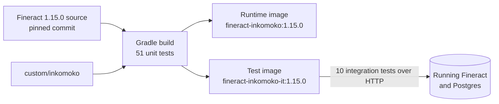

# Building and testing the Fineract plugin

Everything runs inside Docker. Pinned versions are in [VERSIONS](VERSIONS).

## How the build works

One Gradle run builds Fineract with my plugin and runs the 51 unit tests; a failing test means no image. The [Dockerfile](Dockerfile) clones the Fineract 1.15.0 tag, checks the pinned commit, and copies the plugin into Fineract's `custom/` folder.



No Fineract source file is touched. The whole change sits in one folder:

```
custom/inkomoko/glsync/
├── service/   the API, the rules, the table code, the errors, the OpenAPI spec, the tests
└── starter/   switches the plugin on and holds the database migrations
```

## Commands

`make test-java` builds, starts the stack and runs the integration tests. Underneath it runs:

```bash
docker buildx build --load -t fineract-inkomoko:1.15.0 fineract-customization
docker buildx build --load --target integration-test -t fineract-inkomoko-it:1.15.0 fineract-customization
docker compose up -d --no-build --wait
docker run --rm --network inkomoko-fineract_default -e FINERACT_URL=http://fineract:8080 fineract-inkomoko-it:1.15.0
```

## What the tests cover

The unit tests cover payload hashing, command validation, the sync rules and lock order. The 10 integration tests hit real Fineract and Postgres: the Part A behaviours, conflicts, permissions, ten identical requests making one account, and `Idempotency-Key` replay.

## Evidence files

- [build.log](build.log): the build and every unit test result.
- [integration-test.log](integration-test.log): the integration test run.
- [patch/glsync.diff](patch/glsync.diff): the whole change against 1.15.0, 30 new files, nothing outside `custom/inkomoko/`.
- [../docs/openapi/fineract-erp-integration.yaml](../docs/openapi/fineract-erp-integration.yaml): the OpenAPI spec.

## Working in an IDE

Link the plugin into the submodule and have git ignore the link:

```bash
ln -s ../../custom/inkomoko fineract-customization/fineract/custom/inkomoko
echo "custom/inkomoko" >> .git/modules/fineract-upstream/info/exclude
```

Then open `fineract-customization/fineract` in IntelliJ as a Gradle project, JDK 21.
